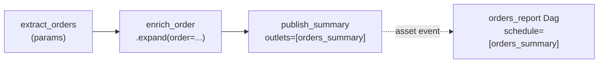

# Tutorial: Build a Realistic Pipeline, Step by Step

> [!CAUTION]
> Commands on this page can change or delete data and affect running deployments. Try them on a test or staging deployment first, and read the [disclaimer](../README.md#disclaimer). The guide is provided "as is", without warranty.

The official tutorials show each feature on its own. This page builds one small, realistic pipeline in eight steps, and each step names the **trap it avoids**: the mistake that works on a laptop and fails in production. At the end you have two Dags. `orders_daily` extracts orders, enriches each one in a dynamically mapped task, and publishes a summary as an Asset. `orders_report` runs whenever that Asset is updated. You test both locally with `dag.test()`.

Prerequisites: a running local Airflow 3.4 from the [quickstart](01_quickstart.md), with `AIRFLOW_HOME` exported in your terminal.



---

## 1. The skeleton: a Dag that parses cheaply

Create `$AIRFLOW_HOME/dags/orders.py` with the skeleton below. The rest of the tutorial fills it in; the complete file is in §7.

```python
from datetime import timedelta

import pendulum

from airflow.sdk import Asset, Param, dag, task

ORDERS_SUMMARY = Asset(
    name="orders_summary",
    uri="file:///tmp/airflow_tutorial/orders_summary.json",
)


@dag(
    schedule="@daily",
    start_date=pendulum.datetime(2026, 1, 1, tz="UTC"),
    catchup=False,
    tags=["tutorial"],
)
def orders_daily():
    pass


orders_daily()
```

**Trap avoided: work at parse time, and a moving start date.** The Dag processor imports this file every `[dag_processor] min_file_process_interval` seconds (default `30`), in every parsing process. Anything at module level (an API call, a database query, `Variable.get()`, a large import) runs on every parse and slows every Dag in the bundle. A `start_date` built from `datetime.now()` changes on every parse, so the scheduler never sees a stable schedule. Keep the module level to imports and constants, and keep `start_date` fixed.

**Second trap: assuming 2.x scheduling semantics.** `catchup` defaults to `[scheduler] catchup_by_default` = `False` in 3.x. A cron or preset schedule such as `"@daily"` uses `CronTriggerTimetable` because `[scheduler] create_cron_data_intervals` defaults to `False`: the run that fires at midnight on 2 January has a logical date of 2 January, not 1 January as in 2.x. If your SQL filters on `ds`, it now selects a different day. See [scheduling, timetables & assets](../02_dag_authoring/02_scheduling_timetables_and_assets.md).

---

## 2. Params: validated inputs for manual runs

Add `params` to the `@dag` call:

```python
@dag(
    schedule="@daily",
    start_date=pendulum.datetime(2026, 1, 1, tz="UTC"),
    catchup=False,
    tags=["tutorial"],
    params={
        "region": Param("emea", type="string", enum=["emea", "amer", "apac"]),
        "max_orders": Param(5, type="integer", minimum=1, maximum=500),
    },
)
```

A task reads them by declaring a parameter named `params`. TaskFlow fills any function parameter whose name is a context key (`params`, `ti`, `dag_run`, `logical_date`, …) from the task context.

**Trap avoided: unvalidated `dag_run.conf`.** Reading `dag_run.conf["max_orders"]` directly gives you whatever someone typed, or a `KeyError`. Declared `Param`s get a default, a JSON-schema type check, and a form in the UI's trigger dialog. A trigger with `--conf '{"max_orders": 0}'` is rejected before any task runs. The conf overrides params because `[core] dag_run_conf_overrides_params` defaults to `True`.

---

## 3. TaskFlow and XCom: pass references, not data

```python
    @task
    def extract_orders(params) -> list[dict]:
        n = params["max_orders"]
        region = params["region"]
        return [{"order_id": f"{region}-{i}", "quantity": i % 3 + 1, "unit_price": 9.5} for i in range(n)]
```

The return value is stored as an XCom and handed to whichever task receives it as an argument. Calling `extract_orders()` inside the Dag function does not run anything; it returns an `XComArg`, a promise of the value, which sets the dependency when you pass it on.

**Trap avoided: shipping data through XCom.** The default XCom backend writes return values to the metadata database (table `xcom`), and every downstream read goes through the API server. A few kilobytes of identifiers are fine. A DataFrame or a 50 MB list is not: it bloats the database and the `airflow db clean` backlog. Return keys, paths or row counts, and put the data itself in object storage. See [XCom, Variables & Connections](../03_task_execution/04_xcom_variables_and_connections.md).

**Second trap: non-serializable return values.** The value is serialized when the task finishes. Database cursors, open files and clients can't be, so the task fails at the very end, after doing all its work.

---

## 4. Retries: decide them per task, and make the task idempotent

Add `default_args` to the `@dag` call:

```python
    default_args={"retries": 2, "retry_delay": timedelta(seconds=30)},
```

**Trap avoided: zero retries by default.** `[core] default_task_retries` is `0`. A single network blip fails the run. Two or three retries with a delay handle most transient errors. The delay falls back to `[core] default_task_retry_delay` (`300` seconds) when you set retries but no delay.

**Second trap: retries on non-idempotent tasks.** A retry runs the whole task again. If attempt 1 inserted half the rows before failing, attempt 2 inserts them again. Write with upserts, overwrite a partition, or write to a temporary location and rename. Override per task where a retry is never safe, for example `@task(retries=0)` on a task that sends money or email.

---

## 5. Dynamic task mapping with `.expand()`

```python
    @task(max_active_tis_per_dagrun=4)
    def enrich_order(order: dict) -> dict:
        return {**order, "total": round(order["quantity"] * order["unit_price"], 2)}
```

And in the Dag body:

```python
    orders = extract_orders()
    enriched = enrich_order.expand(order=orders)
```

At run time, the scheduler creates one `enrich_order` task instance per element of the list that `extract_orders` returned, with `map_index` 0, 1, 2, …. Each mapped instance retries independently, and you can clear a single one.

Traps avoided:

| Trap | What happens | Do this instead |
| :--- | :--- | :--- |
| Mapping over a huge list | When the upstream pushes a list longer than `[core] max_map_length` (default `1024`) to feed a mapped task, the Execution API rejects the push and the **upstream** task fails with "pushed value is too large to map". | Batch upstream: return 50 chunks of 200 items, not 10,000 items. |
| Fan-out stampede | Hundreds of mapped instances hit an external API at once. | Cap concurrency per run with `max_active_tis_per_dagrun`, or use a pool. See [concurrency, pools & priority](../03_task_execution/03_concurrency_pools_and_priority.md). |
| Naming the mapped argument after a context key | `.expand(params=...)` or `.expand(ti=...)` raises `ValueError` at parse time (`cannot call ... on task context variable`). | Use a domain name such as `order`. |
| Constant arguments | `.expand()` maps every keyword it receives. | Pass constants with `.partial(currency="EUR").expand(order=orders)`. |

---

## 6. Collect the mapped results and publish an Asset

```python
    @task(outlets=[ORDERS_SUMMARY])
    def publish_summary(enriched: list[dict], *, dag_run, outlet_events) -> None:
        import json
        from pathlib import Path

        rows = list(enriched)
        summary = {
            "run_id": dag_run.run_id,
            "orders": len(rows),
            "revenue": round(sum(r["total"] for r in rows), 2),
        }
        out = Path("/tmp/airflow_tutorial/orders_summary.json")
        out.parent.mkdir(parents=True, exist_ok=True)
        out.write_text(json.dumps(summary))
        outlet_events[ORDERS_SUMMARY].extra = {"orders": summary["orders"], "revenue": summary["revenue"]}

    publish_summary(enriched)
```

`enriched` here is the list of every mapped instance's return value. It arrives as a lazy sequence that fetches values on demand; `list(enriched)` materializes it. Declaring `outlets=[ORDERS_SUMMARY]` makes Airflow record an **asset event** when the task succeeds, and `outlet_events[...].extra` attaches metadata to that event.

**Trap avoided: keying output by `ds` or `logical_date`.** A manual run triggered without a logical date (the 3.x default for `airflow dags trigger`) has no `ds` and no `logical_date` (see [templates & macros](../09_reference/04_templates_and_macros.md#2-the-logical-date-trap)). `run_id` always exists and is unique per Dag, so record it.

**Second trap: local files in a distributed deployment.** `/tmp` works here because standalone runs every task on one machine. With Celery or Kubernetes workers, the consumer may run on a different host. Use an object store, for example `ObjectStoragePath` from `airflow.sdk`, for anything a second task must read.

**Third trap: emitting an asset event for nothing.** The event is recorded whenever the task succeeds, even if it wrote zero rows. If downstream should not run on empty data, raise or skip before returning.

---

## 7. The consumer Dag, and the complete file

Add a second Dag to the same file, scheduled on the Asset. Here is the complete `orders.py`:

```python
from datetime import timedelta

import pendulum

from airflow.sdk import Asset, Param, dag, task

ORDERS_SUMMARY = Asset(
    name="orders_summary",
    uri="file:///tmp/airflow_tutorial/orders_summary.json",
)


@dag(
    schedule="@daily",
    start_date=pendulum.datetime(2026, 1, 1, tz="UTC"),
    catchup=False,
    tags=["tutorial"],
    default_args={"retries": 2, "retry_delay": timedelta(seconds=30)},
    params={
        "region": Param("emea", type="string", enum=["emea", "amer", "apac"]),
        "max_orders": Param(5, type="integer", minimum=1, maximum=500),
    },
)
def orders_daily():
    @task
    def extract_orders(params) -> list[dict]:
        n = params["max_orders"]
        region = params["region"]
        return [{"order_id": f"{region}-{i}", "quantity": i % 3 + 1, "unit_price": 9.5} for i in range(n)]

    @task(max_active_tis_per_dagrun=4)
    def enrich_order(order: dict) -> dict:
        return {**order, "total": round(order["quantity"] * order["unit_price"], 2)}

    @task(outlets=[ORDERS_SUMMARY])
    def publish_summary(enriched: list[dict], *, dag_run, outlet_events) -> None:
        import json
        from pathlib import Path

        rows = list(enriched)
        summary = {
            "run_id": dag_run.run_id,
            "orders": len(rows),
            "revenue": round(sum(r["total"] for r in rows), 2),
        }
        out = Path("/tmp/airflow_tutorial/orders_summary.json")
        out.parent.mkdir(parents=True, exist_ok=True)
        out.write_text(json.dumps(summary))
        outlet_events[ORDERS_SUMMARY].extra = {"orders": summary["orders"], "revenue": summary["revenue"]}

    orders = extract_orders()
    enriched = enrich_order.expand(order=orders)
    publish_summary(enriched)


@dag(
    schedule=[ORDERS_SUMMARY],
    start_date=pendulum.datetime(2026, 1, 1, tz="UTC"),
    catchup=False,
    tags=["tutorial"],
)
def orders_report():
    @task
    def report(*, triggering_asset_events) -> None:
        for event in triggering_asset_events[ORDERS_SUMMARY]:
            print(f"Run {event.source_run_id} of {event.source_dag_id} published {event.extra}")

    report()


producer = orders_daily()
consumer = orders_report()

if __name__ == "__main__":
    producer.test(run_conf={"max_orders": 8})
```

**Trap avoided: two Dags polling each other.** Before assets, the consumer would run on its own clock and poll for the file with a sensor, occupying a slot. Scheduling on the Asset means the consumer runs only after a successful producer task. Several events can be collapsed into one consumer run, which is why `triggering_asset_events[...]` is a list.

**Second trap: time-based context in an asset-triggered run.** `orders_report` runs have no logical date, so `ds`, `ts` and `data_interval_start` are absent. Read what you need from the asset event (`extra`, `source_run_id`, `timestamp`) instead.

**Third trap: asset identity.** Producer and consumer must reference the same Asset `name` and `uri`. Define it once (here, a module constant; in a larger repo, a shared module) rather than retyping the string. The names `self` and `context` are rejected, and the `airflow` URI scheme is reserved.

---

## 8. Test the whole pipeline with `dag.test()`

```bash
python "$AIRFLOW_HOME/dags/orders.py"
```

`DAG.test()` creates a real Dag run in the metadata database and runs every task in the current process, with no scheduler or executor. You get the logs in your terminal and you can set a breakpoint in any task. Its arguments (from `task-sdk/src/airflow/sdk/definitions/dag.py`): `logical_date`, `run_after`, `run_conf`, `conn_file_path`, `variable_file_path`, `use_executor`, `mark_success_pattern`. The CLI equivalent is:

```bash
airflow dags test orders_daily -c '{"max_orders": 8}'
```

What to expect, and what it doesn't cover:

| Point | Detail |
| :--- | :--- |
| Needs a migrated database | `dag.test()` raises `RuntimeError: Session not configured` without an ORM session, and it writes the run, task instances and XComs to the database. Run `airflow db migrate` once, or start standalone once. |
| Needs the file in a bundle | Before running, it syncs the configured bundles to the database so it can find the Dag's version. Keep the file in the Dags folder. |
| Logical date defaults to now | So `ds` exists in a test even though it doesn't in a plain `airflow dags trigger` run. Pass `logical_date=None` to reproduce an untimed manual run. |
| Clears earlier test runs | With a logical date set, it first clears task instances of this Dag at that same logical date. |
| Retries are real | A failing task with retries goes to `up_for_retry`, and the loop waits for `retry_delay` before running it again. Keep delays short while iterating. |
| Consumer is not run | Asset events are recorded, but `dag.test()` runs only one Dag. Trigger `orders_report` with `airflow dags test orders_report` separately; its `triggering_asset_events` is then empty *(not verified against source)*. |
| Connections and Variables | Point `conn_file_path` / `variable_file_path` at a YAML or JSON file to avoid touching shared ones. |

For unit tests of the task logic itself, call the undecorated function: `extract_orders.function({"max_orders": 2, "region": "emea"})` returns the list without Airflow running anything. See [testing Dags](../02_dag_authoring/03_testing_dags.md) for pytest patterns and Dag-integrity tests.

---

## 9. Run it for real

With standalone running, unpause both Dags and trigger the producer with a different input:

```bash
airflow dags unpause orders_daily
airflow dags unpause orders_report
airflow dags trigger orders_daily -c '{"region": "apac", "max_orders": 12}'
```

In the UI, the `orders_daily` run shows `enrich_order [12]` (twelve mapped instances), and a few seconds after `publish_summary` succeeds, an `orders_report` run appears. Its log prints the `extra` you attached. The **Assets** page shows the event and both Dags.

Try the failure paths too: trigger with `-c '{"max_orders": 0}'` and the CLI rejects the conf before a run exists; raise an exception in `enrich_order` for one `order_id` and watch only that mapped instance retry. The [operations tutorial](03_tutorial_operations.md) shows how to clear and re-run failed tasks.

---

## 10. Where to go next

| You want to… | Read |
| :--- | :--- |
| Structure many Dags: factories, task groups, shared code | [Dag design patterns](../02_dag_authoring/01_dag_design_patterns.md) |
| Timetables, asset conditions, partitioned assets | [Scheduling, timetables & assets](../02_dag_authoring/02_scheduling_timetables_and_assets.md) |
| Long waits without holding a worker slot | [Deferrable operators & triggers](../03_task_execution/02_deferrable_operators_and_triggers.md) |
| Every context variable and macro | [Templates & macros](../09_reference/04_templates_and_macros.md) |
| The full `airflow.sdk` surface | [Task SDK quick reference](../09_reference/06_task_sdk_quick_reference.md) |
| What not to do | [Anti-patterns](../01_architecture_and_mental_model/02_anti_patterns.md) |
