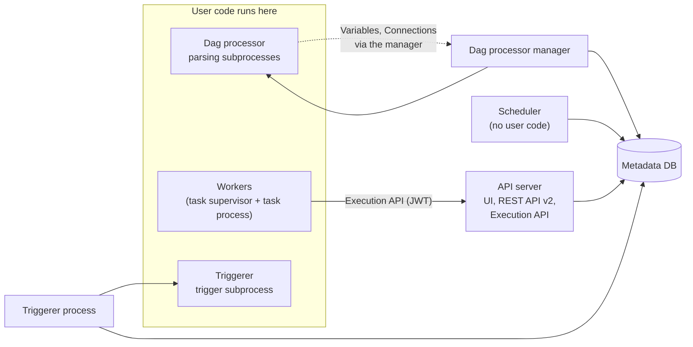
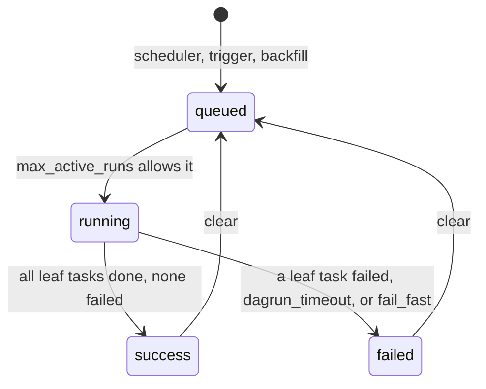
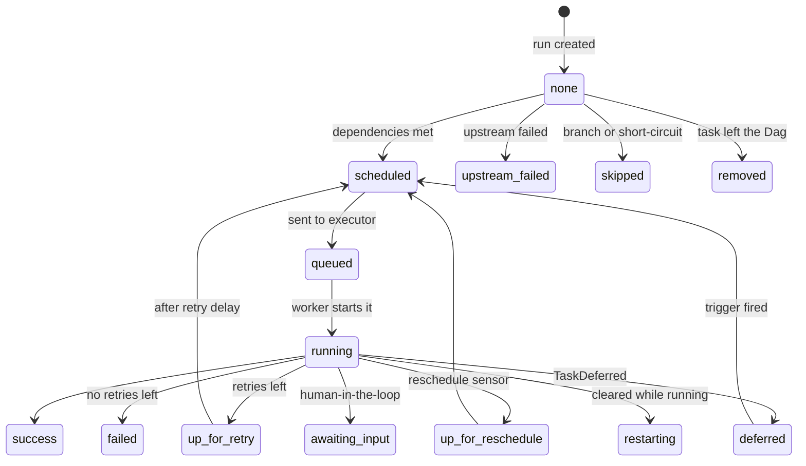

# The Airflow 3.4 Mental Model

> [!CAUTION]
> Commands on this page can change or delete data and affect running deployments. Try them on a test or staging deployment first, and read the [disclaimer](../README.md#disclaimer). The guide is provided "as is", without warranty.

The official docs describe each component on its own page. This page puts them together as one picture an operator or Dag author can reason with: which process runs your code, which process may touch the metadata database, what a "Dag version" is, how a Dag run and a task instance move through their states, and which dates a run carries. It ends with the Airflow 2 habits that no longer hold. Every state, column and config key here was taken from the 3.4 source (`v3-4-stable`).

---

## 1. Components and their boundaries

Airflow 3 is a set of cooperating processes around one metadata database. The important change from Airflow 2 is **who runs user code and who may talk to the database**.



| Component | Start it with | Runs user code? | Talks to the DB? | Job |
| :--- | :--- | :--- | :--- | :--- |
| Scheduler | `airflow scheduler` | **No**. It reads serialized Dags only | Yes | Creates Dag runs, decides which task instances are ready, hands them to the executor, times out runs |
| Dag processor | `airflow dag-processor` | Yes, in parsing subprocesses | The manager does; parsing subprocesses do not | Imports Dag files from each Dag bundle, serializes the result, writes it to the DB. Also runs Dag-level callbacks |
| API server | `airflow api-server` | No | Yes | Serves the React UI, the public REST API (`/api/v2`) and the **Execution API** (`/execution/`) that workers call |
| Triggerer | `airflow triggerer` | Yes, trigger code, in a subprocess | The parent process does | Runs async triggers for deferred tasks and asset watchers |
| Workers | Depends on the executor (`LocalExecutor` runs them under the scheduler; Celery uses `airflow celery worker` from the Celery provider; Kubernetes starts a pod per task) | Yes, your task code | **No**. Only through the Execution API | Execute task instances |
| Metadata DB | PostgreSQL or MySQL (SQLite for local testing) | n/a | n/a | Source of truth for all state |

`[core] executor` defaults to `LocalExecutor`. See [Executors](../03_task_execution/01_executors.md).

### What the boundaries mean in practice

* **Workers never see a database URL.** The task supervisor talks to the API server at `[core] execution_api_server_url` (default: `{[api] base_url}/execution/`) with a short-lived JWT scoped to that task instance (`[execution_api] jwt_expiration_time`, default 600 seconds). If task code imports Airflow's ORM anyway, the supervisor's `block_orm_access()` replaces the session with one that raises `RuntimeError: Direct database access via the ORM is not allowed in Airflow 3.0` (source: `task-sdk/src/airflow/sdk/execution_time/supervisor.py`).
* **Variables, Connections and XComs from tasks go through the API server.** The worker's secrets search path is environment variables first, then the Execution API (`DEFAULT_SECRETS_SEARCH_PATH_WORKERS` in `task-sdk/src/airflow/sdk/execution_time/secrets/__init__.py`), plus any `[secrets] backend` you configure.
* **Dag parsing is isolated the same way.** A parsing subprocess that calls `Variable.get()` sends a request to the Dag processor manager, which answers it; the subprocess itself has no database session.
* **The scheduler never imports your Dag files.** It works from the serialized JSON. Anything that needs your Python code at schedule time (a custom timetable, for example) must be registered through a plugin, not just defined in a Dag file.
* **These guards steer well-behaved code; they are not a sandbox.** The Dag processor and triggerer still run in processes that hold database credentials. The [security hardening](../05_deployment_and_config/03_security_hardening.md) page covers what that means for deployment.

### Where callbacks run

| Callback | Runs in |
| :--- | :--- |
| Task `on_success_callback`, `on_failure_callback`, `on_retry_callback`, `on_skipped_callback`, `on_execute_callback` | The worker, in the task process, after the task finishes (`task_runner.py`) |
| Task failure callbacks when the worker died or the task was killed externally (heartbeat timeout) | The Dag processor, from a `TaskCallbackRequest` the scheduler queues |
| Dag `on_success_callback` / `on_failure_callback` | The Dag processor, from a `DagCallbackRequest` |

So a Dag-level callback that writes to a local file writes it on the Dag processor host, not a worker.

---

## 2. Serialized Dags and Dag versions

The Dag processor turns each Dag file into JSON and stores it. Everything downstream (scheduler, UI, REST API) reads that JSON.

| Table | Holds |
| :--- | :--- |
| `dag` | One row per `dag_id`: paused state, next run, bundle name, active or stale |
| `serialized_dag` | The serialized structure, keyed to a Dag version |
| `dag_version` | One row per structural version of a Dag (`version_number`, `bundle_name`, `bundle_version`) |
| `dag_code` | The source file text for each version, shown in the UI |
| `dag_bundle` | The configured bundles |

**When is a new version created?** On each parse, the processor hashes the serialized Dag. If the hash is unchanged, nothing new is written (only bundle metadata is refreshed). If the hash changed **and** the current version already has task instances, a new `dag_version` row is created. If the current version has no task instances yet, it is updated in place (source: `SerializedDagModel.write_dag` in `airflow-core/src/airflow/models/serialized_dag.py`).

> [!WARNING]
> Anything that changes on every parse (`datetime.now()` in `start_date`, a random value in a task argument, a timestamp in `doc_md`) changes the hash on every parse, so every run gets a new Dag version. Since 3.2 the Dag processor checks Dag files for this statically before parsing: `[dag_processor] dag_version_inflation_check_level` is `warning` by default (`off` and `error` are the other values). The calls it flags are listed in `RUNTIME_VARYING_CALLS` in `airflow-core/src/airflow/utils/dag_version_inflation_checker.py`. See [anti-patterns](02_anti_patterns.md#3-non-deterministic-dag-definitions).

**Which version does a run use?** A Dag run records `created_dag_version_id` and, for versioned bundles, `bundle_version`. Tasks of that run execute against the code at that bundle version, even if newer code has been deployed since. Clearing tasks keeps the original version; backfills use the latest. Both defaults come from `[core] rerun_with_latest_version` (unset by default: False for clears and reruns, True for backfills) and can be overridden per Dag with `DAG(rerun_with_latest_version=...)`. `[dag_processor] disable_bundle_versioning = True` (or `DAG(disable_bundle_versioning=True)`) makes every task use the latest code.

---

## 3. Dag bundles

A Dag bundle is a named source of Dag files. The Dag processor parses each bundle; workers fetch the bundle (at the run's version) before running a task.

`[dag_processor] dag_bundle_config_list` defaults to one bundle:

```json
[{"name": "dags-folder", "classpath": "airflow.dag_processing.bundles.local.LocalDagBundle", "kwargs": {}}]
```

| Bundle | Class | Versioned? | Notes |
| :--- | :--- | :--- | :--- |
| Local folder | `airflow.dag_processing.bundles.local.LocalDagBundle` | No | Default; path is `[core] dags_folder` unless `kwargs.path` is set. Every worker needs the same files |
| Git | `airflow.providers.git.bundles.git.GitDagBundle` (Git provider) | Yes | kwargs: `tracking_ref` (required), `subdir`, `git_conn_id`, `repo_url`, `submodules`, `prune_dotgit_folder`, `sparse_dirs` |
| Object storage | Amazon and Google providers ship bundles under `bundles/` | Provider-specific | Provider versions are independent of core |

Timing knobs, all in `[dag_processor]`:

| Key | Default | Meaning |
| :--- | :--- | :--- |
| `refresh_interval` | 300 s | How often a bundle is refreshed (new files found, git fetched). Overridable per bundle in `kwargs` |
| `min_file_process_interval` | 30 s | How often each known file is re-parsed |
| `parsing_processes` | 2 | Parallel parsing subprocesses |
| `dag_file_processor_timeout` | 50 s | A parsing subprocess running longer is killed |
| `stale_dag_threshold` | 50 s | Grace period before Dags missing from a re-parsed file are deactivated |

`[core] dagbag_import_timeout` (30 s) bounds the import of one file inside the subprocess. Example Dags (`[core] load_examples`, default `True`) are added as their own `example_dags` bundle.

> [!NOTE]
> With `[core] multi_team = True` (3.2+, default `False`) bundles can be assigned to teams. This scopes UI and API access; it does not isolate task execution. See [security hardening](../05_deployment_and_config/03_security_hardening.md).

---

## 4. Life of a Dag run



`DagRunState` has exactly four values: `queued`, `running`, `success`, `failed` (`airflow-core/src/airflow/utils/state.py`). There is no "paused run" state; pausing is a property of the Dag.

Things that move a run:

* **Creation.** Run types (`DagRunType`): `scheduled`, `manual`, `backfill`, `operator_triggered`, `asset_triggered`, `asset_materialization`. The scheduler creates at most `[scheduler] max_dagruns_to_create_per_loop` (default 10) per loop.
* **Start.** A queued run starts when the Dag's running runs are below `max_active_runs` (default `[core] max_active_runs_per_dag` = 16). Backfills have their own `max_active_runs`.
* **Timeout.** When `dagrun_timeout` is exceeded the scheduler marks the run `failed` and sets every unfinished task instance to `skipped` (`scheduler_job_runner.py`).
* **Auto-pause.** `max_consecutive_failed_dag_runs` (default `[core] max_consecutive_failed_dag_runs_per_dag` = 0, off) pauses the Dag after that many failed runs in a row.

The Dag itself has a scheduling state too (`DagSchedulingState`): `active`, `paused`, and, new in 3.4, `draining`. A draining Dag creates no new scheduled or asset-triggered runs but lets queued and running ones finish, then becomes paused.

---

## 5. Life of a task instance



All values of `TaskInstanceState` in 3.4 (plus `None`, which means "created, not yet evaluated"):

| State | Set by | Terminal? |
| :--- | :--- | :--- |
| `scheduled` | Scheduler: dependencies met, waiting for a slot | No |
| `queued` | Handed to the executor | No |
| `running` | Worker | No |
| `success`, `failed`, `skipped`, `upstream_failed`, `removed` | Various | **Yes** (`TerminalTIState`) |
| `up_for_retry` | Failed with retries left | No |
| `up_for_reschedule` | Sensor in `reschedule` mode, or a retry policy returning `RESCHEDULE` | No |
| `deferred` | Task raised `TaskDeferred`; the triggerer owns it | No |
| `awaiting_input` | Human-in-the-loop operator parked for a response | No |
| `restarting` | Cleared while running | No |

Two failure paths that are easy to miss:

* **Heartbeat timeout.** A running task's supervisor heartbeats through the Execution API. If the scheduler sees no heartbeat for `[scheduler] task_instance_heartbeat_timeout` (default 300 s), it fails the task (or retries it) and queues a failure callback for the Dag processor.
* **Retry timing.** The next try waits `retry_delay` (default `[core] default_task_retry_delay` = 300 s), grown by `retry_exponential_backoff` when set, and capped by `max_retry_delay` (default `[core] max_task_retry_delay` = 86400 s). See [Dag design patterns](../02_dag_authoring/01_dag_design_patterns.md#3-retries-timeouts-and-failure-handling).

Slots, pools and priority decide *when* a `scheduled` task becomes `queued`. See [concurrency, pools and priority](../03_task_execution/03_concurrency_pools_and_priority.md).

---

## 6. Dates on a Dag run: `logical_date`, data interval, `run_after`

| Column on `dag_run` | Nullable? | Meaning |
| :--- | :--- | :--- |
| `run_after` | No | The earliest time the run may start. Always set. Shown in the UI as the run's date |
| `logical_date` | **Yes** | The date the run "represents". Unique per Dag when set. Replaces Airflow 2's `execution_date` |
| `data_interval_start` / `data_interval_end` | Yes | The window of data the run should process. `None` together with `logical_date` |
| `partition_key` / `partition_date` | Yes | Set for partitioned Dags (3.2+); see [scheduling](../02_dag_authoring/02_scheduling_timetables_and_assets.md#7-partitioned-dags) |

How the timetable fills them in for a daily schedule picked up on 2026-01-02 at 06:00 UTC:

| Timetable | `logical_date` | Data interval | `run_after` |
| :--- | :--- | :--- | :--- |
| `CronTriggerTimetable("@daily")`, **the 3.x default for a cron string** | 2026-01-02 00:00 | 2026-01-02 00:00 to 2026-01-02 00:00 (zero length) | 2026-01-02 00:00 |
| `CronDataIntervalTimetable("@daily")`, the Airflow 2 behavior | 2026-01-01 00:00 | 2026-01-01 00:00 to 2026-01-02 00:00 | 2026-01-02 00:00 |

> [!IMPORTANT]
> A manual run can have **no logical date**. The REST API's trigger body has `logical_date` as a required but nullable field, and the scheduler creates asset-triggered runs with `logical_date=None` (`scheduler_job_runner.py`). When `logical_date` is `None`, the task context has no `logical_date`, `ds`, `ts`, `data_interval_start` or `data_interval_end` keys (`task_runner.py` only adds them when a logical date exists), so a template using `{{ ds }}` fails with an undefined-variable error. Use `{{ dag_run.run_after }}` or handle the missing key.

---

## 7. What changed from Airflow 2

| Airflow 2 habit | Airflow 3.4 reality |
| :--- | :--- |
| `from airflow import DAG`, `from airflow.decorators import dag, task`, `airflow.models.*` | `from airflow.sdk import DAG, dag, task, Asset, Variable, ...` |
| `airflow.operators.bash.BashOperator`, `PythonOperator`, `EmptyOperator` | Moved to the standard provider: `airflow.providers.standard.operators.{bash,python,empty}` |
| `execution_date`, `{{ execution_date }}` | `logical_date`, which can be `None` |
| `schedule_interval=` / `timetable=` | `schedule=` only; the default is `None` (manual only), not daily |
| Cron string means "run at the end of the interval" | Cron string means `CronTriggerTimetable` (run at the tick) unless `[scheduler] create_cron_data_intervals = True` |
| `catchup` on by default | `[scheduler] catchup_by_default` is `False` |
| Datasets (`airflow.datasets.Dataset`) | Assets (`airflow.sdk.Asset`), with `AssetAlias`, watchers and partitions |
| Asset events batched into one run | Since 3.4 each asset event creates its own run unless `[scheduler] batch_asset_events = True` or the condition uses `&` |
| Tasks query the ORM, `@provide_session` in task code | Blocked; use the REST API, `airflowctl`, or the SDK's `Variable` / `Connection` / XCom |
| The `webserver` command and `[webserver]` config | `airflow api-server`, `[api]` and `[api_auth]` config |
| The `db init` subcommand | `airflow db migrate` |
| Dag processor inside the scheduler | Separate `airflow dag-processor` process, required |
| The `dags backfill` subcommand ran tasks in the CLI process | `airflow backfill create` records a backfill; the scheduler runs it |
| SubDagOperator, SLAs | Removed. Use task groups; use `deadline=DeadlineAlert(...)` on the Dag for lateness alerts |
| `TaskInstance.run()` in tests | Removed; call `op.execute(context)` or `dag.test()` |

The upgrade procedure is in [Upgrading to Airflow 3](../05_deployment_and_config/04_upgrading_to_airflow_3.md). Next, read the [anti-patterns](02_anti_patterns.md) page, which turns this model into a list of things not to do.
