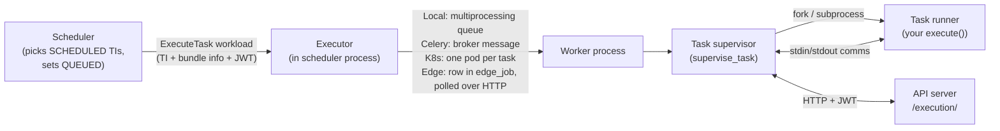

# Executors: Local, Celery, Kubernetes, Edge, and Running Several at Once

> [!CAUTION]
> Commands on this page can change or delete data and affect running deployments. Try them on a test or staging deployment first, and read the [disclaimer](../README.md#disclaimer). The guide is provided "as is", without warranty.

The official executor docs describe each executor on its own. This page puts the four you are likely to run side by side: what process actually runs your task, what each one needs from your infrastructure, which settings matter, and how to run several at once. It also explains the Airflow 3 workload model, so you can tell from a stuck task whether the problem is in the scheduler, the executor, or the worker. Behavior is taken from the 3.4 source (`airflow-core/src/airflow/executors/`) and from the provider source on `main`. Provider versions are released independently of core, so check the provider version you have installed.

---

## 1. What an Executor Does in Airflow 3

The executor sits inside the scheduler process. It never parses Dag files and never talks to the database on behalf of your task. Its job is to take a **workload** from the scheduler and start a process somewhere that runs it.



The pieces, from `airflow-core/src/airflow/executors/workloads/`:

| Workload type | Sent to | What it carries |
| :--- | :--- | :--- |
| `ExecuteTask` | executor | A `TaskInstanceDTO` (ids, try number, pool slots, priority weight), the Dag bundle name and version, the Dag file's relative path, the log path, and a JWT |
| `ExecuteCallback` | executor | A callback that must run on a worker (for example a deadline-alert `SyncCallback`) |
| `TestConnection` | executor | A connection test requested from the UI or API (only when `[core] test_connection` allows it) |
| `RunTrigger` | triggerer, never an executor | A trigger to run; see [Deferrable operators](02_deferrable_operators_and_triggers.md) |

Things worth knowing:

* Executors sort pending workloads by type, callbacks first, then connection tests, then tasks. Within tasks, higher `priority_weight` goes first (`ExecuteTask.sort_key` returns the negated weight).
* The JWT in the workload is minted with a lifetime of `[scheduler] task_queued_timeout` (default 600 seconds) and the scope `workload`. When the task starts, the API server swaps it for an `execution`-scoped token, and refreshes it on later calls via the `Refreshed-API-Token` header. A task that sits in a Celery queue for longer than `task_queued_timeout` arrives with an expired token, but the scheduler will also have revoked and rescheduled it by then (see [§7](#7-stuck-in-queued)).
* Every executor ends up calling `BaseExecutor.run_workload()`, which hands an `ExecuteTask` to `airflow.sdk.execution_time.supervisor.supervise_task`. The supervisor starts the task runner as a child process, relays its requests (Variables, Connections, XComs, state changes) to the Execution API, heartbeats, and enforces timeouts. **Your task code never holds a database connection.**
* Celery, Kubernetes and Edge workers start the same entry point, `python -m airflow.sdk.execution_time.execute_workload`, or call `run_workload` directly.

### Where workers find the API server

Every worker must reach the API server's Execution API. The URL comes from `[core] execution_api_server_url`. When that key is unset, `get_execution_api_server_url()` builds `{[api] base_url}/execution/`, and if `base_url` is unset or relative it uses `http://localhost:{[api] port}` (port default `8080`).

> [!IMPORTANT]
> The fallback to `localhost` only works for LocalExecutor, where workers are child processes of the scheduler on the same host and an API server listens locally. For Celery, Kubernetes and Edge workers, set `AIRFLOW__CORE__EXECUTION_API_SERVER_URL` explicitly (for example `http://airflow-api-server.airflow.svc:8080/execution/`). Getting this wrong is the most common reason tasks go to `running` and then fail with connection errors.

---

## 2. LocalExecutor (core)

**How it runs a workload:** `LocalExecutor` (in `airflow-core/src/airflow/executors/local_executor.py`) starts worker processes with Python `multiprocessing`. Each worker takes one workload at a time from a shared queue and calls `run_workload`, which then starts the supervisor and the task runner. With the `fork` start method, it pre-spawns `parallelism` workers at start-up. Otherwise it spawns them on demand. Process titles look like `airflow worker -- LocalExecutor: <ti id>`, so `ps` shows you which task each one is running. <!-- check_docs: ignore -->

**Needs:** nothing beyond the scheduler host. It is the default (`[core] executor = LocalExecutor`).

**Capacity:** the executor's `parallelism` is `[core] parallelism` (default `32`). That is the maximum number of concurrent task processes **on the scheduler host**.

**Pick it when:** you have one scheduler (or a few), modest task volume, and tasks that are mostly I/O-bound calls to other systems. Scale the scheduler host up, not out.

**Watch out for:**
* Task code and the scheduler share CPU and memory. A task that eats memory can take the scheduler down with it.
* With several schedulers in HA, each runs its own LocalExecutor, and a task runs on whichever scheduler queued it.
* `Ctrl-C` on the scheduler: worker processes ignore `SIGINT` and let running tasks finish.

---

## 3. CeleryExecutor (`apache-airflow-providers-celery`)

**How it runs a workload:** the scheduler serializes the workload to JSON and sends it to the broker as the Celery task `execute_workload`, routed to the task's `queue` (default `[operators] default_queue`, which is `default`). A Celery worker (`airflow celery worker`) picks it up, validates the JSON as an `ExecutorWorkload`, and calls `BaseExecutor.run_workload`.

**Needs:** a broker (Redis or RabbitMQ in practice), a result backend (`[celery] result_backend`, usually the metadata database or Redis), the provider installed on scheduler and workers, the same Dag bundle reachable from workers, and network access from workers to the API server.

**Key settings** (all from the provider's `provider.yaml`):

| Setting | Default | Notes |
| :--- | :--- | :--- |
| `[celery] broker_url` | `redis://redis:6379/0` | Change it; the default assumes a host called `redis` |
| `[celery] result_backend` | unset | When unset, the provider uses `db+` plus `[database] sql_alchemy_conn` (`default_celery.py`) |
| `[celery] worker_concurrency` | `16` | Task slots per worker process. `airflow celery worker --concurrency` overrides it |
| `[celery] worker_autoscale` | unset | `max,min` form; overrides `worker_concurrency` |
| `[celery] worker_prefetch_multiplier` | `1` | Keep it at 1 for long tasks |
| `[celery] task_acks_late` | `True` | Message is acknowledged after the task finishes |
| `[celery] sync_parallelism` | `0` | Processes the scheduler uses to fetch Celery task states; `0` means `max(1, cpu_count - 1)` |
| `[celery] operation_timeout` | `1.0` | Seconds for broker operations from the scheduler |
| `[celery_broker_transport_options] visibility_timeout` | unset (24 h used) | See the warning below |

> [!WARNING]
> If `visibility_timeout` is unset and the broker URL starts with `redis://`, `rediss://`, `sqs://` or `sentinel://`, the provider uses 86,400 seconds and logs `No visibility_timeout configured in [celery_broker_transport_options]. Using default of 86400 seconds (24 hours).` A task that runs longer than that is redelivered. On Airflow 3.2 and later the duplicate delivery is discarded (`TaskAlreadyRunningError`, logged as `Task already running elsewhere, ignoring redelivered message`) and the original keeps running. Set the timeout above your longest task anyway, so the broker does not keep redelivering it.

**Run a worker for specific queues:**
```bash
airflow celery worker --queues default,heavy --concurrency 8
```
Route a task to it with `queue="heavy"` on the operator. Tasks sent to a queue no worker consumes stay `queued` until `task_queued_timeout` (§7).

**Pick it when:** you need horizontal scale with warm workers (no pod start-up per task), and many short tasks.

---

## 4. KubernetesExecutor (`apache-airflow-providers-cncf-kubernetes`)

**How it runs a workload:** one pod per task instance. The pod's command is `python -m airflow.sdk.execution_time.execute_workload --json-string <workload>`. The scheduler watches pod events and maps them back to task state.

**Needs:** the provider installed, RBAC for the scheduler's service account to create, watch and delete pods in the target namespace(s), an image that contains your Dag dependencies (or a pod template that fetches the bundle), and pod-to-API-server networking.

**Key settings** (`[kubernetes_executor]`, from the provider):

| Setting | Default | Notes |
| :--- | :--- | :--- |
| `namespace` | `default` | Where worker pods are created |
| `pod_template_file` | `""` | Base pod spec. Use one; it is easier to reason about than the per-key settings |
| `worker_container_repository` / `worker_container_tag` | `""` | Image when not set in the template |
| `delete_worker_pods` | `True` | Delete pods after they finish |
| `delete_worker_pods_on_failure` | `False` | Failed pods are kept for debugging; clean them up yourself |
| `worker_pods_creation_batch_size` | `1` | Pods created per scheduler loop. Raise it for bursts |
| `multi_namespace_mode` | `False` | Needs cluster-wide RBAC, or a `multi_namespace_mode_namespace_list` |
| `in_cluster` | `True` | `False` uses `config_file` / `cluster_context` |
| `pod_launch_failure_retries` | `1` | Retries of pod creation |

The executor's `parallelism` is still `[core] parallelism`, so at most that many pods per scheduler.

Per-task overrides go in `executor_config`:
```python
from kubernetes.client import models as k8s

from airflow.sdk import task


@task(
    executor_config={
        "pod_override": k8s.V1Pod(
            spec=k8s.V1PodSpec(
                containers=[
                    k8s.V1Container(
                        name="base",
                        resources=k8s.V1ResourceRequirements(requests={"cpu": "2", "memory": "4Gi"}),
                    )
                ]
            )
        )
    }
)
def heavy_transform():
    ...
```

**Pick it when:** tasks need isolation, different images or resources, or the load is bursty and you want to scale to zero. Expect seconds of pod start-up per task. That overhead is too much for thousands of tiny tasks.

---

## 5. EdgeExecutor (`apache-airflow-providers-edge3`)

**How it runs a workload:** the executor writes jobs to an `edge_job` table in the metadata database (the provider creates its tables on first start). Edge workers (`airflow edge worker`) run anywhere that can reach the API server over HTTP(S). They poll for jobs, run each one with the same `execute_workload` entry point, and push logs and state back. Workers never need database access or inbound connections.

**Needs:**
* The provider installed on the API server, scheduler and workers.
* `[edge] api_enabled = True` on the API server (default `False`), so the Edge Worker API is served.
* `[edge] api_url` on each worker, pointing at that API.
* `[core] execution_api_server_url` reachable from the workers.

**Key settings** (`[edge]`): `worker_concurrency` (default `8`), `job_poll_interval` (default `5` s), `heartbeat_interval` (default `30` s), `push_logs` (default `True`).

**Configure it.** It is not a core short name, so give the module path:
```ini
[core]
executor = airflow.providers.edge3.executors.EdgeExecutor
```

```bash
airflow edge worker --queues remote_site --concurrency 4
```
Edge workers can be put into maintenance, and their queues and concurrency changed remotely (`airflow edge maintenance`, `add-worker-queues`, `set-worker-concurrency`, and others).

**Pick it when:** tasks must run in another network, data centre, cloud or on-premises site, behind a firewall that only allows outbound HTTPS.

---

## 6. Running Several Executors at Once

Airflow 3 supports several executors in one deployment natively. The hybrid `CeleryKubernetesExecutor` and `LocalKubernetesExecutor` classes still ship in the providers, but they raise `RuntimeError: ... does not support Airflow 3.0+` on construction. Replace them with the list form below.

**Syntax** (parsed by `ExecutorLoader` in `executor_loader.py`):

```ini
[core]
# First entry is the default executor; the others are available per task.
executor = CeleryExecutor,KubernetesExecutor,remote:airflow.providers.edge3.executors.EdgeExecutor
```

| Form | Example | Meaning |
| :--- | :--- | :--- |
| Core short name | `LocalExecutor`, `CeleryExecutor`, `KubernetesExecutor` | Resolved to the built-in module path. These three are the only short names |
| Module path | `my_company.executors.MyExecutor` | Any importable `BaseExecutor` subclass |
| `alias:module_or_name` | `remote:airflow.providers.edge3.executors.EdgeExecutor`, `big:KubernetesExecutor` | Gives an executor a short name for tasks to use |
| Team lists (multi-team) | `LocalExecutor;team_a=CeleryExecutor` | `;` separates teams. Requires `[core] multi_team = True`; global executors must come first |

Rules enforced at start-up (`AirflowConfigException` otherwise): the value cannot be empty, the same executor class cannot appear twice in one team's list, and an alias's second part must be a core name or contain a dot.

**Choosing an executor per task.** Pass `executor=` with an alias, a module path, or a class name:

```python
from airflow.sdk import dag, task


@dag(schedule=None)
def mixed():
    @task  # default executor (first in the list)
    def light():
        ...

    @task(executor="KubernetesExecutor")
    def isolated():
        ...

    @task(executor="remote")
    def on_prem():
        ...

    light() >> isolated() >> on_prem()


mixed()
```

Set it for a whole Dag with `default_args={"executor": "KubernetesExecutor"}`.

> [!NOTE]
> The `executor` parameter's docstring in `BaseOperator` still says "NOT YET SUPPORTED". It is stale: the Dag processor validates the value and the scheduler routes by it (`_try_to_load_executor`).

> [!IMPORTANT]
> The **Dag processor** validates `executor=` against its own `[core] executor` value. If a task names an executor that is not configured there, the Dag fails to import with `Task '<task_id>' specifies executor '<name>', which is not available. Make sure it is listed in your [core] executor configuration, ...`. Keep `[core] executor` identical on the scheduler, Dag processor and API server.

**Capacity with several executors:** each executor has its own `parallelism` (= `[core] parallelism`), but the scheduler caps the total across all executors at `[core] parallelism` per scheduler. A slot taken by Celery is not available to Kubernetes. See [Concurrency](03_concurrency_pools_and_priority.md#2-the-knobs-in-the-order-the-scheduler-applies-them).

---

## 7. Stuck in Queued

A task in `queued` has been handed to an executor but has not reported `running`. The scheduler checks this every `[scheduler] task_queued_timeout_check_interval` (default `120` s). Any TI it queued more than `[scheduler] task_queued_timeout` (default `600` s) ago is revoked from the executor and set back to `scheduled`. That happens twice; the third time, the task is failed with `Task was requeued more than 2 times and will be failed.` Both events appear in the audit log (`Log` table) for the task.

**Confirm**
```bash
airflow tasks state <dag_id> <task_id> <run_id>
airflow jobs check --job-type SchedulerJob
```
Metrics: `executor.open_slots`, `executor.queued_tasks`, `executor.running_tasks` (tagged by executor class), and `task.queued_duration`.

| Executor | Usual cause of stuck in queued |
| :--- | :--- |
| Local | Rare. A worker process killed between taking the workload and starting it |
| Celery | No worker consuming that `queue`; broker unreachable; workers at `worker_concurrency`; result backend down so state is never read |
| Kubernetes | Pods `Pending` (quota, node capacity, image pull); RBAC denies pod creation; `worker_pods_creation_batch_size` too small for a burst |
| Edge | No edge worker serving that queue; worker in maintenance; `[edge] api_enabled` off |

---

## 8. Comparison

| | LocalExecutor | CeleryExecutor | KubernetesExecutor | EdgeExecutor |
| :--- | :--- | :--- | :--- | :--- |
| Ships in | core | `celery` provider | `cncf.kubernetes` provider | `edge3` provider |
| Where tasks run | Scheduler host | Long-lived Celery workers | One pod per task | Remote workers, polling over HTTP |
| Extra infra | None | Broker + result backend | Kubernetes cluster + RBAC | None beyond the API server |
| Start-up latency per task | Process start | Process start | Pod scheduling + image pull | Poll interval (`job_poll_interval`) |
| Isolation | Process | Process, per worker host | Pod (own image, resources) | Process, per remote host |
| Scale-out | Bigger host only | Add workers | Cluster autoscaling | Add workers anywhere |
| Queue routing (`queue=`) | Ignored | Celery queues | Ignored *(not verified against source)* | Edge worker queues |
| Concurrency setting | `[core] parallelism` | `[celery] worker_concurrency` per worker, capped by `[core] parallelism` | `[core] parallelism` pods | `[edge] worker_concurrency` per worker, capped by `[core] parallelism` |
| Good for | Small and medium deployments, dev | High-throughput, short tasks | Heterogeneous or bursty work | Work in other networks or sites |

Opinionated default: start with LocalExecutor. Move to Celery when one host is not enough. Add Kubernetes **alongside** it (not instead of it) for the tasks that need their own image or resources. Add Edge only for work that has to run somewhere else.

---

**Next:** [Deferrable operators and triggers](02_deferrable_operators_and_triggers.md) for long waits that should not hold an executor slot. See also [Concurrency, pools and priority](03_concurrency_pools_and_priority.md), [Kubernetes and Helm](../04_infrastructure_and_cloud/03_kubernetes_and_helm_chart.md), and the [`[core]` reference](../09_reference/01_airflow_cfg_reference.md#core).
