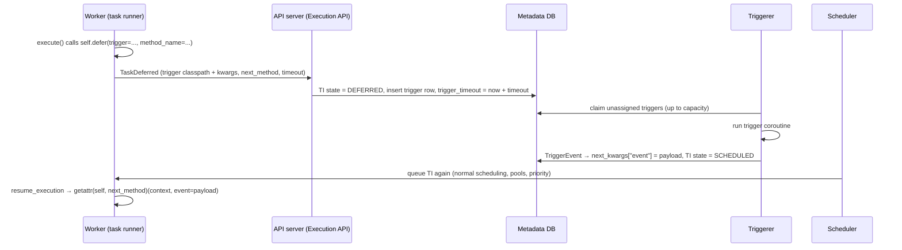

# Deferrable Operators, Triggers and the Triggerer

> [!CAUTION]
> Commands on this page can change or delete data and affect running deployments. Try them on a test or staging deployment first, and read the [disclaimer](../README.md#disclaimer). The guide is provided "as is", without warranty.

**Official docs:** [Deferrable Operators & Triggers](https://airflow.apache.org/docs/apache-airflow/3.4.0/authoring-and-scheduling/deferring.html) · [Task SDK: Deferred vs Async Operators](https://airflow.apache.org/docs/task-sdk/stable/deferred-vs-async-operators.html)

The official docs explain the deferral concept and show the API. This page is for people who write and run deferrable tasks in production. It covers the exact 3.4 call sequence, a trigger template that holds up when the triggerer restarts, how deferral interacts with timeouts, pools and concurrency, how to size and run the triggerer in HA, and what the warnings in its log mean. Core behavior is from `airflow-core/src/airflow/triggers/base.py`, `airflow-core/src/airflow/jobs/triggerer_job_runner.py`, `airflow-core/src/airflow/models/trigger.py` and `task-sdk/src/airflow/sdk/bases/operator.py` on `v3-4-stable`.

---

## 1. Why Defer

A sensor or operator that polls an external system for an hour holds a worker slot (and, by default, a pool slot) for that whole hour while doing almost nothing. Deferring hands the wait to the **triggerer**, a separate process that runs thousands of small `asyncio` coroutines in one event loop. The worker slot is released, and the task comes back to a worker only when there is real work to do.

| Approach | Holds a worker slot while waiting? | Holds a pool slot? | Cost |
| :--- | :--- | :--- | :--- |
| Sensor, `mode="poke"` | Yes, the whole time | Yes | One process per wait |
| Sensor, `mode="reschedule"` | Only during each poke | Only during each poke | A scheduler round trip and a process start per poke |
| Deferrable (`deferrable=True`) | No | Only if the pool has `include_deferred` | One coroutine in the triggerer |
| `start_from_trigger=True` | Never for the waiting part | Same as deferrable | Dag must be loaded in the triggerer to render templates |

Rule of thumb: anything that waits longer than a couple of minutes, and has a deferrable version, should defer.

---

## 2. The Lifecycle in 3.4



Details that matter:

* `self.defer()` raises `TaskDeferred` (a `BaseException`, so a bare `except Exception` in your code will not swallow it). The signature is keyword-only: `defer(*, trigger, method_name, kwargs=None, timeout=None)`.
* `kwargs` are stored and passed back to `method_name` together with `event=<payload>`. The event is added as the `event` keyword by `handle_event_submit` in `models/trigger.py`, so the resume method must accept `event`.
* When the trigger fires, the task goes back to `scheduled`, **not** straight to running. It goes through pools, priority and concurrency checks again like any other task. A busy pool delays the resume.
* The resumed run is a new worker process. Instance attributes you set in `execute()` before deferring are gone; anything you need must be in the trigger's payload or in `kwargs`.
* A trigger can end the task without returning to a worker by yielding `TaskSuccessEvent`, `TaskFailedEvent` or `TaskSkippedEvent` (from `airflow.triggers.base`). Pass `method_name=None` in that case.

---

## 3. Writing a Deferrable Operator and Trigger

`BaseTrigger` and `TriggerEvent` are **not** exported from `airflow.sdk` in 3.4. Import them from `airflow.triggers.base`, as the providers do.

```python
# my_company/triggers.py: must be importable on the TRIGGERER, e.g. an installed package
from __future__ import annotations

import asyncio
import os
from collections.abc import AsyncIterator
from typing import Any

from airflow.triggers.base import BaseTrigger, TriggerEvent


class FileReadyTrigger(BaseTrigger):
    def __init__(self, path: str, poll_interval: float = 30.0):
        super().__init__()
        self.path = path
        self.poll_interval = poll_interval

    def serialize(self) -> tuple[str, dict[str, Any]]:
        # Classpath + kwargs that rebuild this trigger on any triggerer.
        return (
            "my_company.triggers.FileReadyTrigger",
            {"path": self.path, "poll_interval": self.poll_interval},
        )

    async def run(self) -> AsyncIterator[TriggerEvent]:
        while True:
            # Blocking calls go to a thread; never block the event loop.
            if await asyncio.to_thread(os.path.exists, self.path):
                yield TriggerEvent({"status": "ready", "path": self.path})
                return
            await asyncio.sleep(self.poll_interval)
```

```python
# my_company/operators.py
from __future__ import annotations

from datetime import timedelta
from typing import Any

from airflow.sdk import BaseOperator, Context

from my_company.triggers import FileReadyTrigger


class WaitForFileOperator(BaseOperator):
    template_fields = ("path",)

    def __init__(self, *, path: str, max_wait: timedelta = timedelta(hours=2), **kwargs):
        super().__init__(**kwargs)
        self.path = path
        self.max_wait = max_wait

    def execute(self, context: Context) -> None:
        self.defer(
            trigger=FileReadyTrigger(path=self.path),
            method_name="execute_complete",
            timeout=self.max_wait,
        )

    def execute_complete(self, context: Context, event: dict[str, Any] | None = None) -> str:
        if not event or event.get("status") != "ready":
            raise RuntimeError(f"Unexpected trigger event: {event!r}")
        return event["path"]
```

Rules for triggers, each tied to source behavior:

| Rule | Why |
| :--- | :--- |
| `serialize()` returns only JSON-serializable kwargs and the full import path | The triggerer rebuilds the trigger from the stored classpath and kwargs. A wrong path logs `Trigger failed to load code` |
| `yield` the event, don't `return` it | Returning a `TriggerEvent` logs `Trigger returned a TriggerEvent rather than yielding it` and the event is lost |
| Always yield at least one event (or let a timeout fire) | A trigger that exits without an event logs `Trigger exited without sending an event. Dependent tasks will be failed.` |
| Make `run()` safe to start again | On triggerer restart or failover, the trigger is rebuilt from `serialize()` and `run()` starts from the top |
| Put job cancellation in `on_kill()`, not `cleanup()` | `cleanup()` runs on every exit, including restarts and redistribution; `on_kill()` runs only when a user marks the task failed or success, or clears it. It is bounded by `[triggerer] on_kill_timeout` (default `30` s) |
| Event payloads must be serializable | If the payload cannot be serialized, the task is failed with `Could not resume the task: the event payload could not be serialized ...` |

---

## 4. Deferrable by Default and `start_from_trigger`

**`[operators] default_deferrable`** (default `false`, env `AIRFLOW__OPERATORS__DEFAULT_DEFERRABLE`) is the default of the `deferrable` argument in provider operators. Providers read it with `conf.getboolean("operators", "default_deferrable", fallback=False)` **in the constructor signature**, so it is evaluated when the Dag file is parsed.

> [!IMPORTANT]
> Set `default_deferrable` where Dags are **parsed** (the Dag processor) as well as on workers. Turning it on only on workers has no effect on the serialized Dag. Turning it on anywhere requires a running triggerer: without one, every deferred task sits in `deferred` until its timeout.

**`start_from_trigger`** skips the first worker run entirely: the scheduler creates the trigger directly and the task starts in the triggerer. Operators opt in through a class-level `StartTriggerArgs` (from `airflow.triggers.base`). The standard provider's `TimeSensor` supports it:

```python
from datetime import time

from airflow.providers.standard.sensors.time import TimeSensor

wait_until_six = TimeSensor(
    task_id="wait_until_six",
    target_time=time(6, 0),
    deferrable=True,
    start_from_trigger=True,
)
```

Costs and limits (from the `BaseOperator` docstring and `triggerer_job_runner.py`):
* Templated fields are rendered **in the triggerer**, which must load the serialized Dag to do it (logged as `Start from trigger enabled for task <task_id>`). On Dags with many tasks or heavy templating this adds triggerer load.
* Only fields named in `start_trigger_args.trigger_kwargs` that also exist on the trigger are rendered.
* Callables are not allowed in `trigger_kwargs`: `... has a callable in trigger kwargs named '<name>', which is not allowed when start_from_trigger is enabled.`

---

## 5. Timeouts on Deferral

| Timeout | Covers | Enforced by |
| :--- | :--- | :--- |
| `timeout=` on `self.defer()` (or `StartTriggerArgs.timeout`) | Time spent **deferred** | The scheduler: every `[scheduler] trigger_timeout_check_interval` (default `15` s) it finds TIs with `trigger_timeout` in the past and schedules them to resume with an error. The worker then raises `TaskDeferralTimeout` |
| `execution_timeout` | Each **worker** run segment separately: the first `execute()`, then each resume | The task runner's timeout wrapper. The source carries a `TODO: handle timeout in case of deferral` comment: time spent deferred does not count |
| Sensor `timeout` | Total sensor time, for deferrable sensors that pass it on to `defer()` | Depends on the sensor implementation *(not verified against source for every provider)* |

> [!WARNING]
> A deferrable task with no `timeout=` and a trigger that never fires stays `deferred` indefinitely. Always pass a timeout in your own operators, and check that the provider operators you use set one.

`TaskDeferralTimeout` is an ordinary task failure, so `retries` apply. A retry starts again from `execute()`, not from the trigger.

---

## 6. Deferred Tasks and Concurrency

From `ti_deps/dependencies_states.py` and `ConcurrencyMap` in `scheduler_job_runner.py`:

| Limit | Counts DEFERRED tasks? |
| :--- | :--- |
| `[core] parallelism`, executor slots | No |
| Dag `max_active_tasks` (per Dag run) | No |
| Task `max_active_tis_per_dag` / `max_active_tis_per_dagrun` | **Yes** |
| Pool slots | Only if the pool has `include_deferred = True` (default for new pools: off) |

So a pool that protects an external API from too many concurrent jobs **does not** protect it from deferred jobs unless you set `include_deferred`:

```bash
airflow pools set warehouse_api 10 "Limit concurrent warehouse jobs" --include-deferred
```

See [Concurrency, pools and priority](03_concurrency_pools_and_priority.md).

---

## 7. Running the Triggerer

```bash
airflow triggerer                       # uses [triggerer] capacity
airflow triggerer --capacity 2000       # override for this process
airflow triggerer --queues team_a,team_b
```

| Setting | Default | What it does |
| :--- | :--- | :--- |
| `[triggerer] capacity` | `1000` | Max triggers one triggerer runs at once |
| `[triggerer] max_trigger_to_select_per_loop` | `50` | Triggers claimed per loop, so one triggerer does not grab everything in HA |
| `[triggerer] job_heartbeat_sec` | `5` | Heartbeat interval |
| `[triggerer] triggerer_health_check_threshold` | `30` | Seconds without a heartbeat before others consider it dead and take over its triggers |
| `[triggerer] runner_health_check_threshold` | `30` | If the async runner subprocess goes silent this long, the triggerer stops heartbeating so its triggers get reassigned. `0` disables |
| `[triggerer] blocked_main_thread_warning_threshold` | `0.2` | Seconds of event-loop blocking before the warning in §8 |
| `[triggerer] on_kill_timeout` | `30` | Bound on `BaseTrigger.on_kill()` |
| `[triggerer] queues_enabled` | `False` | Triggers inherit the deferring task's `queue`; triggerers pick them up only with a matching `--queues` |

**High availability.** Run two or more triggerers. Triggers are assigned to a triggerer by ID. A triggerer claims triggers that are unassigned or whose triggerer has not heartbeated within `triggerer_health_check_threshold`, with `SELECT ... FOR UPDATE SKIP LOCKED`. Claim order is callback triggers first, then task triggers by `priority_weight`, then asset-watcher triggers. A trigger can briefly run in two places during a handover, so trigger events must be safe to receive twice; that is why the `TriggerEvent` docstring asks for deterministic payloads.

> [!WARNING]
> With `[triggerer] queues_enabled = True`, a triggerer started **without** `--queues` only picks up triggers that have **no** queue. If no triggerer serves a task's queue, its triggers never run. Start at least one triggerer per queue in use.

**Health check:**
```bash
airflow jobs check --job-type TriggererJob --allow-multiple --limit 0
```

**Metrics:** `triggers.running`, `triggerer.capacity_left`, `triggers.blocked_main_thread`, `triggers.failed`, `triggers.succeeded`, `triggerer.trigger_queue_delay`, `triggerer_heartbeat`, `ti.deferred`, `pool.deferred_slots`. Sizing: alert when `triggerer.capacity_left` approaches zero, and add a triggerer rather than raising `capacity` far above the default, since one event loop is one CPU core *(illustrative guidance)*.

---

## 8. Troubleshooting

### Blocked event loop
**Log (INFO):**
`Triggerer's async thread was blocked for <n> seconds, exceeding the configured warning threshold of 0.20 seconds. This is likely caused by a badly-written trigger. Set PYTHONASYNCIODEBUG=1 to get more information on overrunning coroutines.`

**Meaning:** some trigger made a synchronous call (a blocking HTTP client, `time.sleep`, a database driver, file I/O, or a sync `get_connection` on a cold path) and every other trigger in that triggerer stalled. The watchdog cannot tell which trigger it was.

**Confirm:** set `PYTHONASYNCIODEBUG=1` in the triggerer's environment and restart it; asyncio then logs the slow coroutine. Watch `triggers.blocked_main_thread`.

**Fix:** use async clients, or wrap blocking calls in `await asyncio.to_thread(...)`. Raising `blocked_main_thread_warning_threshold` only hides the warning.

### Deadlocked runner
**Log (ERROR):** `TriggerRunner subprocess event loop appears deadlocked: no communication received for <n>s (threshold: <m>s). Skipping heartbeat so the triggerer appears unhealthy to the scheduler and its triggers are reassigned.`
A trigger blocked the loop completely. Its triggers move to another triggerer, so if one trigger is at fault, the problem follows it. Find it with the method above.

### Task stuck in `deferred`
| Check | Command or signal |
| :--- | :--- |
| Is any triggerer alive? | `airflow jobs check --job-type TriggererJob` |
| Is it full? | `triggerer.capacity_left` near 0 |
| Queue mismatch? | `[triggerer] queues_enabled` and the triggerers' `--queues` |
| Trigger failing to import? | Triggerer log: `Trigger failed to load code` (module missing on the triggerer image) |
| Trigger never yields? | No timeout set; see §5 |

### Task fails right after resuming
* `TypeError ... unexpected keyword argument 'event'`: the resume method must accept `event`.
* `AttributeError` on something set in `execute()`: the resume runs in a new process (§2).
* `TaskDeferralError: <message>`: the trigger raised. The traceback is in the task log under `Trigger failed:`.

---

**Next:** [Concurrency, pools and priority](03_concurrency_pools_and_priority.md). See also [Executors](01_executors.md), [Monitoring](../06_operations_and_housekeeping/03_monitoring_and_observability.md), and the [`[triggerer]` reference](../09_reference/01_airflow_cfg_reference.md#triggerer).
