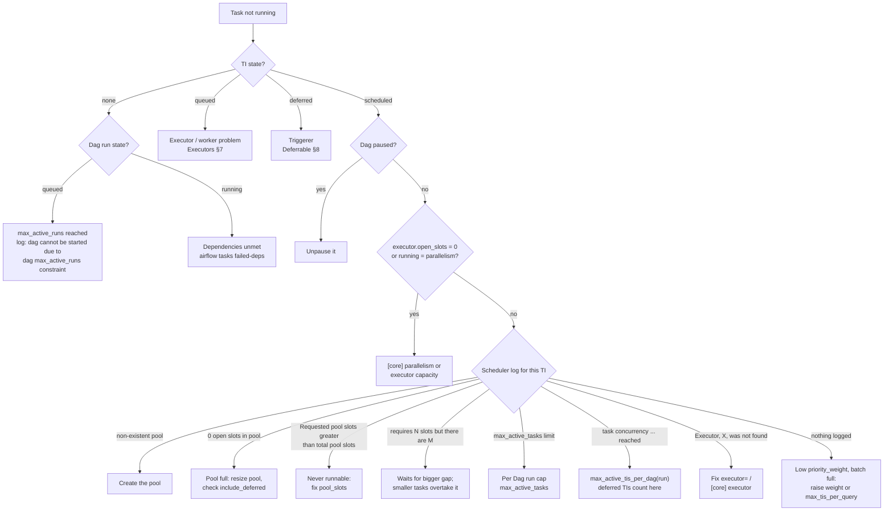

# Concurrency, Pools and Priority: Why Is My Task Not Running?

> [!CAUTION]
> Commands on this page can change or delete data and affect running deployments. Try them on a test or staging deployment first, and read the [disclaimer](../README.md#disclaimer). The guide is provided "as is", without warranty.

The official docs describe each concurrency setting where it is defined, scattered across the config reference, the Dag and operator API docs, and the pools page. This page lists every knob **in the order the scheduler checks them**, with its 3.4 default, the exact log line the scheduler writes when the knob blocks a task, and a decision flow for the question everyone asks: "why is my task not running?" Everything here comes from `_critical_section_enqueue_task_instances`, `_select_task_instances_to_queue` and `_task_concurrency_allows_execution` in `airflow-core/src/airflow/jobs/scheduler_job_runner.py` on `v3-4-stable`. In 3.4 they replace the older `_executable_task_instances_to_queued`.

---

## 1. First, Which State Is It Really In?

"Queued" is used loosely. The fix depends on the actual state:

| Task instance state | Who is holding it | Go to |
| :--- | :--- | :--- |
| none / `None` | Dependencies not met (upstream, trigger rule, `depends_on_past`), or its Dag run is not running yet | [§4](#4-before-the-critical-section-dag-runs-and-dependencies) |
| `scheduled` | The scheduler: a concurrency limit, pool, or executor slot is blocking it | [§2](#2-the-knobs-in-the-order-the-scheduler-applies-them) |
| `queued` | The executor or worker: it was handed off but has not started | [Executors §7](01_executors.md#7-stuck-in-queued) |
| `deferred` | The triggerer | [Deferrable §8](02_deferrable_operators_and_triggers.md#8-troubleshooting) |
| Dag run `queued` | `max_active_runs` | [§4](#4-before-the-critical-section-dag-runs-and-dependencies) |

```bash
airflow tasks state <dag_id> <task_id> <run_id>
airflow tasks failed-deps <dag_id> <task_id> <run_id>   # why it is not scheduled yet
```

---

## 2. The Knobs in the Order the Scheduler Applies Them

Each scheduler loop runs one "critical section" (one scheduler at a time, using a lock on the `slot_pool` rows, plus a Postgres advisory lock). It goes through these steps in order.

| # | Check | Setting and default | Scope | Log line when it blocks (verbatim) |
| :--- | :--- | :--- | :--- | :--- |
| 1 | Free executor capacity | `[core] parallelism` = `32` | Per **scheduler**, summed over all its executors | (DEBUG) `max_tis query size is less than or equal to zero. No query will be performed!` |
| 2 | Batch size | `[scheduler] max_tis_per_query` = `16` (`0` means use `parallelism`) | Per loop | none; it only limits how many TIs are looked at |
| 3 | Any pool has room | Sum of open slots over all pools | Global | (DEBUG) `All pools are full!` |
| 4 | Candidate query | Only TIs in `scheduled`, in a `running` Dag run, in an unpaused Dag. Ordered by `priority_weight` desc, then logical date, then map index. Per Dag run, at most `max_active_tasks` minus the tasks already running | Per Dag run | none |
| 5 | Pool exists | `pool=` on the task (default `default_pool`) | Per task | (WARNING) `Tasks using non-existent pool '%s' will not be scheduled` |
| 6 | Pool has open slots | Pool `slots` (default pool: `[core] default_pool_task_slot_count` = `128` at creation) | Per pool | (INFO) `Not scheduling since there are %s open slots in pool %s` |
| 7 | Task fits the pool at all | `pool_slots` (default `1`) ≤ pool `slots` | Per task | (WARNING) `Not executing %s. Requested pool slots (%s) are greater than total pool slots: '%s' for pool: %s.` |
| 8 | Task fits the open slots now | `pool_slots` ≤ open slots | Per task | (INFO) `Not executing %s since it requires %s slots but there are %s open slots in the pool %s.` |
| 9 | Dag run active tasks | Dag `max_active_tasks`, default `[core] max_active_tasks_per_dag` = `16` | **Per Dag run** | (INFO) `DAG %s has %s/%s running and queued tasks`, then `Not executing %s since the number of tasks running or queued from DAG %s is >= to the DAG's max_active_tasks limit of %s` |
| 10 | Task across all runs | `max_active_tis_per_dag` (default unset) | Per task, all runs | (INFO) `Not executing %s since the task concurrency for this task has been reached.` |
| 11 | Task within one run | `max_active_tis_per_dagrun` (default unset) | Per task, per run | (INFO) `Not executing %s since the task concurrency per DAG run for this task has been reached.` |
| 12 | Target executor has a slot | That executor's free slots | Per executor | (DEBUG) `Not scheduling %s since its executor %s does not currently have any more available slots` |
| 13 | Executor exists | `executor=` on the task | Per task | (WARNING) `Executor, %s, was not found but a Task or Callback was configured to use it` |

The scheduler logs each batch it examines as `%s tasks up for execution:` followed by one TI per line. When a whole batch was rejected but more candidates might exist, it narrows the query and tries again, logging `Found no task instances to queue on query iteration %s but there could be more candidate task instances to check.`

> [!IMPORTANT]
> In Airflow 3, `max_active_tasks` (and `[core] max_active_tasks_per_dag`) is enforced **per Dag run**, not per Dag. The config description says "in each dag run", and the scheduler keys the count by `(dag_id, run_id)`. Ten active runs of one Dag can run 10 × 16 tasks at once. To cap a Dag as a whole, use a pool.

> [!NOTE]
> `[core] parallelism` is per **scheduler**. With three HA schedulers, up to 3 × `parallelism` tasks can be running. With several executors, the scheduler caps the **sum** across executors at `parallelism`; each executor individually also has `parallelism` slots.

### What counts as "active" for each limit
From `ti_deps/dependencies_states.py` and `ConcurrencyMap.load()`:

| Limit | `queued` + `running` | `deferred` | `awaiting_input` (human-in-the-loop) |
| :--- | :--- | :--- | :--- |
| Executor slots / `parallelism` | yes | no | no |
| Dag run `max_active_tasks` | yes | no | no |
| `max_active_tis_per_dag` / `_per_dagrun` | yes | **yes** | **yes** |
| Pool slots | yes | only with `include_deferred` | never |

---

## 3. Pools

A pool is a named counter of slots, shared across all Dags. Every task uses one; without `pool=` it uses `default_pool`.

* **Open slots** = `slots` − (pool slots of `running` + `queued` TIs) − (pool slots of `deferred` TIs if `include_deferred`). From `Pool.slots_stats()`.
* `slots = -1` means unlimited.
* `default_pool` cannot be deleted. `[core] default_pool_task_slot_count` only applies when the pool is first created; on an existing deployment, change the slots with the CLI, the UI or the API.
* A task naming a pool that does not exist is **not failed**. It stays `scheduled` forever, with the WARNING above in the scheduler log.

```bash
airflow pools list
airflow pools set default_pool 256 "Default pool"
airflow pools set warehouse 8 "Max 8 concurrent warehouse queries" --include-deferred
airflow pools get warehouse
airflow pools export /tmp/pools.json
```
`airflow pools set` takes NAME, SLOTS and DESCRIPTION as positional arguments, and all three are required.

```python
from airflow.sdk import task


@task(pool="warehouse", pool_slots=2, priority_weight=10)
def big_query():
    ...
```

> [!WARNING]
> A task with `pool_slots` greater than the pool's total `slots` can **never** run, and nothing fails it. Look for the WARNING `Requested pool slots (...) are greater than total pool slots` and either resize the pool or lower `pool_slots`.

Metrics per pool: `pool.open_slots`, `pool.queued_slots`, `pool.running_slots`, `pool.deferred_slots`, `pool.scheduled_slots`, `pool.starving_tasks`. Scheduler-wide: `scheduler.tasks.starving` (blocked by pools in this loop) and `scheduler.tasks.executable`.

---

## 4. Before the Critical Section: Dag Runs and Dependencies

A task only becomes a candidate (step 4) when its Dag run is `running` and the scheduler has moved the task to `scheduled`.

* **`max_active_runs`** on the Dag (default `[core] max_active_runs_per_dag` = `16`) limits how many runs are `running`. Extra runs wait in `queued`, and the scheduler logs `dag cannot be started due to dag max_active_runs constraint; active_runs=%s max_active_runs=%s dag_id=%s run_id=%s`. Backfills have their own `max_active_runs` and log `dag cannot be started due to backfill max_active_runs constraint; ...`.
* **Dependencies** (upstream state, trigger rules, `depends_on_past`, `wait_for_downstream`) decide when a task goes from none to `scheduled`. `airflow tasks failed-deps` prints the unmet ones.
* **Paused Dags** are excluded from the candidate query; nothing is logged.
* **`max_consecutive_failed_dag_runs`** (default `[core] max_consecutive_failed_dag_runs_per_dag` = `0`, disabled) auto-pauses a Dag after that many failed runs in a row.

---

## 5. Priority

The candidate query sorts by `priority_weight` (highest first), then by logical date, then by map index. Executors also sort what they dispatch by priority weight. The **effective** weight is computed when task instances are created, from the task's `priority_weight` (default `1`) and its `weight_rule`:

| `weight_rule` | Effective weight | Effect |
| :--- | :--- | :--- |
| `downstream` (default, `[core] default_task_weight_rule`) | own + sum of all downstream tasks' weights | Upstream tasks run first. Wide Dags get large weights and can starve small Dags |
| `upstream` | own + sum of all upstream tasks' weights | Tasks near the end run first, so runs finish sooner |
| `absolute` | own weight only | Predictable. Recommended when you set weights on purpose |

```python
from airflow.sdk import DAG, WeightRule, task

with DAG(
    dag_id="critical_reporting",
    schedule="@hourly",
    default_args={"priority_weight": 100, "weight_rule": WeightRule.ABSOLUTE},
):

    @task
    def build_report(): ...

    build_report()
```

**Custom strategy.** Subclass `airflow.task.priority_strategy.PriorityWeightStrategy` (marked experimental in its docstring), implement `get_weight(self, ti) -> int`, and register it in a plugin's `priority_weight_strategies` list. Then pass the class or its import path as `weight_rule`. Strategies must be stateless: their parameters are not serialized. The core example is `airflow/example_dags/plugins/decreasing_priority_weight_strategy.py`, which lowers the weight on each retry.

> [!TIP]
> Priority only orders tasks **that are already competing** for the same pool or the same slots. It does not get a task past `max_active_tasks`, past a full pool it does not use, or past an executor with no slots.

---

## 6. Decision Flow: Why Is My Task Not Running?



**Confirm**
```bash
# Scheduler log lines for one task (adjust the log path to your deployment)
grep -E "Not (executing|scheduling)|non-existent pool|max_active_tasks|was not found" <scheduler_log_file> | grep "<task_id>"
airflow pools list
airflow config get-value core parallelism
airflow config get-value scheduler max_tis_per_query
```
Most "not running" lines are logged at INFO. The executor-slot line is DEBUG, so set `[logging] logging_level = DEBUG` on one scheduler briefly if nothing else explains it.

---

## 7. Tuning Notes

* **Raising `parallelism` alone** rarely helps. The binding limit is usually a pool, `max_active_tasks`, or worker capacity (`[celery] worker_concurrency`). Find the log line first.
* **`max_tis_per_query`**: the default `16` keeps each critical section short. Raising it lets one loop queue more tasks, but holds the pool-row lock longer, which matters with several schedulers *(illustrative guidance)*.
* **Protecting an external system**: use a pool with `include_deferred`, not `max_active_tasks`, since the pool works across Dags and runs.
* **One task must never overlap itself across runs**: `max_active_tis_per_dag=1`. Deferred instances count, so a long deferred wait still blocks the next run's instance.
* **Mapped tasks**: `max_active_tis_per_dagrun` caps how many map indexes of one task run at once within a run.

| Knob | Where to set | Default |
| :--- | :--- | :--- |
| `[core] parallelism` | config | `32` |
| `[core] max_active_tasks_per_dag` | config (default for Dag `max_active_tasks`) | `16` |
| `[core] max_active_runs_per_dag` | config (default for Dag `max_active_runs`) | `16` |
| `[core] default_pool_task_slot_count` | config (initial `default_pool` size) | `128` |
| `[core] default_task_weight_rule` | config | `downstream` |
| `[scheduler] max_tis_per_query` | config | `16` |
| `max_active_tasks`, `max_active_runs` | `DAG(...)` / `@dag(...)` | from config |
| `max_active_tis_per_dag`, `max_active_tis_per_dagrun` | operator / `@task` | unset |
| `pool`, `pool_slots` | operator / `@task` | `default_pool`, `1` |
| `priority_weight`, `weight_rule` | operator / `@task` | `1`, `downstream` |
| Pool `slots`, `include_deferred` | `airflow pools set`, UI, API | per pool |

---

**Next:** [XCom, Variables and Connections](04_xcom_variables_and_connections.md). See also [Capacity planning](../05_deployment_and_config/05_capacity_planning.md), [Troubleshooting playbook](../06_operations_and_housekeeping/05_troubleshooting_playbook.md), and the [`[scheduler]` reference](../09_reference/01_airflow_cfg_reference.md#scheduler).
