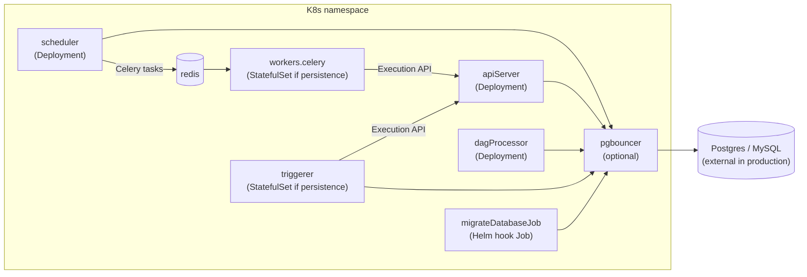

# Kubernetes and the Official Helm Chart

> [!CAUTION]
> Commands on this page can change or delete data and affect running deployments. Try them on a test or staging deployment first, and read the [disclaimer](../README.md#disclaimer). The guide is provided "as is", without warranty.

**Official docs:** [Kubernetes](https://airflow.apache.org/docs/apache-airflow/3.4.0/administration-and-deployment/kubernetes.html) · [Helm chart: Helm Chart for Apache Airflow](https://airflow.apache.org/docs/helm-chart/stable/index.html) · [Helm chart: Production Guide](https://airflow.apache.org/docs/helm-chart/stable/production-guide.html) · [Helm chart: Parameters reference](https://airflow.apache.org/docs/helm-chart/stable/parameters-ref.html)

The chart's own documentation (`chart/docs/` in the source, "Helm Chart for Apache Airflow" on the website) explains each value. This page adds what operators learn the hard way: which defaults are development-only, which secrets the chart **regenerates on every upgrade**, how Dag delivery choices interact with Dag versioning, how to size PgBouncer, and a production `values.yaml` to start from.

Version scope. In the `v3-4-stable` source the chart is `version: 2.0.0` in `chart/Chart.yaml`, with `appVersion` and `defaultAirflowTag` still at **3.3.2**; the main branch bumps the default image to 3.4.0. So set `images.airflow.tag` (or your own image) and `airflowVersion: "3.4.0"` explicitly. The `chart/RELEASE_NOTES.rst` in that tree ends at 1.21.0; the 2.0.0 changes below come from the `chart/newsfragments/*.significant.rst` files and were checked against the 3.4 `values.yaml`.

---

## 1. Chart 2.0.0: Breaking Changes You Will Hit

| Change | What to do |
| :--- | :--- |
| Requires Airflow **3.1.0 or newer**. Airflow 2.x needs a 1.x chart | Upgrade Airflow first with a 1.x chart, or deploy 3.x and the 2.0 chart together |
| `webserver.*` removed. Use `apiServer.*`; `webserver.defaultUser` → `createUserJob.defaultUser`; `webserverSecretKey*` → `apiSecretKey*` | Rename in your values. Old keys are rejected by the schema |
| `LocalKubernetesExecutor` and `CeleryKubernetesExecutor` removed | Use multiple executors: `executor: "CeleryExecutor,KubernetesExecutor"` |
| All deprecated top-level `workers.*` keys removed | Move them under `workers.celery.*` or `workers.kubernetes.*` |
| `ingress.enabled` and single `host` keys removed | `ingress.apiServer.enabled` with `ingress.apiServer.hosts: []` (and `ingress.flower.*`) |
| Top-level and per-component `securityContext` removed | Use `securityContexts` |
| `enableServiceLinks` defaults to `false` | Set it to `true` only if code relies on the `<SERVICE>_PORT` env vars |
| `dagProcessor.enabled` defaults to `true` | Nothing; Airflow 3 always needs a Dag processor |

Read every `significant` newsfragment between your current chart and the target before upgrading; the chart is versioned independently of Airflow.

---

## 2. What the Chart Deploys



| Component | Value block | Default | Notes |
| :--- | :--- | :--- | :--- |
| Scheduler | `scheduler` | `enabled: true`, `replicas: 1` | Run 2 or more for HA (needs Postgres or MySQL 8 with row-level locking) |
| API server | `apiServer` | `replicas: 1` | Serves UI, REST API and the Execution API. Scale with replicas, not `[api] workers` |
| Dag processor | `dagProcessor` | `enabled: true`, `replicas: 1` | Parses Dags; configure bundles here (§4) |
| Triggerer | `triggerer` | `enabled: true`, `replicas: 1`, `persistence.enabled: true` | Needed for deferrable operators |
| Celery workers | `workers.celery` | `replicas: 1`, `persistence.enabled: true` (100Gi each) | Only with `CeleryExecutor` |
| KubernetesExecutor pods | `workers.kubernetes`, `podTemplate` | | Only with `KubernetesExecutor` |
| Redis | `redis` | `enabled: true` | Celery broker |
| Bundled Postgres | `postgresql` | **`enabled: true`** (Bitnami chart, `bitnamilegacy/postgresql` 16.1) | Development only. Disable in production |
| PgBouncer | `pgbouncer` | `enabled: false` | Turn on for Postgres (§5) |
| Migration Job | `migrateDatabaseJob` | `enabled: true`, `useHelmHooks: true` | Runs `airflow db migrate` |
| Create-user Job | `createUserJob` | `enabled: true` | Creates a FAB admin user |
| DB cleanup CronJob | `databaseCleanup` | `enabled: false`, `retentionDays: 90`, weekly | Runs `airflow db clean --clean-before-timestamp ... --yes` |
| StatsD / OTel collector | `statsd`, `otelCollector` | `statsd.enabled: true` | See [Monitoring](../06_operations_and_housekeeping/03_monitoring_and_observability.md) |

Every long-running Airflow pod has a `waitForMigrations` init container that runs `airflow db check-migrations` and blocks until the schema matches the image. With GitOps tools that don't run Helm hooks (Argo CD, Flux), set `migrateDatabaseJob.useHelmHooks: false` and `createUserJob.useHelmHooks: false`, or the migration never runs and every pod waits forever.

---

## 3. Choosing the Executor

`executor` defaults to `CeleryExecutor`. The schema accepts a comma-separated list for multiple executors.

| Executor | Pick it when | Chart consequences |
| :--- | :--- | :--- |
| `CeleryExecutor` | Many short tasks, low start-up latency, steady load | Redis, worker StatefulSet, optional KEDA (§7), Flower if `flower.enabled` |
| `KubernetesExecutor` | Isolation per task, spiky load, per-task resources | One pod per task from the pod template file; no Redis needed; logs must go remote (§8) |
| `CeleryExecutor,KubernetesExecutor` | Mostly Celery, a few heavy or isolated tasks | Route tasks with the `executor=` argument on the task |
| `LocalExecutor` | Small installs | Tasks run inside the scheduler pod; a scheduler restart kills them |

See [Executors](../03_task_execution/01_executors.md) for behavior and tuning.

### `pod_template_file` versus `KubernetesPodOperator`

These are easy to confuse:

| | KubernetesExecutor pod template | `KubernetesPodOperator` |
| :--- | :--- | :--- |
| What it shapes | The pod that runs **any** Airflow task under the KubernetesExecutor (the Airflow image runs the task supervisor) | A pod running **your own image and command**, started by a task |
| Where it comes from | `[kubernetes_executor] pod_template_file`; the chart renders it from `files/pod-template-file.kubernetes-helm-yaml` or your `podTemplate` value | `pod_template_file`, `pod_template_dict` or `full_pod_spec` arguments on the operator |
| Per-task override | `executor_config={"pod_override": k8s.V1Pod(...)}`; the main container must be named `base` | Operator arguments (`image`, `cmds`, `container_resources`, ...) |
| Needs Airflow in the image | Yes | No |

Both come from the `cncf.kubernetes` provider (11.1.0 on main at the time of writing, released independently of core).

---

## 4. Getting Dags to the Pods

| Method | Values | Behavior |
| :--- | :--- | :--- |
| **Dag bundles** (recommended in Airflow 3) | `dagProcessor.dagBundleConfigList` (rendered into `[dag_processor] dag_bundle_config_list`) | Airflow fetches versioned code itself, for example `airflow.providers.git.bundles.git.GitDagBundle` with `tracking_ref`, `subdir`, `git_conn_id`. Workers check out the version the Dag run started on. Needs the `git` provider in the image and the Git connection available to all components |
| **git-sync sidecar** | `dags.gitSync.enabled: true`, `repo`, `branch`/`ref`, `credentialsSecret` or `sshKeySecret` | A sidecar keeps a checkout in the pod's Dags folder. Combined with the default `LocalDagBundle` named `dags-folder`, Airflow sees a non-versioned bundle |
| **Persistent volume** | `dags.persistence.enabled: true` (needs `ReadWriteMany`) | Something else writes the files. Same non-versioned behavior |
| **Baked into the image** | Nothing; `COPY` in your Dockerfile | Immutable and simple; every Dag change is an image rollout |

The default `dagBundleConfigList` is a single `LocalDagBundle` called `dags-folder` pointing at the Dags folder. A local bundle has no versions, so a worker always runs whatever code is on disk now, even for a Dag run that started on older code. If you need "a run finishes on the code it started with", use a versioned bundle (Git). See [Dag design patterns](../02_dag_authoring/01_dag_design_patterns.md).

> [!NOTE]
> The `dags.gitSync` defaults point at the Apache repository (`repo: https://github.com/apache/airflow.git`, `branch: v2-2-stable`, `subPath: "tests/dags"`). They are placeholders; always override them.

---

## 5. External Database and PgBouncer

In production:

```yaml
postgresql:
  enabled: false
data:
  metadataSecretName: airflow-metadata     # Secret with key "connection" (or set data.metadataSecretKey)
```

The connection string goes in the Secret's `connection` key. For 3.4 use the `postgresql+psycopg://` scheme (psycopg 3 is the default driver in 3.4; `postgresql+psycopg2://` still works if `psycopg2` is installed). See [Metadata database](04_metadata_database.md#3-connection-url-and-driver).

**PgBouncer** (`pgbouncer.enabled: true`) runs in `pool_mode = transaction`. Defaults: `maxClientConn: 100`, `metadataPoolSize: 10`, `resultBackendPoolSize: 5`, `auth_type: scram-sha-256`.

* With credentials in values (`data.metadataConnection`), the chart writes `pgbouncer.ini`, `users.txt` and points Airflow at PgBouncer automatically.
* With `data.metadataSecretName`, the chart cannot read your password, so you must provide `pgbouncer.configSecretName` (keys `pgbouncer.ini` and `users.txt`) and `pgbouncer.metricsExporterSidecar.statsSecretName` yourself, and the connection in your metadata Secret must point at the PgBouncer service on port 6543.
* `maxClientConn` must exceed the sum of every pod's SQLAlchemy pool (see [Metadata database §4](04_metadata_database.md#4-connection-pools-and-connection-math)). `metadataPoolSize` is the number of real server connections; keep it under the database's `max_connections` minus headroom.
* The chart's PgBouncer image in the 3.4 tree is `airflow-pgbouncer-2026.04.17-1.23.1`. Behind it, psycopg 3 server-side prepared statements must stay disabled; Airflow 3.4 already defaults `prepare_threshold` to `None`.

---

## 6. Secrets and Auth

| Secret | Value to set | Secret key name | Default if you set nothing |
| :--- | :--- | :--- | :--- |
| Fernet key (`[core] fernet_key`) | `fernetKeySecretName` (or `fernetKey`) | `fernet-key` | Random, created **once** by a `pre-install` hook. `fernetKey` can only be set at install time |
| API secret key (`[api] secret_key`) | `apiSecretKeySecretName` (or `apiSecretKey`) | `api-secret-key` | **Random on every `helm upgrade`** (regular Secret, `randAlphaNum 32`) |
| JWT secret (`[api_auth] jwt_secret`) | `jwtSecretName` (or `jwtSecret`) | `jwt-secret` | **Random on every `helm upgrade`** (`randAlphaNum 128`) |
| Metadata DB connection | `data.metadataSecretName` | `connection` | Built from `data.metadataConnection` (default user/password `postgres`) |
| Celery broker | `data.brokerUrlSecretName` | `connection` (or `data.brokerUrlSecretKey`) | Built from the bundled Redis |

> [!WARNING]
> **Pre-create all three key Secrets and reference them by name.** If the JWT secret changes during a rollout, old pods sign tokens that new pods reject, and running tasks fail to talk to the Execution API (the values file itself warns this "can cause dag failures during component rollouts"). A changed API secret key logs users out. A lost Fernet key makes every encrypted connection, variable and trigger unreadable: back it up as described in [Backup and disaster recovery](../07_disaster_recovery/01_backup_and_disaster_recovery.md).

```bash
NS=airflow
kubectl --namespace "$NS" create secret generic airflow-fernet-key \
  --from-literal=fernet-key="$(openssl rand -base64 32 | tr '+/' '-_')"
kubectl --namespace "$NS" create secret generic airflow-api-secret-key \
  --from-literal=api-secret-key="$(openssl rand -hex 32)"
kubectl --namespace "$NS" create secret generic airflow-jwt-secret \
  --from-literal=jwt-secret="$(openssl rand -hex 64)"
```

A Fernet key is 32 random bytes in URL-safe base64; `openssl rand -base64 32 | tr '+/' '-_'` produces one.

**Auth manager.** The chart sets `config.core.auth_manager` to the FAB auth manager, and the create-user job creates a FAB admin. The image therefore needs `apache-airflow-providers-fab`: the regular image has it, the slim image does not. Core's own default is `SimpleAuthManager`; if you switch to it or another manager, disable `createUserJob`.

**Hardening.** In the 3.4 tree, KubernetesExecutor task pods still receive `AIRFLOW__DATABASE__SQL_ALCHEMY_CONN` and `AIRFLOW_CONN_AIRFLOW_DB` through the shared environment helper. Tasks don't need them in Airflow 3. You can switch them off with `enableBuiltInSecretEnvVars.AIRFLOW_CONN_AIRFLOW_DB: false`; removing `AIRFLOW__DATABASE__SQL_ALCHEMY_CONN` breaks components that need it, so do that per component only. A later chart change removes them from task pods by default *(main-branch newsfragment 72206, not in the 3.4 tree)*. See [Security hardening](../05_deployment_and_config/03_security_hardening.md).

---

## 7. Autoscaling Celery Workers with KEDA

```yaml
workers:
  celery:
    keda:
      enabled: true
      minReplicaCount: 0
      maxReplicaCount: 10
      pollingInterval: 5
      cooldownPeriod: 30
config:
  celery:
    worker_concurrency: 16
```

* KEDA must be installed in the cluster separately.
* The default scaler runs SQL against the metadata DB: `ceil(count(queued + running task instances in the worker's queues) / worker_concurrency)`. That is why `config.celery.worker_concurrency` must be set through chart values: the query reads it from there.
* With PgBouncer enabled, `keda.usePgbouncer: true` (default) makes KEDA go through PgBouncer.
* KEDA and `workers.celery.hpa` are mutually exclusive; the HPA template only renders when KEDA is off.
* Set `cooldownPeriod` above `workers.celery.terminationGracePeriodSeconds` (default `600`) if you scale to zero, so a worker can finish its warm shutdown before the next decision.
* `minReplicaCount: 0` means the first task after an idle period waits for a pod to schedule and start.

The triggerer has its own KEDA block (`triggerer.keda`) that scales on the row count in the `trigger` table.

---

## 8. Logs

| Setup | What happens to task logs |
| :--- | :--- |
| Defaults, CeleryExecutor | Each worker keeps logs on its own 100Gi PVC; the API server fetches them from the worker's log server. A log groomer sidecar deletes old files (`AIRFLOW__LOG_RETENTION_DAYS`, default 15 days) |
| KubernetesExecutor, no remote logging | Logs vanish with the pod. **Always configure remote logging** or `logs.persistence` with KubernetesExecutor |
| `logs.persistence.enabled: true` | One shared PVC (needs `ReadWriteMany`) mounted by every Airflow pod |
| Remote logging (recommended) | `config.logging.remote_logging: "True"`, `remote_base_log_folder`, `remote_log_conn_id`; the provider's log handler uploads at task end |

Details in [Logging](../06_operations_and_housekeeping/04_logging.md).

---

## 9. A Minimal Production `values.yaml`

Illustrative; adjust names, sizes and the registry. Assumes the three Secrets from §6, a metadata Secret, your own image built as in [Docker images](02_docker_images.md), and remote logging to S3.

```yaml
airflowVersion: "3.4.0"
images:
  airflow:
    repository: registry.example.internal/airflow
    tag: "3.4.0-abc1234"
  useDefaultImageForMigration: false

executor: "CeleryExecutor"

postgresql:
  enabled: false
data:
  metadataSecretName: airflow-metadata
fernetKeySecretName: airflow-fernet-key
apiSecretKeySecretName: airflow-api-secret-key
jwtSecretName: airflow-jwt-secret

pgbouncer:
  enabled: true
  configSecretName: airflow-pgbouncer-config
  maxClientConn: 400
  metadataPoolSize: 40
  metricsExporterSidecar:
    statsSecretName: airflow-pgbouncer-stats

scheduler:
  replicas: 2
apiServer:
  replicas: 2
triggerer:
  replicas: 2
dagProcessor:
  replicas: 1
  dagBundleConfigList:
    - name: main
      classpath: "airflow.providers.git.bundles.git.GitDagBundle"
      kwargs:
        git_conn_id: "git_main"
        tracking_ref: "main"
        subdir: "dags"
        refresh_interval: 60

workers:
  celery:
    replicas: 2
    keda:
      enabled: true
      minReplicaCount: 1
      maxReplicaCount: 20

config:
  celery:
    worker_concurrency: 16
  logging:
    remote_logging: "True"
    remote_base_log_folder: "s3://example-airflow-logs/prod"
    remote_log_conn_id: "aws_logs"

databaseCleanup:
  enabled: true
  retentionDays: 90
```

```bash
helm repo add apache-airflow https://airflow.apache.org
helm upgrade --install airflow apache-airflow/airflow \
  --namespace airflow --version 2.0.0 -f values.yaml --wait --timeout 20m
```

Check after every install or upgrade:

```bash
NS=airflow
kubectl --namespace "$NS" get pods
kubectl --namespace "$NS" logs job/airflow-run-airflow-migrations
kubectl --namespace "$NS" exec deploy/airflow-scheduler -c scheduler -- airflow jobs check --job-type SchedulerJob --allow-multiple --limit 5
kubectl --namespace "$NS" exec deploy/airflow-scheduler -c scheduler -- airflow db check-migrations
```

The Job and Deployment names assume the release is called `airflow`; with `useStandardNaming: false` (the default) the chart's names are `<release>-<component>`. Check with `kubectl get jobs,deploy` if yours differ. With `useHelmHooks: true` the migration Job is deleted 300 seconds after it finishes (`ttlSecondsAfterFinished`), so read its log promptly.

---

## 10. Common Chart Problems

| Symptom | Cause | Fix |
| :--- | :--- | :--- |
| All pods stuck in `Init: wait-for-airflow-migrations` | Migration Job never ran (hooks disabled by GitOps) or failed | `useHelmHooks: false`; read the Job log; run `airflow db migrate` manually |
| Tasks fail right after `helm upgrade` with JWT / 403 errors on the Execution API | JWT secret regenerated during rollout | Pin `jwtSecretName` (§6) |
| Users logged out after every upgrade | API secret key regenerated | Pin `apiSecretKeySecretName` |
| `ModuleNotFoundError` for `airflow.providers.fab` | Slim image with the chart's FAB default | Add the `fab` provider to the image, or change `config.core.auth_manager` |
| "too many clients" in PgBouncer logs | `maxClientConn` below the pods' total pool size | Raise `maxClientConn` and check the math in [Metadata database §4](04_metadata_database.md#4-connection-pools-and-connection-math) |
| KubernetesExecutor task logs missing in the UI after the pod is gone | No remote logging | §8 |

---

## See Also

* [Docker images](02_docker_images.md)
* [Metadata database](04_metadata_database.md)
* [Executors](../03_task_execution/01_executors.md)
* [Deployment runbook](../05_deployment_and_config/02_deployment_runbook.md)
* [Backup and disaster recovery](../07_disaster_recovery/01_backup_and_disaster_recovery.md)
