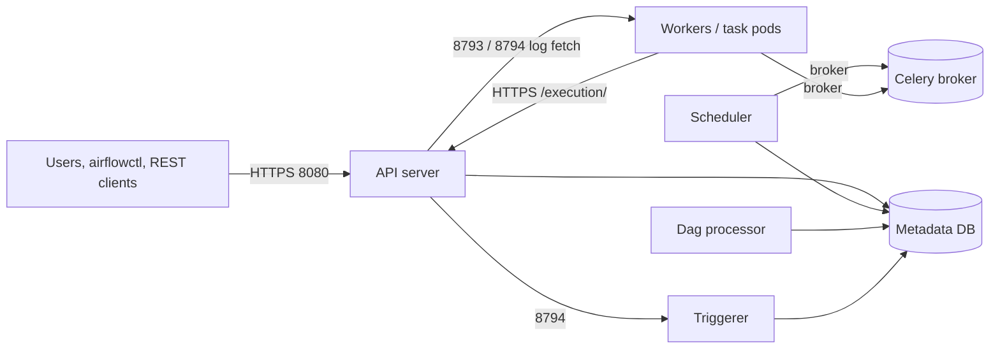

# Deployment Runbook

> [!CAUTION]
> Commands on this page can change or delete data and affect running deployments. Try them on a test or staging deployment first, and read the [disclaimer](../README.md#disclaimer). The guide is provided "as is", without warranty.

The official docs describe each Airflow component on its own page. This runbook puts them together the way an operator deploys them: which process needs which network paths and secrets, the order to bring things up, how Dag bundles are wired, how to run each component highly available, which health check to use for each one, and a go-live checklist. It assumes Airflow 3.4 on VMs or containers. For Kubernetes with the official chart, read [Kubernetes and the Helm Chart](../04_infrastructure_and_cloud/03_kubernetes_and_helm_chart.md) alongside this page.

---

## 1. The Components and What Each One Needs

In Airflow 3 every component is a separate process started with its own command. The Airflow 2 `webserver` command is gone (replaced by `airflow api-server`), and the scheduler no longer parses Dags.

| Component | Start command | Metadata DB | JWT signing key | Dag files | Listens on |
| :--- | :--- | :--- | :--- | :--- | :--- |
| API server | `airflow api-server` | Yes | Yes (validates; signs UI/REST tokens) | No (reads serialized Dags) | `[api] port` `8080` |
| Scheduler | `airflow scheduler` | Yes | Yes (signs task tokens) | No | `8974` only if `[scheduler] enable_health_check = True`; `8793` log server with LocalExecutor |
| Dag processor | `airflow dag-processor` | Yes | No | **Yes** | nothing |
| Triggerer | `airflow triggerer` | Yes | No | No (reads serialized Dags), but every trigger class must be importable, so install trigger code as a package | `[logging] trigger_log_server_port` `8794` |
| Celery worker | `airflow celery worker` (celery provider) | **No** (see warning) | No | **Yes** | `[logging] worker_log_server_port` `8793` |
| Kubernetes task pod | started by `KubernetesExecutor` | No | No | **Yes** | nothing |

Network paths you must open:



> [!WARNING]
> **Celery workers get database credentials by accident.** If `[celery] result_backend` is unset, the celery provider derives it from `[database] sql_alchemy_conn` (with a `db+` prefix), so the workers need the metadata DB URL after all. To keep workers off the metadata DB, point `result_backend` at a separate database or schema with its own credentials.

What each process needs in its environment:

| Value | API server | Scheduler | Dag processor | Triggerer | Worker |
| :--- | :--- | :--- | :--- | :--- | :--- |
| `AIRFLOW__DATABASE__SQL_ALCHEMY_CONN` | yes | yes | yes | yes | no |
| `AIRFLOW__API_AUTH__JWT_SECRET` (or private key file) | yes | yes | no | no | no |
| `AIRFLOW__CORE__FERNET_KEY` | yes | yes | yes | yes | yes |
| `AIRFLOW__API__SECRET_KEY` | yes | yes | no | yes | yes |
| `AIRFLOW__CORE__EXECUTION_API_SERVER_URL` | n/a | yes (LocalExecutor) | no | no | yes |

This table follows the sensitive-values table in `airflow-core/docs/security/security_model.rst`. See [Security Hardening](03_security_hardening.md) for the reasoning.

---

## 2. First Deployment: Order of Operations

1. **Create the database and user.** PostgreSQL is the common choice; see [Metadata Database](../04_infrastructure_and_cloud/04_metadata_database.md).
2. **Write the shared config** (environment variables or one `airflow.cfg` distributed to every host), with the keys from [Configuration §9](01_configuration_and_tuning.md#9-settings-to-review-before-go-live) set explicitly.
3. **Migrate the schema, once, from one host:**
   ```bash
   airflow db migrate
   airflow db check-migrations --migration-wait-timeout 60   # exits non-zero if not at head
   ```
   There is no `init` subcommand under `airflow db` in Airflow 3: `db migrate` both creates and upgrades the schema.
4. **Create users** with your auth manager. With the FAB provider: `airflow users create ...`. With the Keycloak provider, users live in Keycloak.
5. **Start the API server**, then the **scheduler**, **Dag processor**, **triggerer**, and finally the **workers**. Workers only need the API server; the others only need the database.
6. **Check health** (§6), then unpause one Dag and run it end to end.

```bash
airflow api-server --port 8080 --workers 2
airflow scheduler
airflow dag-processor
airflow triggerer
airflow celery worker --queues default --concurrency 16
```

In containers, run each command as the main process of its own container. The `-D` / `--daemon` flags exist but are meant for bare VMs without a process manager.

---

## 3. Dag Bundles

Airflow 3 reads Dags from **bundles** listed in `[dag_processor] dag_bundle_config_list`, a JSON list where each entry has `name`, `classpath` and `kwargs`, plus an optional `team_name`. The default is a single `LocalDagBundle` named `dags-folder` that reads `[core] dags_folder`.

**Local folder on shared storage** (the Dag processor and every worker must see the same path):

```ini
[dag_processor]
dag_bundle_config_list = [
    {
      "name": "dags-folder",
      "classpath": "airflow.dag_processing.bundles.local.LocalDagBundle",
      "kwargs": {"path": "/opt/airflow/dags"}
    }
  ]
```

**Git repository** (`GitDagBundle`, from the `apache-airflow-providers-git` provider; provider versions are independent of core):

```ini
[dag_processor]
dag_bundle_config_list = [
    {
      "name": "analytics",
      "classpath": "airflow.providers.git.bundles.git.GitDagBundle",
      "kwargs": {
        "git_conn_id": "git_analytics",
        "tracking_ref": "main",
        "subdir": "dags",
        "refresh_interval": 60
      }
    }
  ]
```

`GitDagBundle` kwargs (from `providers/git/src/airflow/providers/git/bundles/git.py`): `tracking_ref` (required: branch, tag or commit SHA), `subdir`, `git_conn_id`, `repo_url`, `submodules`, `prune_dotgit_folder`, `sparse_dirs`. Every bundle also takes `refresh_interval` (default `[dag_processor] refresh_interval`, `300`) and `view_url_template`.

Operational notes:

* `GitDagBundle` is **versioned**: each Dag run records the commit it was created with, and workers check out that commit. Versions are stored under `[dag_processor] dag_bundle_storage_path`, which defaults to a folder in the system temp directory. Put it on a persistent, sized volume.
* `LocalDagBundle` is **not** versioned. A run always uses whatever is on disk when the task starts.
* The bundle must be configured on **every** component (API server and scheduler included) even though only the Dag processor and workers read the files. The API server and scheduler don't need the git credentials.
* `airflow dag-processor --bundle-name analytics` (repeatable, `-B`) limits one processor to some bundles. That is the unit of horizontal scaling and of team separation for parsing.
* Remove the stale tracking repo only with the processor stopped; old bundle versions are pruned by `[dag_processor] stale_bundle_cleanup_*`.

> [!NOTE]
> The subdir flag of Airflow 2 CLI commands is gone; bundles replace it.

---

## 4. Running Components Highly Available

| Component | Can run several? | How they share work |
| :--- | :--- | :--- |
| API server | Yes, behind a load balancer | Stateless. Scale replicas rather than `[api] workers`. |
| Scheduler | Yes | Row-level locking (`SELECT ... FOR UPDATE`, with `SKIP LOCKED` where the backend supports it); needs `[scheduler] use_row_level_locking = True` (default) and PostgreSQL or MySQL, never SQLite. Total parallelism = `[core] parallelism` × schedulers. |
| Dag processor | Yes | Partition by `--bundle-name`, or run several on the same bundle with `[dag_processor] file_parsing_sort_mode = random_seeded_by_host`. |
| Triggerer | Yes | Each claims up to `[triggerer] capacity` triggers; keep `max_trigger_to_select_per_loop` low so they balance. |
| Workers | Yes | Celery queues or Kubernetes pods. |

Two schedulers are enough for availability in most deployments. More schedulers add throughput only until the database becomes the bottleneck; watch `scheduler.critical_section_busy` and `scheduler.critical_section_duration`.

> [!WARNING]
> In multi-team mode a triggerer started with `--team-name` only runs that team's triggers, and a Dag processor started with `--bundle-name` only parses those bundles. The `/api/v2/monitor/health` response reports `degraded` when some team or bundle has no live instance. Run at least two of each partition.

---

## 5. Upgrades and Rolling Restarts

Within 3.4.x patch releases there is usually no schema change, but always run `airflow db migrate`: it is safe when nothing needs migrating.

Order for an upgrade:

1. **Back up the database** ([Backup and DR](../07_disaster_recovery/01_backup_and_disaster_recovery.md)) and run `airflow db clean` beforehand if tables are large.
2. **Install the new version** in a new image or virtualenv. Do not change providers at the same time unless you have to.
3. **Run `airflow db migrate`** from one host using the **new** version.
4. **Restart the API servers** one at a time. The Execution API is versioned, so older workers keep talking to a newer API server; newer workers negotiate down with an older API server, but may lose features (3.4 release notes, callback token redemption).
5. **Restart the schedulers** one at a time, then the **Dag processors** and **triggerers**.
6. **Roll the workers last.** For Celery, stop a worker with a warm shutdown so running tasks finish (`airflow celery stop` or SIGTERM), then start the new one.

> [!IMPORTANT]
> Rolling *configuration* changes need care when the value must match across components. Changing `[api_auth] jwt_secret` invalidates every token in flight: running tasks start failing on their next Execution API call. Change it in a maintenance window, or switch to asymmetric keys with a JWKS URL that lists both the old and new public key.

For the 2.x → 3.x jump and minor-version notes, see [Upgrading to Airflow 3](04_upgrading_to_airflow_3.md).

---

## 6. Health Checks

| Component | Check | Source |
| :--- | :--- | :--- |
| API server (liveness/readiness) | `GET /api/v2/monitor/health` returns JSON; HTTP 200 while the API server answers | `api_fastapi/core_api/routes/public/monitor.py` |
| Execution API | `GET /execution/health` returns `{"status": "healthy"}` | `api_fastapi/execution_api/routes/health.py` |
| Scheduler | `airflow jobs check --job-type SchedulerJob --local`, or HTTP `GET :8974/health` (200 or 503) when `[scheduler] enable_health_check = True` | `utils/scheduler_health.py` |
| Dag processor | `airflow jobs check --job-type DagProcessorJob --local` | `cli/cli_config.py` |
| Triggerer | `airflow jobs check --job-type TriggererJob --local` | `cli/cli_config.py` |
| Celery worker | `celery --app airflow.providers.celery.executors.celery_executor.app inspect ping -d celery@$HOSTNAME` (what the Helm chart uses) | `chart/templates/workers/worker-deployment.yaml` |
| Any HA set | `airflow jobs check --job-type SchedulerJob --allow-multiple --limit 100` | |

The `/api/v2/monitor/health` body has `metadatabase`, `scheduler`, `triggerer` and `dag_processor` entries. Each component entry has `status` (`healthy`/`unhealthy`), a `latest_*_heartbeat`, a `detailed_status` (`healthy`/`degraded`/`down`) and the live `instances`. It is unauthenticated by design.

```bash
curl -s http://10.0.0.10:8080/api/v2/monitor/health | jq '{db: .metadatabase.status, sch: .scheduler.detailed_status, dp: .dag_processor.detailed_status, trg: .triggerer.detailed_status}'
```

> [!WARNING]
> Do not use `/api/v2/monitor/health` as the **liveness** probe of the API server and expect it to reflect the scheduler: a component marked `unhealthy` in the body still returns HTTP 200. Alert on the JSON fields; probe each component with its own check. Also note a missing triggerer shows as `unhealthy` even if you don't use deferrable operators.

---

## 7. Go-Live Checklist

- [ ] Metadata DB is PostgreSQL or MySQL, backed up, with point-in-time recovery tested.
- [ ] `airflow db check-migrations` passes from every image you deploy.
- [ ] `[core] fernet_key`, `[api_auth] jwt_secret` (or `jwt_private_key_path`) and `[api] secret_key` are set explicitly and identically where needed, from a secret store.
- [ ] `[core] auth_manager` is not `SimpleAuthManager`; admin accounts created; SSO tested.
- [ ] `[core] load_examples = False`.
- [ ] `[api] base_url` is the public URL; workers resolve `[core] execution_api_server_url`.
- [ ] TLS terminates in front of the API server (or `[api] ssl_cert`/`ssl_key` are set), and the proxy sets a request-size limit.
- [ ] Workers cannot reach the metadata DB (network policy), and `[celery] result_backend` is not the metadata DB with full credentials.
- [ ] Dag bundles configured on every component; bundle storage on a persistent volume.
- [ ] Remote logging on and tested: a finished task's log is viewable after its worker is gone.
- [ ] Metrics (`[metrics] statsd_on` or `otel_on`) flowing, with alerts on `scheduler_heartbeat`, `dag_processing.import_errors`, `executor.open_slots`, `pool.starving_tasks`.
- [ ] Two of each: API server, scheduler, triggerer; Dag processor per bundle partition.
- [ ] Health checks wired as in §6.
- [ ] `airflow db clean` scheduled ([Housekeeping](../06_operations_and_housekeeping/02_housekeeping_and_automations.md)).
- [ ] Upgrade and rollback steps rehearsed on staging ([Upgrading](04_upgrading_to_airflow_3.md)).

Next: [Security Hardening](03_security_hardening.md) and [Capacity Planning](05_capacity_planning.md).
