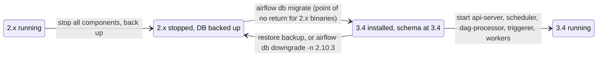

# Upgrading to Airflow 3

> [!CAUTION]
> Commands on this page can change or delete data and affect running deployments. Try them on a test or staging deployment first, and read the [disclaimer](../README.md#disclaimer). The guide is provided "as is", without warranty.

This page covers the jump from **Airflow 2.x to 3.4**, and upgrades between 3.x minor versions up to 3.4. The official guide (`airflow-core/docs/installation/upgrading_to_airflow3.rst`) and `RELEASE_NOTES.rst` are the authoritative sources; read the "Significant Changes" of **every release** between your version and the target. What this page adds: the upgrade as a runbook with a point-of-no-return, a table of the breaking changes that actually break Dags and deployments, and the rollback limits taken from the migration code (`airflow-core/src/airflow/utils/db.py`).

---

## 1. Supported Upgrade Paths

| From | To 3.4? | Notes |
| :--- | :--- | :--- |
| 2.7.x – 2.10.x | **Yes**, offline (stop everything, migrate, start 3.4) | The official guide requires 2.7 or later and recommends the latest 2.x first. Offline SQL generation (`--show-sql-only`) is supported from 2.7.0 (`_revisions_above_min_for_offline`). |
| 2.6 and older | Upgrade to 2.10.x first | The oldest migration in 3.4 is the squashed `0000_2_6_2` revision. |
| 3.0 – 3.3 | **Yes**, same procedure, usually a shorter outage | §8. |

A 2.x → 3.x upgrade is **not** rolling: Airflow 2 components cannot run against an Airflow 3 schema. Plan a full stop.

Version requirements for 3.4:

* **Python 3.11 or newer** (`requires-python = ">=3.11,!=3.15"`). 3.10 support was removed in 3.4.
* **SQLAlchemy 2** (since 3.2).
* PostgreSQL uses **psycopg 3** by default (since 3.4). A bare `postgresql://` URL is rewritten to `postgresql+psycopg://`. Install the postgres provider's `psycopg2` extra and name the driver if you need to keep psycopg2.

---

## 2. Pre-Upgrade Checklist (on 2.x)

- [ ] On the latest 2.10.x, with `apache-airflow-providers-standard` installed so Dags can already use the new operator imports.
- [ ] `airflow dags reserialize` runs with no errors, and the UI shows no import errors.
- [ ] Dags pass `ruff check --select AIR3` (§4).
- [ ] No SubDags, no SLAs (`sla`, `sla_miss_callback`), no `SequentialExecutor`, no `CeleryKubernetesExecutor` / `LocalKubernetesExecutor`.
- [ ] No task code that opens metadata DB sessions (`from airflow.settings import Session`, `@provide_session` in task code, ORM queries from tasks).
- [ ] REST API clients inventoried: `/api/v1` is gone.
- [ ] Plugins inventoried: Flask `appbuilder_views`, `appbuilder_menu_items` and `flask_blueprints` need the FAB provider, or a rewrite to `fastapi_apps` / `external_views`.
- [ ] `airflow db clean` run to trim old XCom, logs and task instances: schema changes on big tables are slow.
- [ ] **Full database backup** taken with Airflow stopped (or a consistent hot backup). This is your only reliable rollback.

---

## 3. Breaking Changes That Bite

| Area | Airflow 2 | Airflow 3 | Symptom if missed |
| :--- | :--- | :--- | :--- |
| Dag scheduling argument | `schedule_interval=`, `timetable=` | `schedule=` only | Dag import error |
| Cron default | `CronDataIntervalTimetable` | `CronTriggerTimetable` (`[scheduler] create_cron_data_intervals = False`) | `data_interval_start` and `ds` shift for cron-string Dags. Set the option **before** the first 3.x run if you depend on intervals. |
| Catchup | `catchup_by_default = True` | `False` | Missed intervals are not backfilled |
| Context variables | `execution_date`, `next_execution_date`, `prev_execution_date`, `prev_execution_date_success`, `next_ds`, `next_ds_nodash`, `prev_ds`, `prev_ds_nodash`, `yesterday_ds`, `yesterday_ds_nodash`, `tomorrow_ds`, `tomorrow_ds_nodash` | Removed; use `logical_date`, `data_interval_start` / `data_interval_end`, `prev_data_interval_start_success` / `prev_data_interval_end_success` | `KeyError` / template render failure |
| Manual runs | data interval derived from the date you entered | Do not assume it; read `logical_date` explicitly | Wrong partition processed |
| `xcom_pull()` without `task_ids` | searched all tasks in the run | only the **current** task | `None` returned |
| Imports | `airflow.models.DAG`, `airflow.decorators`, `airflow.datasets.Dataset`, `airflow.operators.bash` | `airflow.sdk` (`DAG`, `dag`, `task`, `Asset`), `airflow.providers.standard.operators.bash` | Deprecation warnings, later import errors. The `airflow.Dataset` alias was removed in 3.4. |
| DB access from tasks | allowed | blocked; use the Task SDK or the REST API | Task fails on session use |
| SubDags, SLAs, Dag pickling | supported | removed (TaskGroups; Deadline Alerts) | Import error |
| Web UI process | the `webserver` command and its config section | `airflow api-server`, `[api]` keys | Process won't start; keys ignored |
| Dag parsing | inside the scheduler | separate `airflow dag-processor`, `[dag_processor]` keys | No Dags appear |
| Auth | FAB built in | `SimpleAuthManager` default; FAB and Keycloak are providers | Old users can't log in |
| Auth URLs | `/oauth-authorized/google` | `/auth/oauth-authorized/google` | SSO redirect fails |
| REST API | `/api/v1`, basic auth | `/api/v2`, JWT from `/auth/token`; 422 for validation errors; `logical_date` replaces `execution_date` | Clients get 404 / 401 |
| CLI | `db init` subcommand, the subdir flag, user management in core | `airflow db migrate`; Dag bundles; `airflow users` comes from the FAB provider | Command not found |
| Executors | `SequentialExecutor`, hybrid executors | `LocalExecutor`; multiple executors via `[core] executor = A,B` | Startup failure |

---

## 4. Fixing Dag Code with Ruff

Ruff ships the Airflow migration rules (an external tool; check its own docs). The official guide names `AIR301` / `AIR302` (breaking changes) and `AIR311` / `AIR312` (recommended updates) and asks for ruff `0.13.1` or later:

```bash
ruff check dags/ --select AIR3                       # everything in the AIR3xx family
ruff check dags/ --select AIR301,AIR302 --show-fixes # breaking only, with proposed fixes
ruff check dags/ --select AIR301 --fix               # apply safe fixes
ruff check dags/ --select AIR301 --fix --unsafe-fixes   # also import-path-only rewrites
```

A minimal Airflow 3 Dag after migration:

```python
import pendulum

from airflow.providers.standard.operators.bash import BashOperator
from airflow.sdk import DAG, task

with DAG(
    dag_id="nightly_export",
    schedule="0 2 * * *",
    start_date=pendulum.datetime(2026, 1, 1, tz="UTC"),
    catchup=False,
):
    extract = BashOperator(task_id="extract", bash_command="echo {{ logical_date }}")

    @task
    def load(**context):
        print(context["data_interval_start"], context["data_interval_end"])

    extract >> load()
```

Custom operators that queried the metadata DB must move to the REST API (the `apache-airflow-client` package or plain HTTP against `/api/v2`) or to Task SDK APIs. See [Testing Dags](../02_dag_authoring/03_testing_dags.md) and [REST API and airflowctl](../09_reference/05_rest_api_and_airflowctl.md).

---

## 5. Configuration and Deployment Changes

```bash
airflow config lint                         # list removed / renamed / changed-default keys
airflow config update                       # dry run, breaking changes only
airflow config update --all-recommendations # dry run, everything
airflow config update --fix                 # rewrite airflow.cfg (backup written first)
```

`config update` only edits `airflow.cfg`. Move environment variables by hand. For example, the old `AIRFLOW__WEBSERVER__…` variables for `web_server_port`, `workers` and `web_server_ssl_cert` become `AIRFLOW__API__PORT`, `AIRFLOW__API__WORKERS` and `AIRFLOW__API__SSL_CERT`.

New things to configure that 2.x did not have: `[api_auth] jwt_secret`, `[core] execution_api_server_url` (or an absolute `[api] base_url`) for remote workers, `[dag_processor] dag_bundle_config_list`, and the auth manager. See [Configuration](01_configuration_and_tuning.md#9-settings-to-review-before-go-live).

If you use a custom `webserver_config.py` with FAB, replace `from airflow.www.security import AirflowSecurityManager` with `from airflow.providers.fab.auth_manager.security_manager.override import FabAirflowSecurityManagerOverride`.

---

## 6. The Upgrade Procedure



1. Pause the deployment: stop schedulers first so no new tasks are queued, let running tasks finish or accept that they will be cleared, then stop everything else.
2. Back up the database.
3. Install 3.4 (new images or virtualenvs), the providers you need (`standard`, `fab` or `keycloak`, `celery` / `cncf.kubernetes`, `git`), and the migrated config.
4. Run the migration once, from one host:
   ```bash
   airflow db migrate
   airflow db check-migrations
   ```
   To review the SQL first (PostgreSQL / MySQL, not SQLite): `airflow db migrate --show-sql-only --from-version 2.10.3 --to-version 3.4.0`.
5. Start `airflow api-server`, `airflow scheduler`, `airflow dag-processor`, `airflow triggerer`, then workers.
6. Check `/api/v2/monitor/health`, the import-errors list (`airflow dags list-import-errors`), and run one Dag end to end before unpausing the rest.

---

## 7. Rollback and `airflow db downgrade`

`airflow db downgrade` must be run with the **newer** Airflow installed (it holds the down-migrations), then you reinstall the old version.

```bash
airflow db downgrade --to-version 3.3.0 --show-sql-only   # review first
airflow db downgrade --to-version 3.3.0                   # prompts; add -y to skip
```

`--to-version` resolves through `_REVISION_HEADS_MAP`: a version with no schema change maps to the closest earlier listed one (for example `3.3.2` → `3.3.0`).

| Situation | Rollback option |
| :--- | :--- |
| Migration failed half way | Restore the backup. Re-running `airflow db migrate` may also work if the failure was transient. |
| 3.4 → 3.3 | `airflow db downgrade --to-version 3.3.0`. It can be **slow**: XCom rows written on 3.4 live in a new `xcom_v2` table and are copied back. The downgrade stops if it finds rows it cannot map; each migration commits separately, so fix the data and re-run, or `airflow db migrate` back to 3.4. On **MySQL** a failure can leave the schema partly downgraded (no transactional DDL): back up first. |
| 3.x → 2.x | `airflow db downgrade --to-version 2.10.3`. Downgrading below 3.0 runs extra FAB-table handling (`_handle_fab_downgrade`). Prefer restoring the pre-upgrade backup: work done on 3.x (runs, task state, new assets) is lost either way. |
| After downgrade | Reinstall the old version, then run `airflow dags reserialize` so serialized Dags match it. |

> [!WARNING]
> `airflow db downgrade`, `airflow db reset` and restoring a backup are irreversible for any data written since the upgrade. Always take a fresh backup before a downgrade.

---

## 8. Upgrading Within 3.x (3.2 / 3.3 → 3.4)

Same procedure as §6, but components can be restarted in order (API server, schedulers, Dag processors, triggerers, then workers) after `airflow db migrate`, as described in the [Deployment Runbook](02_deployment_runbook.md#5-upgrades-and-rolling-restarts). Notable changes to check:

| Since | Change | Action |
| :--- | :--- | :--- |
| 3.2 | SQLAlchemy 2 only; MySQL client removed from official images | Check custom images and plugins. |
| 3.2 | `[api] server_type = gunicorn` available | Optional zero-downtime worker recycling. |
| 3.2 | Multi-team deployments (experimental) | Only if you opt in with `[core] multi_team`. |
| 3.3 | Task and asset state store (`[state_store]`), asset partitioning, retry policies | New tables; nothing to do unless used. |
| 3.3 | OpenTelemetry timers become histograms | Fix dashboards built on the old gauges. |
| 3.3.1 | Fix for 2.x upgrades with a custom bundle (`Requested bundle 'dags-folder' is not configured`) | If you hit it on an older 3.x, run `airflow dags reserialize`. |
| 3.4 | Python 3.10 dropped | Rebuild images on 3.11+. |
| 3.4 | psycopg 3 default driver | Re-test PgBouncer and any `sql_alchemy_conn` that names `psycopg2`. |
| 3.4 | Asset-triggered Dags: one run per event | Set `batch_asset_events=True` on the timetable or `[scheduler] batch_asset_events = True` to keep batching. |
| 3.4 | `[workers] max_failed_heartbeats` default 3 → 30; client retries no longer apply to heartbeats | Revisit any explicit value; keep 5 s × value below `[scheduler] task_instance_heartbeat_timeout`. |
| 3.4 | Clearing a task discards its task state store entries | Pass `keep_task_state=True` to keep checkpoints. |
| 3.4 | Try number increments before the next try starts | External systems reading TI state or logs of up-for-retry tasks. |
| 3.4 | `[core] execute_tasks_new_python_interpreter = True` now affects task processes | Expect per-task interpreter start-up cost, or set `False`. |
| 3.4 | Team names lower case only | Migration refuses to run if two team names differ only by case. |
| 3.4 | The `--file-io` option of `airflow info` was removed | Use `airflow info --anonymize > airflow-info.txt`. |
| 3.4 | Audit-log rows without a Dag need `AUDIT_LOGS_ALL`; reparsing files with no Dag needs `REPARSE_ALL` | Grant the new FAB resources to custom roles. |
| 3.4 | Official images on Docker Hardened Images, Debian 13 | Re-test image extensions. See [Docker Images](../04_infrastructure_and_cloud/02_docker_images.md). |

Then continue with [Configuration](01_configuration_and_tuning.md) for the new defaults, and [Troubleshooting](../06_operations_and_housekeeping/05_troubleshooting_playbook.md) if something does not come up.
