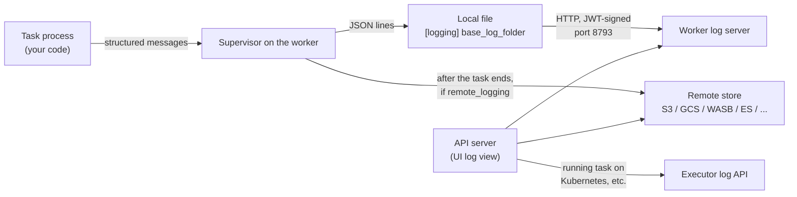

# Logging: Where Logs Go in Airflow 3 and How to Keep Them

> [!CAUTION]
> Commands on this page can change or delete data and affect running deployments. Try them on a test or staging deployment first, and read the [disclaimer](../README.md#disclaimer). The guide is provided "as is", without warranty.

Airflow 3 changed who writes and who reads task logs. A task's log is written by the Task SDK **supervisor on the worker**, uploaded by that supervisor if remote logging is on, and read back by the **API server** when someone opens it in the UI. Most "log not found" tickets come from one of those three hops missing a piece of configuration. This page traces the path through the 3.4 source (`task-sdk/src/airflow/sdk/log.py`, `task-sdk/src/airflow/sdk/execution_time/supervisor.py`, `airflow-core/src/airflow/utils/log/file_task_handler.py`, `airflow-core/src/airflow/config_templates/airflow_local_settings.py`), then covers remote logging, structured logs, log levels, custom logging config and secret masking, and ends with the exact "log not found" messages and their fixes.

---

## 1. The Path of a Task Log



1. **Writing.** The supervisor creates `[logging] base_log_folder`/`<log_filename_template>`, by default
   `dag_id=<dag_id>/run_id=<run_id>/task_id=<task_id>/[map_index=<n>/]attempt=<try>.log`. In 3.4 the file content is always **JSON lines** (`json_logs = True` is hard-coded in `supervisor._configure_logging`), whatever `[logging] json_logs` says. `tail -f` shows JSON; the UI renders it.
2. **Uploading.** When the task process exits, the supervisor calls `upload_to_remote()`. It fetches the connection named by `[logging] remote_log_conn_id` through the Execution API, so **workers do not need the connection in their environment**, but they do need the provider package installed.
3. **Serving.** While a task runs, or when there is no remote copy, the API server asks the worker's log server. It listens on `[logging] worker_log_server_port` (8793). Triggerers serve deferred-task logs on `[logging] trigger_log_server_port` (8794). Requests are JWTs signed with `[api] secret_key`, audience `task-instance-logs`.
4. **Reading.** The API server's `FileTaskHandler` reads, in order: remote logs; executor logs for a running task (for example pod logs from the Kubernetes executor); the local file if the API server can see the same volume; the worker log server for running or deferred tasks, or as a fallback when nothing else was found. Each source is listed in the collapsible "Log message source details" group at the top of the log view.

> [!IMPORTANT]
> Every component that reads or serves logs must share `[api] secret_key`, and their clocks must agree. A mismatch gives HTTP 403 from the log server and the `!!!! Please make sure that all your Airflow components ...` message in the UI (see [§7](#7-troubleshooting-log-not-found)).

---

## 2. Remote Logging

Turn it on with three keys, on **every** component (workers to write, triggerers to write deferral logs, API server to read):

```ini
[logging]
remote_logging = True
remote_base_log_folder = s3://my-airflow-logs/prod
remote_log_conn_id = aws_logs
delete_local_logs = True
```

The handler is chosen by the prefix of `remote_base_log_folder` (`airflow_local_settings.py`):

| Prefix | Provider package | Notes |
| :--- | :--- | :--- |
| `s3://` | `apache-airflow-providers-amazon` | `[logging] encrypt_s3_logs` for SSE |
| `cloudwatch://<log group arn>` | amazon | Log group ARN after the scheme |
| `gs://` | `apache-airflow-providers-google` | `[logging] google_key_path` optional |
| `wasb...` | `apache-airflow-providers-microsoft-azure` | Container from the Azure provider's `remote_wasb_log_container` option (`AIRFLOW__AZURE_REMOTE_LOGGING__REMOTE_WASB_LOG_CONTAINER`, default `airflow-logs`) |
| `stackdriver://` | google | Log name is the path |
| `oss://` | `apache-airflow-providers-alibaba` | |
| `hdfs://` | `apache-airflow-providers-apache-hdfs` | |
| *(none: set a host instead)* | `apache-airflow-providers-elasticsearch` or `-opensearch` | Selected when the provider's `host` option is set (`AIRFLOW__ELASTICSEARCH__HOST` or `AIRFLOW__OPENSEARCH__HOST`) |

If `remote_logging` is `True` and nothing matches, every component fails at startup with `Incorrect remote log configuration. Please check the configuration of option 'host' in section 'elasticsearch' if you are using Elasticsearch. In the other case, 'remote_base_log_folder' option in the 'logging' section.`

Notes:
* If `remote_log_conn_id` is empty, the handler's hook default connection (for example `aws_default`) is used.
* `[logging] remote_task_handler_kwargs` (JSON) passes extra arguments to the remote handler; keys that `FileTaskHandler` accepts go to the file handler instead.
* `[logging] delete_local_logs` (default `False`) removes the local copy after upload for GCS, S3, WASB, HDFS and OSS. Turn it on when remote logging works, so worker disks stop filling up.
* Logs are uploaded **after** the attempt ends. A worker killed with `SIGKILL` (OOM, node loss) never uploads; the log then only exists on that worker's disk, if at all.
* Provider versions are released independently of Airflow core; check the provider's changelog when a handler misbehaves.

The Elasticsearch and OpenSearch handlers can either write to the index themselves (the providers' `write_to_es` / `write_to_os` options) or print to stdout for a log shipper to index (`write_stdout`); in the shipper setup, also enable the providers' `json_format` so fields can be parsed. Check the option names in your provider version's configuration reference.

---

## 3. Component Logs and Structured Logging

Scheduler, API server, Dag processor and triggerer log to stdout through **structlog**. The relevant keys:

| Key | Default | Effect |
| :--- | :--- | :--- |
| `[logging] json_logs` | `False` | One JSON object per line for all process output, including API server access logs. Turn on for log aggregators |
| `[logging] colored_console_log` | `True` | ANSI colors on a TTY |
| `[logging] log_format` | empty | Format for non-JSON output |
| `[logging] callsite_parameters` | `filename,lineno` | Extra call-site fields per message; set empty to save a little CPU |
| `[logging] log_timestamp_format` | `iso` | Timestamp format |
| `[logging] dag_processor_log_target` | `file` | Dag processor parsing output to files (or `stdout`) |
| `[logging] dag_processor_child_process_log_directory` | `{AIRFLOW_HOME}/logs/dag_processor` | Where per-file parse logs go |
| `[logging] task_logs_to_stdout` | `False` | Also forward task output to the worker's stdout. Only consulted by the Celery worker and the Edge3 worker; LocalExecutor and the Kubernetes/ECS/Batch/Lambda per-task entrypoints always forward |

On Kubernetes, set `AIRFLOW__LOGGING__JSON_LOGS=True` on every pod and let the node's collector ship stdout. Keep remote task logging as well: stdout shipping alone does not make logs visible in the UI.

---

## 4. Log Levels

| Key | Default | Scope |
| :--- | :--- | :--- |
| `[logging] logging_level` | `INFO` | Root level for every process, and the `airflow.task` logger |
| `[logging] namespace_levels` | unset | Per-logger overrides: `sqlalchemy.engine=INFO botocore=WARNING` (space or comma separated) |
| `[logging] celery_logging_level` | empty (uses `logging_level`) | Celery worker |
| `[logging] uvicorn_logging_level` | `INFO` | API server's HTTP server |
| `[logging] fab_logging_level` | `WARNING` | FAB auth manager |

Set levels **per component** with the environment variable on that component only, for example `AIRFLOW__LOGGING__LOGGING_LEVEL=DEBUG` on one scheduler pod while you debug it. A global `DEBUG` on workers multiplies log volume by every task.

```bash
# Debug SQL from the scheduler only, without touching anything else
AIRFLOW__LOGGING__NAMESPACE_LEVELS="sqlalchemy.engine=INFO" airflow scheduler
```

---

## 5. Custom Logging Configuration

`[logging] logging_config_class` takes the import path of a `logging.config.dictConfig` dictionary (the `_class` suffix is historical). Start from the default and change only what you need:

```python
# $AIRFLOW_HOME/config/log_config.py  (must be importable on every component)
from copy import deepcopy

from airflow.config_templates.airflow_local_settings import (  # noqa: F401
    DEFAULT_LOGGING_CONFIG,
    DEFAULT_REMOTE_CONN_ID,
    REMOTE_TASK_LOG,
)

LOGGING_CONFIG = deepcopy(DEFAULT_LOGGING_CONFIG)
LOGGING_CONFIG["loggers"]["my_company.http"] = {"handlers": ["console"], "level": "WARNING", "propagate": False}
```

```ini
[logging]
logging_config_class = log_config.LOGGING_CONFIG
```

> [!WARNING]
> Remote task-log read-back is wired through two **module-level** names, `REMOTE_TASK_LOG` and `DEFAULT_REMOTE_CONN_ID`, read from whichever module `logging_config_class` points at (comment in `airflow_local_settings.py`). If your module does not define them (for example you built the dict from scratch), uploads and the UI's remote read silently stop. Re-export them as above.

The worker log server also reads `handlers.task.base_log_folder` from a custom config to decide which directory it serves; keep that key if you change the folder.

To add a logger without a custom module, use `[logging] extra_logger_names` (comma-separated); they get the console handler at `logging_level`.

---

## 6. Secret Masking

Values are masked as `***` in task logs, component logs and rendered fields when Airflow knows they are secret:

* Connection passwords and the values of sensitive connection extras.
* Variables whose **name** contains a sensitive word. The built-in list (`DEFAULT_SENSITIVE_FIELDS` in `shared/secrets_masker`) includes `password`, `passwd`, `secret`, `token`, `api_key`, `apikey`, `access_token`, `private_key`, `authorization`, `passphrase`, `keyfile_dict`, `webhook_url` and a few more. Add your own with `[core] sensitive_var_conn_names`.
* Anything you register yourself:

```python
from airflow.sdk import task
from airflow.sdk.log import mask_secret


@task
def call_partner_api():
    token = fetch_token_somehow()  # your code
    mask_secret(token)  # masked in this task's log and in the supervisor's output
    ...
```

Limits to know:
* Secrets shorter than `[logging] min_length_masked_secret` (5) are never masked, to avoid masking common short strings.
* Masking is string replacement on output. A secret that is transformed (base64, URL-encoded, split across lines) before it is printed is not recognized.
* `[core] hide_sensitive_var_conn_fields` (`True`) controls masking of sensitive fields in the UI and API; leave it on.

---

## 7. Troubleshooting "Log Not Found"

Open the "Log message source details" group at the top of the log first: it lists every source the API server tried and why it failed.

| Message in the UI (verbatim from 3.4) | Cause | Fix |
| :--- | :--- | :--- |
| `Log file not found on worker '<hostname>'. This attempt may have run on a different worker whose logs are no longer accessible. Consider configuring remote logging (S3, GCS, etc.) for log persistence.` | The worker's log server answered 404: the pod was replaced, the file was groomed, or the task ran elsewhere | Enable remote logging ([§2](#2-remote-logging)); align log groomer retention with how long you need logs |
| ``Could not read served logs: Hostname not available for worker. Please check your `hostname_callable` configuration.`` (or `for trigger.`) | The task instance has no recorded hostname, often because it never started | Check `[core] hostname_callable`; if the task never started, see [Troubleshooting §2](05_troubleshooting_playbook.md#2-tasks-stuck-in-queued) |
| `Could not read served logs: <connection error>` | API server cannot reach `<worker hostname>:8793`: wrong hostname resolution, network policy, or the log server is not running | The hostname must resolve from the API server; open port 8793 (8794 for triggerers); do not pass `--skip-serve-logs` to components that run tasks |
| `!!!! Please make sure that all your Airflow components (e.g. schedulers, api-servers, dag-processors, workers and triggerer) have the same 'secret_key' configured in '[api]' section and time is synchronized on all your machines (for example with ntpd)` | 403 from the log server: different `[api] secret_key`, or clock skew | Set the same `AIRFLOW__API__SECRET_KEY` everywhere; run NTP. The worker log says `The signature of the request has expired. Make sure that all components in your system have synchronized clocks.` on skew |
| `Task was skipped, no logs available.` | The task was skipped or upstream-failed before it ran | Not an error |
| `Operator inherits from empty operator and thus does not have logs` | `EmptyOperator` tasks never run on a worker | Not an error |

If the remote store has the file but the UI shows nothing, check from the API server container that the provider is installed (`airflow providers list`), the connection works (`airflow connections test <conn_id>` with `[core] test_connection` enabled), and that the API server has the same `remote_base_log_folder` as the workers.

`[api] log_fetch_timeout_sec` (5) bounds each request to a worker log server. Raise it if large logs time out on a slow network.

---

**See also:** log retention and groomer settings in [Housekeeping §4](02_housekeeping_and_automations.md#4-task-log-retention), and log-related symptoms in the [Troubleshooting playbook](05_troubleshooting_playbook.md#11-log-not-found-in-the-ui).
