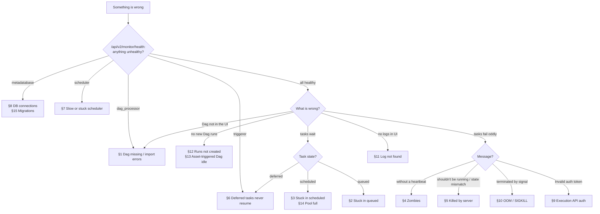

# Troubleshooting Playbook: Symptom → Diagnosis → Fix

> [!CAUTION]
> Commands on this page can change or delete data and affect running deployments. Try them on a test or staging deployment first, and read the [disclaimer](../README.md#disclaimer). The guide is provided "as is", without warranty.

**Official docs:** [Troubleshooting](https://airflow.apache.org/docs/apache-airflow/3.4.0/troubleshooting.html) · [FAQ](https://airflow.apache.org/docs/apache-airflow/3.4.0/faq.html)

The official troubleshooting page explains a handful of failure modes. This page is organized by **what you see**. Each entry quotes the **exact text** Airflow 3.4 logs or shows (taken from the `v3-4-stable` source, with the file named), the commands or metrics that confirm the cause, and the fix. `%s` and `<...>` mark values Airflow fills in.

> [!TIP]
> **First five minutes, on any incident:**
> ```bash
> curl -s http://10.0.0.10:8080/api/v2/monitor/health | jq .         # DB, scheduler, triggerer, Dag processor
> airflow jobs check --job-type SchedulerJob --allow-multiple --limit 100
> airflow dags list-import-errors
> airflow db check
> kubectl logs deploy/airflow-scheduler --since=15m | grep -E "ERROR|CRITICAL|WARNING" | tail -50
> ```
> Then look at three metrics: `scheduler.scheduler_loop_duration`, `executor.open_slots`, `scheduler.tasks.starving`. See [Monitoring](03_monitoring_and_observability.md).

Then go to the section for what you see:



Commands below use the `airflow` CLI, which needs metadata-DB access: run them in a scheduler or Dag processor container (see [CLI guide §1](01_cli_operations_guide.md#1-where-to-run-the-cli-database-dag-files-or-the-api)).

---

## 1. Dag Missing, Import Errors, Parse Timeouts

**Logs / UI:**
* Import error banner in the UI; `airflow dags list-import-errors` lists the file and traceback.
* Parse too slow (`task-sdk/.../importers/python_importer.py`):
  `DagBag import timeout for <file> after 30.0s.` followed by links to the best-practice docs.
* Whole file processor killed (`dag_processing/manager.py`, ERROR):
  `Processor for <file> with PID <pid> has been running for <n> seconds, exceeding the timeout of <m> seconds. Killing it!`
* Dag removed (`manager.py`, INFO): `Deactivating stale DAG <dag_id>. Not parsed for <n> seconds (last parsed: <ts>).`

**Confirm**
```bash
airflow dags list-import-errors -o json
airflow dags report -o table                 # in the Dag processor container: parse time per file
airflow dags list -B <bundle_name> | grep <dag_id>
```
Metrics: `dag_processing.import_errors`, `dag_processing.processor_timeouts`, `dag_processing.total_parse_time`.

**Fix**
| Cause | Fix |
| :--- | :--- |
| Exception at import | Fix the code; reproduce with `airflow dags list-import-errors --local` in the Dag processor container |
| Missing package on the Dag processor | Install it in the Dag processor image, not only on workers |
| Heavy top-level code (DB calls, API calls, big imports) | Move it into tasks; see [Anti-patterns](../01_architecture_and_mental_model/02_anti_patterns.md) |
| Timeouts | Raise `[core] dagbag_import_timeout` (30 s) and `[dag_processor] dag_file_processor_timeout` (50 s) together, after fixing the code |
| File skipped silently | With `[core] dag_discovery_safe_mode` (`True`), a file is only parsed if it contains `airflow` and either `dag` or `asset` (case-insensitive; `shared/module_loading/.../dag_file.py`) |
| New file not picked up yet | Bundles are rescanned every `[dag_processor] refresh_interval` (300 s); wait or restart the Dag processor |
| Dag appears but is paused | `[core] dags_are_paused_at_creation` is `True`; `airflow dags unpause <dag_id>` |

---

## 2. Tasks Stuck in Queued

**Logs (scheduler, `jobs/scheduler_job_runner.py`):**
* `Task stuck in queued; will try to requeue. task_instance=<ti>` and an audit-log event `stuck in queued reschedule`: `Task was in queued state for longer than 600.0 seconds; task state will be set back to scheduled.`
* After repeated attempts (2 by default, an intentionally undocumented setting): `Task requeue attempts exceeded max; marking failed. task_instance=<ti>` and the audit event `stuck in queued tries exceeded`: `Task was requeued more than 2 times and will be failed.`

**Meaning:** the executor accepted the task but no worker started it within `[scheduler] task_queued_timeout` (600 s).

**Confirm:** `executor.queued_tasks` high while `executor.running_tasks` is flat; `task.queued_duration` p95; the worker side (Celery worker logs and broker queue length, pending pods for the Kubernetes executor: `kubectl get pods --field-selector=status.phase=Pending`).

**Fix**
| Cause | Fix |
| :--- | :--- |
| No workers listening on the task's `queue` | Start workers for that queue or fix `queue=` on the task (default `[operators] default_queue` = `default`) |
| Pods cannot be scheduled (quota, node selector, image pull) | `kubectl describe pod`; fix resources or the image |
| Worker cannot reach the API server | Workers need `[core] execution_api_server_url` (default `{BASE_URL}/execution/`) to resolve; check `/execution/health` from a worker |
| Timeout too short for a slow autoscaler | Raise `[scheduler] task_queued_timeout`; it also sets the lifetime of the token the queued task carries |

---

## 3. Tasks Stuck in Scheduled

**Logs (scheduler, INFO):**
* `Not executing <ti> since the number of tasks running or queued from DAG <dag_id> is >= to the DAG's max_active_tasks limit of <n>`
* `Not executing <ti> since the task concurrency for this task has been reached.`
* `Not scheduling <task_id> since its executor <executor> does not currently have any more available slots` (DEBUG level)

**Confirm**
```bash
airflow tasks failed-deps <dag_id> <task_id> <run_id>      # the scheduler's view of why it is held back
```
Metrics: `scheduler.tasks.starving`, `executor.open_slots` at 0, `pool.starving_tasks`.

**Fix:** raise the limit that is binding: the Dag's `max_active_tasks` (default `[core] max_active_tasks_per_dag` = 16), the task's `max_active_tis_per_dag`, or `[core] parallelism` (32) for the executor. If pools are the limit, see §14. Check `[scheduler] max_tis_per_query` (16) only if the scheduler is otherwise idle. See [Concurrency, pools and priority](../03_task_execution/03_concurrency_pools_and_priority.md).

---

## 4. Task Failed Without a Heartbeat (Zombies)

**Logs (scheduler, ERROR):**
`Detected a task instance without a heartbeat: <ti> (See https://airflow.apache.org/docs/apache-airflow/stable/core-concepts/tasks.html#task-instance-heartbeat-timeout)`
preceded by `Failing <n> TIs without heartbeat after <ts>`. The audit log gets a `heartbeat timeout` event: `Task did not emit heartbeat within time limit (300 seconds) and will be terminated.`

**Meaning:** the worker-side supervisor stopped heartbeating to the Execution API for `[scheduler] task_instance_heartbeat_timeout` (300 s). The task is failed or retried; the worker may not even know.

**Confirm:** metric `task_instances_without_heartbeats_killed`; worker pod restarts or OOM kills (`kubectl get pods`, `kubectl describe pod` → `OOMKilled`); node events; API server availability around that time.

**Fix**
| Cause | Fix |
| :--- | :--- |
| Whole worker or pod killed (OOM of the supervisor, node eviction, spot reclaim) | Raise memory limits; see §10 |
| Worker could not reach the API server for a long time | Fix networking/load balancer; the worker log shows `Failed to send heartbeat. Will be retried` then `Too many failed heartbeats; terminating process` after `[workers] max_failed_heartbeats` (30) failures |
| API server overloaded or restarting | Scale API server replicas; heartbeats are not retried |
| Long GC or CPU starvation on the worker | More CPU, fewer tasks per worker |

Do not "fix" zombies by raising `task_instance_heartbeat_timeout` to hours: you only delay detecting dead workers.

---

## 5. Task Killed: Server Indicated the Task Shouldn't Be Running Anymore

**Logs (worker supervisor, `supervisor.py`, ERROR):**
`Server indicated the task shouldn't be running anymore`, then in the task log `Server indicated the task shouldn't be running anymore. Terminating process` and `Task killed!`.
The Execution API answered the heartbeat with 404, 409 or 410. The 409 details (`execution_api/routes/task_instances.py`):
* `{"reason": "not_running", "message": "TI is no longer in the running state and task should terminate"}`
* `{"reason": "running_elsewhere", "message": "TI is already running elsewhere"}`

At start-up, a task that is not `queued` gets `{"reason": "invalid_state", "message": "TI was not in a state where it could be marked as running", ...}`.

Scheduler variant (audit event `state mismatch`): `Executor <executor> reported that the task instance <ti> finished with state <state>, but the task instance's state attribute is <state>.`

**Meaning:** something else changed the task's state while it ran: a user cleared or marked it, a heartbeat timeout (§4) failed it, or a second copy started.

**Confirm:** the task's audit log (UI Browse > Audit Log, filter by Dag and task) shows who cleared or marked it, or a `heartbeat timeout` event; metric `scheduler.tasks.killed_externally`.

**Fix:** if a person cleared it, nothing is broken. If it follows a heartbeat timeout, fix §4. `running_elsewhere` with no user action points to duplicate delivery by the executor or broker; check Celery visibility timeouts and that only one executor owns the queue.

---

## 6. Deferred Tasks Never Resume

**Symptoms:** tasks sit in `deferred`; or they fail with the reason `Trigger timeout` when the deferral's timeout passes.

**Logs (triggerer):**
* `Trigger failed to load code` (provider not installed on the triggerer)
* `Triggerer's async thread was blocked for <n> seconds, exceeding the configured warning threshold of 0.20 seconds. This is likely caused by a badly-written trigger. Set PYTHONASYNCIODEBUG=1 to get more information on overrunning coroutines.` (logged at **INFO**, so alerting on WARNING misses it)
* `Trigger exited without sending an event. Dependent tasks will be failed.`
* `TriggerRunner subprocess event loop appears deadlocked: no communication received for <n>s (threshold: <m>s). Skipping heartbeat so the triggerer appears unhealthy ...`

**Confirm**
```bash
airflow jobs check --job-type TriggererJob --allow-multiple --limit 10
```
Metrics: `triggerer_heartbeat`, `triggerer.capacity_left`, `triggers.running`, `triggers.blocked_main_thread`, `triggers.failed`.

**Fix:** run at least one triggerer (two for HA); install the same providers on triggerers as on workers; raise `[triggerer] capacity` (1000) or add triggerers when `capacity_left` is near 0; fix blocking calls in custom triggers. With `[triggerer] queues_enabled`, a triggerer only picks up its `--queues`. See [Deferrable operators](../03_task_execution/02_deferrable_operators_and_triggers.md).

---

## 7. Scheduler Slow or Stuck

**Symptoms:** runs start late, tasks wait in `scheduled` with free slots, `scheduler.scheduler_loop_duration` climbs.

**Confirm**
* Metrics: `scheduler.scheduler_loop_duration`, `scheduler.critical_section_duration`, `scheduler.critical_section_busy`, `dagrun.schedule_delay`, `scheduler.loop_exceptions` (tagged by exception class).
* `pkill -f -USR2 "airflow scheduler"` dumps the executor's tracked task state to the scheduler log.
* Database: long-running queries and lock waits (`pg_stat_activity`, `wait_event_type = 'Lock'`).

**Fix, in order:**
1. Check the database first: CPU, IOPS, bloat, missing `VACUUM`. A slow DB is the usual cause. Run [`db clean`](02_housekeeping_and_automations.md#2-airflow-db-clean-what-it-actually-does) if tables are huge.
2. Check the scheduler's own CPU and memory. In Airflow 3 the scheduler never parses Dag files (the Dag processor does), so a busy scheduler is spending its time in DB queries and executor calls; profile those before adding resources.
3. Tune `[scheduler] max_dagruns_per_loop_to_schedule` (20), `max_dagruns_to_create_per_loop` (10) and `max_tis_per_query` (16) gradually, watching loop duration.
4. Add a second scheduler for HA and throughput; `scheduler.critical_section_busy` rising afterwards means they contend on the same lock.
5. `[scheduler] enable_tracemalloc` (`False`) can help find memory growth; it costs CPU.

---

## 8. Database Connection Exhaustion

**Logs:** these come from SQLAlchemy and the database, not Airflow:
* `QueuePool limit of size 5 overflow 10 reached, connection timed out, timeout 30.00` (SQLAlchemy; numbers come from your pool settings)
* `FATAL:  sorry, too many clients already` or `remaining connection slots are reserved ...` (PostgreSQL)
* `job_heartbeat_failure` metric increments; health shows `metadatabase: unhealthy`.

**Arithmetic:** each process with a DB pool can hold up to `[database] sql_alchemy_pool_size` (5) + `sql_alchemy_max_overflow` (10) = 15 connections. Multiply by API server workers (`[api] workers`) × replicas, schedulers, Dag processors and triggerers. Workers should hold none.

**Fix:** put PgBouncer in front (the chart's `pgbouncer.enabled`), lower the pool size on components that do not need it, raise `max_connections` on the database only as a last step. Keep `[database] sql_alchemy_pool_pre_ping` (`True`) on to drop stale connections after failovers. See [Metadata database](../04_infrastructure_and_cloud/04_metadata_database.md).

---

## 9. Execution API Auth Failures (JWT)

**Logs:**
* API server (`execution_api/security.py`, WARNING): `Failed to validate JWT`, then the worker gets HTTP 403 with detail `Invalid auth token`.
* No token: 401 `Missing auth token`.
* Wrong token type: `Invalid token scope: <scope>`; mismatched task: `Token subject does not match task instance ID`.

**Causes and fixes**
| Cause | Fix |
| :--- | :--- |
| Scheduler and API server sign/verify with different keys | Set the same `[api_auth] jwt_secret` (`AIRFLOW__API_AUTH__JWT_SECRET`) on every scheduler and API server, or configure `[api_auth] jwt_private_key_path` / `trusted_jwks_url` consistently. When Airflow has to create `airflow.cfg`, it writes a random `jwt_secret` into it (`configuration.py`), so containers that each generate their own config get different secrets |
| Clock skew between hosts | Run NTP everywhere. `[api_auth] jwt_leeway` (10 s) only tolerates small drift |
| Task waited in a queue longer than its token's life | Workload tokens live for `[scheduler] task_queued_timeout`; running tasks get refreshed tokens from the API server before `[execution_api] jwt_expiration_time` (600 s) ends |
| Audience mismatch after customizing | `[execution_api] jwt_audience` must be the same on all components (default `urn:airflow.apache.org:task`) |

---

## 10. Process Terminated by Signal / OOM

**Logs (task log, from the supervisor):**
* `Process terminated by signal. Likely out of memory error (OOM). For more information, see https://airflow.apache.org/docs/apache-airflow/stable/troubleshooting.html#process-terminated-by-signal.` at CRITICAL, with `signal=-9` and `signal_name=SIGKILL`.
* Other signals give the same sentence without the OOM part, at ERROR.
* A non-signal non-zero exit: `Process exited abnormally` with `exit_code`.

**Meaning:** the task process (not the supervisor) was killed. If the whole pod or container was OOM-killed, the supervisor dies too and you see §4 instead.

**Confirm:** `dmesg | grep -i oom` on the node, `kubectl describe pod` → `OOMKilled`, container memory metrics at the limit.

**Fix:** give the task more memory (pod override or a bigger worker class), reduce how many tasks run per worker (the Celery provider's worker concurrency option, for Celery), stream data instead of loading it whole, and push big results to object storage instead of XCom.

---

## 11. Log Not Found in the UI

**Text:** `Log file not found on worker '<hostname>'. This attempt may have run on a different worker whose logs are no longer accessible. Consider configuring remote logging (S3, GCS, etc.) for log persistence.` Other variants: `Could not read served logs: ...` and the `!!!! Please make sure that all your Airflow components ...` message about `[api] secret_key` and clocks.

**Fix:** configure remote logging, make worker hostnames resolvable from the API server on port 8793, and share `[api] secret_key`. The full table is in [Logging §7](04_logging.md#7-troubleshooting-log-not-found).

---

## 12. Dag Runs Not Created

**Logs (scheduler):**
* `Dag run cannot be created; max active runs exceeded.` (WARNING, with `dag_id`, `max_active_runs`, `active_runs`)
* `dag cannot be started due to dag max_active_runs constraint; active_runs=<n> max_active_runs=<m> dag_id=<id> run_id=<run>` (queued runs held back)
* `Pausing DAG <dag_id> because last <n> DAG runs failed.` (auto-pause)

**Confirm**
```bash
airflow dags details <dag_id> -o yaml | grep -E "is_paused|max_active_runs|next_dagrun|has_import_errors"
airflow dags next-execution <dag_id> -n 3
airflow dags list-runs <dag_id> --state running --limit 20
```

**Checklist**
| Check | Notes |
| :--- | :--- |
| Paused? | New Dags start paused (`[core] dags_are_paused_at_creation`) |
| Auto-paused? | `[core] max_consecutive_failed_dag_runs_per_dag` (0 = off) or the Dag's own setting |
| `max_active_runs` reached? | Old runs stuck in `running` block new ones; finish or fail them |
| Expecting catch-up runs? | `catchup` defaults to `False` in Airflow 3 (`[scheduler] catchup_by_default`); only the latest interval runs. Use `airflow backfill create` for history |
| `start_date` in the future, or `end_date` passed? | No runs are due |
| `schedule=None`? | Only manual or API triggers |
| Import error on the file? | A file that fails to import is not re-serialized, so changes you expect (a new schedule) never reach the scheduler; check §1 |

---

## 13. Asset-Triggered Dag Not Running

**Logs (scheduler, DEBUG level, so raise `namespace_levels` for `airflow.jobs.scheduler_job_runner` to see them):**
`Creating asset-triggered DagRun for '<dag_id>': <n> queued assets, triggered_date=<ts>` or `Skipping asset-triggered DagRun creation for Dag '<dag_id>'; no queued assets remain.`

**Confirm**
```bash
airflow assets list -o table
airflow assets details --name <asset_name> -o yaml
```
Metrics: `asset.updates`, `asset.triggered_dagruns`. In the UI, the asset page shows events and consuming Dags.

**Fix**
| Cause | Fix |
| :--- | :--- |
| Producer task did not declare the asset in `outlets`, or failed | An event is only emitted when the producing task succeeds |
| Name/URI mismatch between producer and consumer | Assets match on name and URI exactly; compare in `airflow assets list` |
| Consumer waits for several assets (`&` condition) | All must have new events since the last run |
| Consumer paused | Unpause it (what happens to events received while paused is *not verified against source*; check the asset page after unpausing) |
| Event created through the API or another Deployment | Check the asset page's event list for the timestamp |

---

## 14. Pool Full

**Logs (scheduler):**
* `Not scheduling since there are 0 open slots in pool <pool>` (INFO)
* `Not executing <ti> since it requires <n> slots but there are <m> open slots in the pool <pool>.` (INFO)
* `Not executing <ti>. Requested pool slots (<n>) are greater than total pool slots: '<m>' for pool: <pool>.` (WARNING: this task can **never** run)
* `Tasks using non-existent pool '<pool>' will not be scheduled` (WARNING)

**Confirm**
```bash
airflow pools list
airflow pools get <pool>
```
Metrics: `pool.open_slots`, `pool.starving_tasks`, `pool.running_slots`, `pool.deferred_slots`.

**Fix:** `airflow pools set <pool> <slots> "<description>"`; create missing pools (`default_pool` size comes from `[core] default_pool_task_slot_count`, 128, at DB init); lower `pool_slots` on tasks that ask for more than the pool holds; decide whether deferred tasks should occupy slots (`--include-deferred`).

---

## 15. Migration Failed or Not Applied

**Logs:**
* Components refuse to start, or `airflow db check-migrations` times out with:
  `There are still unapplied migrations after 60 seconds. MigrationHead(s) in DB: {...} | Migration Head(s) in Source Code: {...}` (`utils/db.py`; the missing space after "Migration" is in the source)
* Interactive CLI: ``Database migration required. Please run `airflow db migrate`. Make sure the command is run using Airflow version <version>.``

**Fix**
1. Run `airflow db migrate` **once**, with the new version's image, before starting the new components (the chart's migrate job does this). Do not run it from several pods at once.
2. If it failed halfway, read the error, fix the cause (permissions, disk, a lock held by a running scheduler), and rerun. Migrations are designed to be re-run from the current revision.
3. "Heads in DB" newer than "in source code" means you started an **older** image against an upgraded DB. Roll forward, or downgrade the schema with `airflow db downgrade -n <version>` using the newer version *before* rolling back binaries, from a backup-protected state.
4. Restore from backup if the schema is inconsistent. See [Upgrading to Airflow 3](../05_deployment_and_config/04_upgrading_to_airflow_3.md) and [Backup and disaster recovery](../07_disaster_recovery/01_backup_and_disaster_recovery.md).

---

**See also:** commands in the [CLI operations guide](01_cli_operations_guide.md), metrics and health endpoints in [Monitoring](03_monitoring_and_observability.md), and log plumbing in [Logging](04_logging.md).
