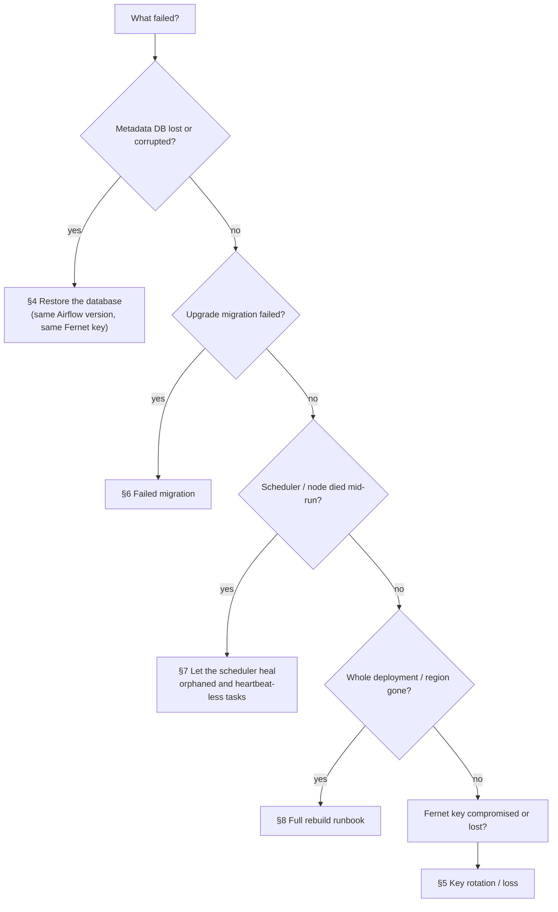

# Backup, Restore and Disaster Recovery Runbook

> [!CAUTION]
> Commands on this page can change or delete data and affect running deployments. Try them on a test or staging deployment first, and read the [disclaimer](../README.md#disclaimer). The guide is provided "as is", without warranty.

The official docs have no single disaster-recovery chapter; the pieces are spread across the database setup, Fernet key and upgrade pages. This runbook puts them together for Airflow 3.4: an inventory of every piece of state and where it lives, how to back each one up, why the Fernet key matters more than the database dump, how schema versions constrain a restore, how to recover from a failed migration, and how a 3.4 scheduler heals task instances that were running when a scheduler or the whole deployment died. Rehearse every procedure on a non-production deployment before you need it.

---

## 0. Two Rules That Apply to Every Restore

> [!IMPORTANT]
> **1. A database backup is useless without the Fernet key it was written with.** Connection passwords and extras, Variables marked as encrypted, and trigger arguments are encrypted with `[core] fernet_key`. Restore the database with a different key and every one of them fails to decrypt. Back the key up separately from the database, and test that you can read a restored connection.
>
> **2. The restored schema must match the Airflow code that starts against it.** Components exit with "Database migration required" when the Alembic revision in the database differs from the code, in either direction. Restore with the **same Airflow version** that wrote the backup, then upgrade with `airflow db migrate` if needed.



---

## 1. Inventory: What State Airflow Has

| State | Where it lives | Lost means | Back up how |
| :--- | :--- | :--- | :--- |
| **Metadata database** | Postgres or MySQL | Run history, task states, serialized Dags and versions, connections/variables/pools stored in the DB, FAB users and roles, audit log | Database-native backups (§3) |
| **Fernet key** | `[core] fernet_key` (env var, secret, Helm `fernetKeySecretName`) | Encrypted connection fields, encrypted Variables, trigger kwargs unreadable | Secret manager / offline copy, versioned (§2) |
| **API secret key** | `[api] secret_key` | Sessions invalidated; must be identical on all API servers | Secret manager |
| **JWT signing material** | `[api_auth] jwt_secret`, or `[api_auth] jwt_private_key_path` (+ `jwt_kid`) | Running tasks cannot authenticate to the Execution API until all components share the new key | Secret manager |
| **Dag code** | Git (Dag bundles, git-sync), a volume, or the image | Nothing to schedule | Git is the backup; for volumes, snapshot them |
| **Python environment** | Container image or virtualenv | Can't reproduce the running code | Keep images in a registry by digest; keep `pip freeze` / constraints files |
| **Configuration** | `airflow.cfg`, `AIRFLOW__*` env vars, Helm `values.yaml`, `airflow_local_settings.py`, `webserver_config.py` (FAB) | Deployment behaves differently after rebuild | In Git with the deployment code |
| **Secrets backend contents** | Vault, AWS SM, GCP SM, etc. | Connections and variables defined there | The secret manager's own replication/backup |
| **Task logs** | Remote store (S3, GCS, Azure Blob, Elasticsearch, OpenSearch) or local disks/PVCs | Log history only; Airflow keeps running | Object-store versioning/replication |
| **Celery broker** (Redis, RabbitMQ) | Broker | Messages for queued tasks | Usually not backed up; the scheduler re-queues stuck tasks (§7) |
| **Simple auth manager passwords** | `AIRFLOW_HOME/simple_auth_manager_passwords.json.generated` (default) | Logins, if you use `SimpleAuthManager` | File backup, or define users in config |

`airflow info` prints the paths, DB URL (masked), executor and providers of a running deployment; save its output alongside each backup.

---

## 2. Protect the Keys First

1. Store the Fernet key, API secret key and JWT secret (or private key) in a secret manager with versioning, **and** in an offline break-glass location (for example an encrypted vault export held by a second team).
2. Record which Fernet key(s) were active at each backup time. With key rotation (§5) a dump from last month may need the old key.
3. Never let components generate their own keys. If no `airflow.cfg` exists, Airflow writes a **random** `fernet_key` and `jwt_secret` into a new one on first start (`configuration.py`), and the Helm chart generates the API secret and JWT secret again on every `helm upgrade` unless you pass existing Secrets. Both turn into data loss or outages during a rebuild. See [Kubernetes and the Helm chart](../04_infrastructure_and_cloud/03_kubernetes_and_helm_chart.md#6-secrets-and-auth).

---

## 3. Backing Up the Metadata Database

Use the database's own tools; Airflow has no backup command. A single logical dump is transaction-consistent on its own, so you don't need to stop Airflow for it.

**Postgres:**

```bash
# Consistent logical backup in custom format (parallel restore possible)
pg_dump --format=custom --no-owner --file="airflow-$(date -u +%Y%m%dT%H%M%SZ).dump" \
  "host=10.0.12.5 port=5432 dbname=airflow user=airflow_backup sslmode=require"

# Record the schema revision and Airflow version with the backup
psql "host=10.0.12.5 dbname=airflow user=airflow_backup" -Atc "SELECT version_num FROM alembic_version;"
airflow version
```

Connect to the database directly, **not through PgBouncer** in transaction mode.

**MySQL:**

```bash
mysqldump --single-transaction --routines --triggers --set-gtid-purged=OFF \
  -h 10.0.12.6 -u airflow_backup -p airflow > "airflow-$(date -u +%Y%m%dT%H%M%SZ).sql"
```

**Point-in-time recovery.** For an RPO below your dump interval, use WAL archiving (Postgres) or binlogs (MySQL), or the managed service's PITR and snapshots. Restoring to a point in time is the same as restoring a dump as far as Airflow is concerned (§4).

**Shrink first.** Dumps and restores scale with `task_instance`, `xcom_v2`, `log` and `job`. Regular `airflow db clean` keeps them small; see [Metadata database §7](../04_infrastructure_and_cloud/04_metadata_database.md#7-table-growth-hot-spots-34-table-names).

**Logical exports as a second line.** These are portable across versions and useful for partial recovery, but they are not a substitute for a database backup:

```bash
airflow connections export /backup/connections.json --file-format json   # contains secrets in clear text
airflow variables export /backup/variables.json
airflow pools export /backup/pools.json
```

> [!WARNING]
> `airflow connections export` writes decrypted passwords. Encrypt the file at rest and restrict who can run it.

---

## 4. Restoring the Metadata Database

Restore into a new, empty database (or a new deployment), never on top of a live one.

1. **Stop every Airflow component** that points at the target database: schedulers, API servers, Dag processors, triggerers, workers. Scale them to 0 in Kubernetes.
2. **Restore the dump:**
   ```bash
   createdb -h 10.0.12.7 -U postgres airflow
   pg_restore --no-owner --role=airflow --jobs=4 -h 10.0.12.7 -U postgres -d airflow airflow-20261120T020000Z.dump
   ```
3. **Check the schema revision** and find the matching Airflow version in `airflow-core/docs/migrations-ref.rst` (3.4.0's head is `b4f1a7d2c903`):
   ```bash
   psql -h 10.0.12.7 -U postgres -d airflow -Atc "SELECT version_num FROM alembic_version;"
   ```
   If you use the FAB auth manager, the FAB provider keeps its own revision in `alembic_version_fab`.
4. **Configure the same Fernet key** (and the API secret key and JWT secret) the backup was written with.
5. **Start one component with the same Airflow version** as the backup, and verify:
   ```bash
   airflow db check-migrations -t 1
   airflow connections get <conn_id> -o json        # decrypts? then the Fernet key is right
   airflow dags list-import-errors
   ```
6. **If the backup is from an older Airflow version**, run `airflow db migrate` with the new version now, then start everything.
7. **Start the scheduler last**, after the Dag processor has re-parsed the Dags, and watch §7 happen.

> [!WARNING]
> **A restore rewinds Airflow's view of the world, not the world.** Dag runs and task tries recorded after the backup are gone. Tasks that ran after the backup and wrote to external systems will look "not yet run" and may run again. Pause affected Dags (`airflow dags pause <dag_id>`) before starting the scheduler if a re-run would be harmful, and reconcile manually.

---

## 5. Fernet Key Rotation and Loss

`[core] fernet_key` accepts a **comma-separated list**. Airflow builds a `MultiFernet` (`airflow/models/crypto.py`): it encrypts with the **first** key and decrypts with any key in the list. An empty value disables encryption ("values will not be stored encrypted").

**Rotation procedure:**

1. Generate a new key: `openssl rand -base64 32 | tr '+/' '-_'`.
2. Set `[core] fernet_key` (`AIRFLOW__CORE__FERNET_KEY`) to `<new_key>,<old_key>` on **every** component and restart them all.
3. Re-encrypt stored values with the new key:
   ```bash
   airflow rotate-fernet-key
   ```
   It re-encrypts encrypted connections, encrypted Variables, all `trigger` rows and connection test requests, in one transaction, in batches of 100 (`rotate_fernet_key_command.py`).
4. Take a database backup now; it is the first one that needs only the new key.
5. Set `[core] fernet_key` to `<new_key>` only and restart everything.

> [!WARNING]
> Keep the old key until step 5 is done everywhere **and** you no longer need backups taken before step 4. Removing it first makes those backups undecryptable.

**Key lost, database intact.** The encrypted values cannot be recovered. Start with a new key, then re-enter every encrypted connection and Variable (from your secret manager, an `airflow connections export` taken earlier, or the owners of the systems). Deferred tasks whose trigger rows are encrypted with the lost key fail; clear and re-run them.

---

## 6. Recovering from a Failed Migration

Prevention, before every upgrade: back up (§3), run `airflow db clean` on the old version, run `airflow db migrate --show-sql-only` and read it, and time the migration against a restored copy. 3.4.0 alone has 26 migrations, including one that copies all of `task_instance_history` into `task_instance` (see [Metadata database §6](../04_infrastructure_and_cloud/04_metadata_database.md#6-schema-migrations)).

**Confirm**
```bash
airflow db check-migrations -t 1        # prints the DB head(s) and the code head(s)
```
```sql
SELECT version_num FROM alembic_version;
```

**Fix**

| Backend and situation | What to do |
| :--- | :--- |
| Postgres, migration failed with an error you can fix (timeout, lock wait, disk full, bad data) | Each migration runs in its own transaction, so the DB sits at the last completed revision. Fix the cause and re-run `airflow db migrate` with the **new** version |
| Postgres, you want to go back | Restore the pre-upgrade backup and start the **old** version. Prefer this over `airflow db downgrade` |
| MySQL, any failure | DDL is not transactional; the failing step may be half-applied. Restore the pre-upgrade backup |
| Migration Job keeps failing in Kubernetes while pods wait in `wait-for-airflow-migrations` | Read the Job log before its TTL deletes it; run the migration manually from a one-off pod with the new image |
| The entrypoint's `_AIRFLOW_DB_MIGRATE` was used | It runs `airflow db migrate \|\| true` and hides failures. Check `airflow db check-migrations` explicitly ([Docker images §5](../04_infrastructure_and_cloud/02_docker_images.md#5-what-the-entrypoint-does)) |

`airflow db downgrade -n <version>` exists, but is a last resort: some 3.4 downgrades refuse to run when they would merge or lose rows, and newer data has nowhere to go in the old schema. Test it on a copy first.

---

## 7. A Scheduler (or Node) Died Mid-Run

Airflow 3.4 heals most of this by itself. The mechanisms, from `airflow-core/src/airflow/jobs/scheduler_job_runner.py`:

| Mechanism | Trigger | Effect | Settings |
| :--- | :--- | :--- | :--- |
| Orphan adoption | Runs at scheduler start and every `[scheduler] orphaned_tasks_check_interval` (default `300.0` s) | Marks `SchedulerJob` rows whose heartbeat is older than `[scheduler] scheduler_health_check_threshold` (default `30` s) as failed. Task instances in `queued`, `running` or `restarting` that were queued by a non-running scheduler (in running Dag runs) are offered to the executor: **adopted** if the executor can track them, otherwise **reset** to no state so they are scheduled again | Metrics `scheduler.orphaned_tasks.adopted`, `scheduler.orphaned_tasks.cleared` |
| Task heartbeat timeout | Every `[scheduler] task_instance_heartbeat_timeout_detection_interval` (default `10.0` s) | `running`/`restarting` task instances owned by this scheduler with `last_heartbeat_at` older than `[scheduler] task_instance_heartbeat_timeout` (default `300` s) are failed (and retried if they have retries left) | Metric `scheduler.zombies.detected` |
| Stuck in queued | Every `[scheduler] task_queued_timeout_check_interval` (default `120.0` s) | Task instances queued longer than `[scheduler] task_queued_timeout` (default `600.0` s) are revoked and set back to scheduled, up to 2 times, then failed | |

Which executor can adopt:

| Executor | Tasks while the scheduler is down | After a new scheduler starts |
| :--- | :--- | :--- |
| `LocalExecutor` | Run as child processes of the scheduler; **they die with it** | Cannot adopt (base implementation), so they are reset and re-run |
| `CeleryExecutor` (provider) | Keep running on workers | Adopted using the Celery task IDs, if the broker/result backend survived |
| `KubernetesExecutor` (provider) | Pods keep running | Adopted from the pods |

**Runbook**

1. Start a scheduler (or confirm another HA scheduler is alive): `airflow jobs check --job-type SchedulerJob --allow-multiple --limit 5`.
2. Wait up to `orphaned_tasks_check_interval` plus `task_instance_heartbeat_timeout` (about 10 minutes with defaults) before intervening by hand.
3. Check the scheduler log for "Adopting or resetting orphaned tasks" and "Reset the following ... orphaned TaskInstances".
4. Only if tasks are still stuck after that: clear them (`airflow tasks clear <dag_id> -t <task_regex> -s <start_date> -e <end_date>`) or mark them in the UI. See [Troubleshooting playbook](../06_operations_and_housekeeping/05_troubleshooting_playbook.md).

> [!NOTE]
> Task heartbeats in Airflow 3 are sent by the task supervisor to the API server's Execution API, not written to the database by the worker. If the **API server** is down, running tasks cannot heartbeat. Bring the API server back within `task_instance_heartbeat_timeout`, or expect those tasks to be failed and retried.

---

## 8. Full Rebuild Runbook (Region or Cluster Lost)

| Step | Action | Check |
| :--- | :--- | :--- |
| 1 | Provision the database and restore the latest backup or PITR target (§4 steps 1–3) | `alembic_version` matches the version you will deploy |
| 2 | Restore keys into the new secret store: Fernet, API secret, JWT | Same values as the backup |
| 3 | Deploy the **same image digest** (or `pip install` from the saved constraints) | `airflow version`, `airflow providers list` |
| 4 | Deploy config (Helm values / env) with schedulers scaled to 0 and `migrateDatabaseJob` enabled | Migration Job succeeds (no-op if versions match) |
| 5 | Restore Dag delivery (Git access, bundle connection, volume) | `airflow dags list-import-errors` is empty |
| 6 | Point remote logging at the replicated log bucket | Old task logs open in the UI |
| 7 | Pause Dags whose re-runs would be harmful | `airflow dags list` |
| 8 | Start API server, Dag processor, triggerer, workers, then schedulers | §7 healing completes |
| 9 | Reconcile runs between backup time and the outage | Owners confirm external state |

**RPO and RTO (illustrative).**

| Approach | RPO | RTO drivers |
| :--- | :--- | :--- |
| Nightly `pg_dump` | Up to 24 h of run history | Restore time grows with `task_instance`, `xcom_v2`, `log` sizes |
| Managed snapshots + PITR | Minutes | Snapshot restore time, DNS/secret cutover |
| Streaming replica in another region | Seconds | Promotion plus redeploy; keys and images must already be there |

The Dag code and keys usually decide your real RTO: a database restored in 20 minutes does not help if nobody can find the Fernet key or rebuild the image.

---

## 9. Recovery Drill Checklist

- [ ] Restore last night's backup into a scratch database, with the recorded Airflow version.
- [ ] `airflow db check-migrations -t 1` passes.
- [ ] One encrypted connection decrypts with the backed-up Fernet key.
- [ ] The image digest and constraints for that version are still pullable.
- [ ] Remote logs from before the backup open in the UI.
- [ ] Time each step and compare it with your RTO.

---

## See Also

* [Metadata database](../04_infrastructure_and_cloud/04_metadata_database.md)
* [Housekeeping and automations](../06_operations_and_housekeeping/02_housekeeping_and_automations.md)
* [Security hardening](../05_deployment_and_config/03_security_hardening.md)
* [Upgrading to Airflow 3](../05_deployment_and_config/04_upgrading_to_airflow_3.md)
* [CLI reference: `airflow db`](../09_reference/02_cli_reference.md#airflow-db) and [`airflow rotate-fernet-key`](../09_reference/02_cli_reference.md#airflow-rotate-fernet-key)
