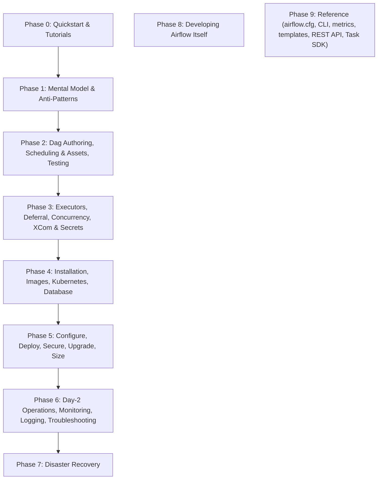

# Field Guide for Apache Airflow® 3.4

> **Independent documentation.** This is a community guide to [Apache Airflow®](https://airflow.apache.org/). It is not affiliated with, endorsed by, or sponsored by [The Apache Software Foundation](https://www.apache.org/). For the official documentation, see [airflow.apache.org/docs](https://airflow.apache.org/docs/apache-airflow/stable/).

> [!CAUTION]
> **Use at your own risk.** Many commands in this guide change or delete data, restart components or change running deployments. Run them on a test or staging deployment before production. The guide is provided "as is", without warranty of any kind. Read the [disclaimer](#disclaimer).

Runbooks and guidance for the parts of Airflow 3.4 that teams find hardest in practice: the Airflow 3 architecture, scheduling and assets, concurrency, deployment, security, upgrading from Airflow 2, housekeeping, troubleshooting and recovery. The pages follow the order in which a team meets Airflow, from a first local Dag to disaster recovery. **New to Airflow? Start with the [Quickstart](00_getting_started/01_quickstart.md).**

**How this guide is checked:**
* **Names and defaults** (every `[section] key`, environment variable, `airflow` CLI command and flag used on the pages) are checked by [`tools/check_docs.py`](tools/README.md#check_docspy) against the Airflow source on the `v3-4-stable` branch, plus the providers' `provider.yaml` files. The three generated reference pages are built from that source.
* **Behavior** claims cite the source file that implements them. Claims the writers could not tie to source are labeled *(not verified against source)*.
* **Not yet:** behavior has **not** been run on a live deployment. A validation environment like the one in the Cassandra field guide this guide is modeled on is the first item on the [roadmap](ROADMAP.md#2-content-gaps-in-priority-order).

> [!NOTE]
> **About AI assistance.** The pages were drafted with AI tools working from the Airflow 3.4 source code, then checked as described above. If you find something wrong, please open an issue; see [CONTRIBUTING.md](CONTRIBUTING.md).

> **Version scope**: These guides target Apache Airflow **3.4.x**. Names and defaults were verified against the `v3-4-stable` branch at 3.4.0 (commit `d589193b35`, Task SDK 1.4.0). Supported Python versions are **3.11 to 3.14**. Provider packages are released separately from core; provider details were read from the providers on `main` in November 2026.
>
> Airflow 3 is a different system from Airflow 2: workers and the Dag processor reach the metadata database only through the Execution API, the scheduler never runs user code, Dags are authored with `airflow.sdk`, the web server is now `airflow api-server`, and `execution_date`, SubDags and SLAs are gone. Advice written for 2.x is the most common source of wrong answers. The [upgrade page](05_deployment_and_config/04_upgrading_to_airflow_3.md) lists the changes.
>
> The Helm chart in the 3.4 tree is chart **2.0.0** with `appVersion` 3.3.2, so set the image tag yourself ([Kubernetes and the Helm chart](04_infrastructure_and_cloud/03_kubernetes_and_helm_chart.md)). Out of the box Airflow uses SQLite and the Simple auth manager, and it generates its Fernet key and JWT secret per installation. Read [Security Hardening](05_deployment_and_config/03_security_hardening.md) before go-live.

These pages complement, and do not replace, the official reStructuredText docs in [`airflow-core/docs`](https://github.com/apache/airflow/tree/v3-4-stable/airflow-core/docs) (published at airflow.apache.org). They are opinionated runbooks and guidance. The official docs remain the concept and API reference. See [how this guide relates to the official docs](08_developing_airflow/01_building_and_testing_from_source.md).

---

## The Engineering Lifecycle

---

## Table of Contents

### Phase 0: Getting Started
> **Audience**: Anyone new to Airflow. **Goal**: A running Airflow and a first Dag in about 15 minutes, then two hands-on tutorials: one for Dag authors, one for operators.

* **[01_quickstart.md](00_getting_started/01_quickstart.md)**: install Airflow 3.4 with pip and the constraints file (Python 3.11–3.14), start it with `airflow standalone` (what it overrides: LocalExecutor, SimpleAuthManager, a 5 s bundle refresh; where the generated admin password lives) or the official Docker Compose file, write a first `@dag`/`@task` Dag from `airflow.sdk`, see why a new file takes up to 300 s (`refresh_interval`) and an edit up to 30 s (`min_file_process_interval`) to appear, unpause, trigger, find the logs, and test with `airflow dags test`.
* **[02_tutorial_dag_authoring.md](00_getting_started/02_tutorial_dag_authoring.md)**: *tutorial for Dag authors.* Build a producer/consumer pipeline step by step: fixed `start_date`, the 3.x `@daily` logical-date shift, validated `Param`s, small XCom return values, retries against `default_task_retries=0`, idempotent retries, `.expand()` with the `max_map_length` 1024 limit, an Asset published with `outlets` and consumed with `schedule=[asset]` and `triggering_asset_events`, then test it with `dag.test()` and `airflow dags test -c`.
* **[03_tutorial_operations.md](00_getting_started/03_tutorial_operations.md)**: *tutorial for operators.* An operations drill on a local deployment: `airflow jobs check --local`, `/api/v2/monitor/health` (`/health` is gone), `dags list-import-errors`, what pause does to triggered and backfill runs, `dags trigger -r/-l/-c`, watching a task retry and fail, recovery with `tasks clear` (no date bounds clears every run) or mark-success through the REST API, `backfill create --dry-run`, and `db clean --dry-run` with its archive tables.

### Phase 1: Architecture & Mental Model
> **Audience**: Software engineers, architects, anyone coming from Airflow 2. **Goal**: Know which component does what, and what each one may not do.

* **[01_mental_model.md](01_architecture_and_mental_model/01_mental_model.md)**: what each Airflow 3.4 component may and may not do (the scheduler never runs user code; workers reach the metadata DB only through the Execution API with JWTs), where callbacks run, serialized Dags and when a new Dag version is created, Dag bundles, the Dag-run and task-instance state machines from `state.py` (including deferred, awaiting_input and draining), logical date vs data interval vs `run_after` (logical date can be None), and an Airflow 2 → 3 table.
* **[02_anti_patterns.md](01_architecture_and_mental_model/02_anti_patterns.md)**: 13 traps with why, how to spot and the fix: heavy top-level code (`dagbag_import_timeout` 30 s, `dag_file_processor_timeout` 50 s), parse-time `Variable.get`, runtime-varying values and `dag_version_inflation_check_level`, renaming ids, large XComs, poke-mode sensors (7-day default timeout), `max_map_length` enforced by the API server, catchup and per-event asset backlogs, non-idempotent tasks, blocked DB access, giant Dags, `depends_on_past` chains, and asset lists meaning AND.

### Phase 2: Dag Authoring, Scheduling & Testing
> **Audience**: Data engineers and Dag authors.

* **[01_dag_design_patterns.md](02_dag_authoring/01_dag_design_patterns.md)**: TaskFlow vs classic operators, idempotent tasks keyed on the data interval or `run_after`, retries with the 3.4 multiplier-style `retry_exponential_backoff` and the new `retry_policy`, `execution_timeout` (no default) vs sensor timeout vs `dagrun_timeout`, all 13 trigger rules, branching, task groups, setup/teardown, dynamic task mapping (`partial`/`expand`/`expand_kwargs`/`map_index_template`), `Param` and run conf, callbacks, notifiers and `DeadlineAlert`, and ETL and ML pipeline skeletons.
* **[02_scheduling_timetables_and_assets.md](02_dag_authoring/02_scheduling_timetables_and_assets.md)**: how each `schedule` value becomes a timetable (cron → `CronTriggerTimetable` unless `create_cron_data_intervals`; a list of assets is AND), catchup (off by default), `airflow backfill create` and its rules, assets (outlets, `Metadata`, `inlet_events`, `AssetAlias`, conditions), 3.4's per-event asset runs (`batch_asset_events` False), partitioned Dags and the `airflow partitions clear` trap, asset watchers, and a "why didn't my Dag run" checklist.
* **[03_testing_dags.md](02_dag_authoring/03_testing_dags.md)**: the testing pyramid: a 3.4-correct `DagBag` integrity test, unit-testing `@task` functions and operators, mocking with `AIRFLOW_VAR_*`/`AIRFLOW_CONN_*`, `dag.test()` and its metadata-DB and bundle requirements, `airflow dags test` (fails the exit code) vs `airflow tasks test` (needs a serialized Dag, never fails the exit code), ruff `AIR` rules, and a CI script.

### Phase 3: Task Execution
> **Audience**: Dag authors and platform engineers.

* **[01_executors.md](03_task_execution/01_executors.md)**: how LocalExecutor, CeleryExecutor, KubernetesExecutor and EdgeExecutor run a workload through the task supervisor and the Execution API; setting `[core] execution_api_server_url` on remote workers; key `[celery]`, `[kubernetes_executor]` and `[edge]` settings; several executors at once (`[core] executor` list, aliases, per-task `executor=`; CeleryKubernetesExecutor raises on Airflow 3); stuck-in-queued handling via `[scheduler] task_queued_timeout`; and a comparison table.
* **[02_deferrable_operators_and_triggers.md](03_task_execution/02_deferrable_operators_and_triggers.md)**: the defer-and-resume lifecycle (`self.defer(trigger=, method_name=, kwargs=, timeout=)`), a restart-safe trigger template (`airflow.triggers.base`, not `airflow.sdk`), `[operators] default_deferrable` and `start_from_trigger`, defer `timeout` vs `execution_timeout`, how deferred tasks count against pools and limits, triggerer sizing and HA (`capacity`, `queues_enabled`, `--queues`), and the exact blocked-event-loop log messages.
* **[03_concurrency_pools_and_priority.md](03_task_execution/03_concurrency_pools_and_priority.md)**: every concurrency knob in the order the scheduler checks it (`[core] parallelism` 32, `[scheduler] max_tis_per_query` 16, pools and `pool_slots`, per-run `max_active_tasks` 16, `max_active_tis_per_dag`/`_per_dagrun`, executor slots), each with the scheduler's verbatim log line; which limits count deferred tasks; pools that never run a task; `priority_weight`/`weight_rule`; and a "why is my task not running" decision flow.
* **[04_xcom_variables_and_connections.md](03_task_execution/04_xcom_variables_and_connections.md)**: how tasks reach Variables, Connections and XComs through the Execution API; the worker and server secrets lookup chains (`[workers] secrets_backend` vs `[secrets] backend`); XCom size limits and custom backends (`[core] xcom_backend`, the object-storage backend whose default threshold of -1 keeps everything in the database); `AIRFLOW_CONN_` URI and JSON forms; `BACKEND_KWARG__` overrides; masking; and `[secrets] use_cache`, which caches only in the Dag processor.

### Phase 4: Infrastructure & Cloud
> **Audience**: Platform engineers, SREs, DevOps.

* **[01_installation_and_python.md](04_infrastructure_and_cloud/01_installation_and_python.md)**: the 3.4 distribution split (`apache-airflow`, `apache-airflow-core` 3.4.0, `apache-airflow-task-sdk` 1.4.0, providers), Python 3.11–3.14, why every `pip install` needs the constraints file, extras, adding providers with core pinned in the same command, uv, the psycopg 3 default driver, OS packages, and first-run traps (auto-generated `fernet_key`/`jwt_secret`, SQLite and Simple auth manager defaults, `airflow db migrate` instead of the removed `init`).
* **[02_docker_images.md](04_infrastructure_and_cloud/02_docker_images.md)**: regular vs slim `apache/airflow` tags, the 3.4 move to Debian 13 hardened base images and what it breaks, extending vs customizing, adding packages with constraints, UID 50000 with GID 0, what the entrypoint does (`_AIRFLOW_DB_MIGRATE` swallows migration failures, `_PIP_ADDITIONAL_REQUIREMENTS`, `_AIRFLOW_WWW_USER_CREATE` only with FAB), setting secrets explicitly, and pinning by digest.
* **[03_kubernetes_and_helm_chart.md](04_infrastructure_and_cloud/03_kubernetes_and_helm_chart.md)**: chart 2.0.0 breaking changes (no `webserver.*`, no hybrid executors, `workers.celery.*`/`workers.kubernetes.*`), the components it deploys, executor choice, `pod_template_file`/`pod_override` vs `KubernetesPodOperator`, Dag delivery (bundles, git-sync, PVC, baked image), external Postgres and PgBouncer sizing, pre-creating the Fernet, API and JWT secrets (otherwise regenerated on every `helm upgrade`), KEDA, logs, and a minimal production `values.yaml`.
* **[04_metadata_database.md](04_infrastructure_and_cloud/04_metadata_database.md)**: supported backends (Postgres 14–18, MySQL 8.0/8.4, SQLite for dev only, no MariaDB), which components connect in Airflow 3, `[database] sql_alchemy_conn` and psycopg 3 scheme rewriting, pool settings and connection math, PgBouncer, `airflow db migrate`/`check`/`check-migrations`/`downgrade`, the 26 3.4.0 migrations and how a failure leaves the DB, and the 3.4 table hot spots (`task_instance` now holds past tries, `xcom_v1`/`xcom_v2`, `rtif_*`, `log`, `job`, `dag_version`).

### Phase 5: Configure, Deploy, Secure, Upgrade & Size
> **Audience**: Platform engineers, SREs.

* **[01_configuration_and_tuning.md](05_deployment_and_config/01_configuration_and_tuning.md)**: how a config value resolves (env var, `_CMD`/`_SECRET` for sensitive keys only, `airflow.cfg`, defaults), `airflow config get-value/list/lint/update` and their traps (values hidden without `--show-values`; `get-value` prints nothing on a typo), auto-generated keys that differ per process, production keys with 3.4 defaults per component, and a go-live settings table.
* **[02_deployment_runbook.md](05_deployment_and_config/02_deployment_runbook.md)**: run `airflow api-server`, `scheduler`, `dag-processor`, `triggerer` and workers as separate processes with the right DB access, JWT key, ports and secrets; first-time order with `airflow db migrate`; `dag_bundle_config_list` with LocalDagBundle and GitDagBundle; HA for every component; upgrade restart order; per-component health checks; and a go-live checklist.
* **[03_security_hardening.md](05_deployment_and_config/03_security_hardening.md)**: the security model sorted into guarantees, known limitations and hardening; the three keys you must set and Fernet rotation; Simple (dev-only), FAB and Keycloak auth managers and `/auth/token`; REST tokens vs Execution API tokens (algorithms, `trusted_jwks_url`, task tokens that can't be revoked); secrets masking; where Dag-author code runs and the limits of multi-team; TLS, proxy headers, and a network-policy table.
* **[04_upgrading_to_airflow_3.md](05_deployment_and_config/04_upgrading_to_airflow_3.md)**: upgrade from 2.7+ to 3.4 as an offline cutover (Python 3.11+, psycopg 3), the breaking changes (`schedule`, CronTriggerTimetable default, `catchup` False, removed context variables, `airflow.sdk` imports, api-server and dag-processor, auth managers, `/api/v2`), `ruff check --select AIR3`, `airflow config update --fix`, `airflow db migrate`, rollback limits of `airflow db downgrade`, and notable 3.2/3.3 → 3.4 changes.
* **[05_capacity_planning.md](05_deployment_and_config/05_capacity_planning.md)**: illustrative sizing for the concurrency funnel (`[core] parallelism` 32 per scheduler, `default_pool` 128, Celery `worker_concurrency` 16), scheduler throughput settings, Dag processor parse-cycle math, DB connections per process and PgBouncer, Kubernetes pod creation, triggerer capacity, API server load from heartbeats, a worked example, and the metrics to watch.

### Phase 6: Day-2 Operations
> **Audience**: Operations engineers, on-call SREs.

* **[01_cli_operations_guide.md](06_operations_and_housekeeping/01_cli_operations_guide.md)**: the day-2 `airflow` CLI by task: which commands hit the metadata DB and which moved to `airflowctl`; `jobs check` and its exit codes; inspecting Dags (`list-import-errors`, `report`, `list-runs`, `next-execution`, `tasks failed-deps`); `dags trigger/pause`, `tasks clear` filters, `dags clear` for partitioned Dags; `backfill create`; pools, variables and connections import/export (plaintext secrets); `config list --show-values`; and `db` commands and their risks.
* **[02_housekeeping_and_automations.md](06_operations_and_housekeeping/02_housekeeping_and_automations.md)**: metadata DB growth and `airflow db clean` (every table and its recency column, keep-last rules, `--batch-size`, `--skip-archive`, archive tables, `export-archived`/`drop-archived`, exit 0 on failure without `--error-on-cleanup-failure`), running it from the chart's `databaseCleanup` CronJob or cron instead of a Dag, log retention, `airflow state-store clean`, stale Dags, Dag version inflation, Fernet rotation, and alerts for missed chores.
* **[03_monitoring_and_observability.md](06_operations_and_housekeeping/03_monitoring_and_observability.md)**: metrics backend precedence (DogStatsD > StatsD > OpenTelemetry), legacy names vs tags, allow/block lists, deprecated `otel_*` keys replaced by `OTEL_*` env vars, about 25 metrics with alert thresholds, health endpoints and what they really report, OpenTelemetry traces, `DeadlineAlert` replacing SLAs, listener hooks, and the UI views for operations.
* **[04_logging.md](06_operations_and_housekeeping/04_logging.md)**: the Airflow 3 task-log path (the worker supervisor writes JSON lines and uploads; the API server reads remote, executor, local or log-server logs with `[api] secret_key` JWTs), remote logging by `remote_base_log_folder` prefix and provider, `delete_local_logs`, structlog and `json_logs`, per-component levels, `logging_config_class` (must re-export `REMOTE_TASK_LOG`), secret masking, and the exact "log not found" messages and fixes.
* **[05_troubleshooting_playbook.md](06_operations_and_housekeeping/05_troubleshooting_playbook.md)**: a first-five-minutes checklist, a symptom flowchart and 15 symptoms with the exact 3.4 log text, how to confirm and how to fix: import errors and parse timeouts, stuck in queued or scheduled, heartbeat timeouts, "Server indicated the task shouldn't be running anymore", triggers that never resume, slow scheduler, DB pool exhaustion, Execution API JWT failures, SIGKILL/OOM, log not found, runs not created, idle asset-triggered Dags, full pools, and unapplied migrations.

### Phase 7: Disaster Recovery
> **Audience**: On-call engineers, SREs.

* **[01_backup_and_disaster_recovery.md](07_disaster_recovery/01_backup_and_disaster_recovery.md)**: an inventory of Airflow state (metadata DB, Fernet key, `[api] secret_key`, JWT secret, Dag code, image, config, logs, broker), consistent `pg_dump`/`mysqldump` backups with the `alembic_version` recorded, restoring with the same Airflow version and Fernet key, key rotation with a comma-separated `[core] fernet_key` and `airflow rotate-fernet-key`, recovering from a failed migration, how the scheduler heals orphaned tasks, and a full-rebuild runbook with RPO/RTO notes and a drill checklist.

### Phase 8: Developing Apache Airflow from Source
> **Audience**: Contributors, engineers patching Airflow or a provider.

* **[01_building_and_testing_from_source.md](08_developing_airflow/01_building_and_testing_from_source.md)**: the uv workspace layout (airflow-core, task-sdk, providers, symlinked shared libraries, chart, airflow-ctl), one-time setup (uv sync, prek, the per-worktree breeze shim), when to use `uv run --project` and when Breeze, test commands and `breeze verify`, `breeze start-airflow`, prek hooks, `breeze build-docs`, the main / v3-4-test / v3-4-stable branches, and how this guide relates to `airflow-core/docs`.

### Phase 9: Reference
> **Audience**: Everyone. Look things up here; read the phases above to learn.

* **[01_airflow_cfg_reference.md](09_reference/01_airflow_cfg_reference.md)**: *generated* from `config.yml`. Every core `[section] key` with its default, type, environment variable, version added, sensitivity, deprecation, and the table of keys renamed since 2.x.
* **[02_cli_reference.md](09_reference/02_cli_reference.md)**: *generated* from `cli_config.py`. Every core `airflow` command, subcommand, argument, choice and default.
* **[03_metrics_reference.md](09_reference/03_metrics_reference.md)**: *generated* from the metrics registry. Every counter, gauge and timer with its legacy name and description.
* **[04_templates_and_macros.md](09_reference/04_templates_and_macros.md)**: every 3.4 template variable with its type and when it exists (`ds`, `ts`, `logical_date` and the data interval only when the run has a logical date, under `StrictUndefined`), callback-only keys, the filters, every macro and its signature, `var`/`conn` accessors, replacements for removed 2.x variables, and `user_defined_macros`/`user_defined_filters`.
* **[05_rest_api_and_airflowctl.md](09_reference/05_rest_api_and_airflowctl.md)**: the `/api/v2`, `/auth`, `/execution` and `/ui` prefixes, getting a JWT from `POST /auth/token`, curl recipes for trigger, list runs, clear task instances, logs, pools, variables and connections, body traps (`logical_date` required; `dry_run` defaults to true), and `airflowctl` install, `auth login` and its command groups.
* **[06_task_sdk_quick_reference.md](09_reference/06_task_sdk_quick_reference.md)**: all public names in `airflow.sdk` for 3.4 (Task SDK 1.4.0) grouped by purpose (Dags, operators and hooks, context, assets, timetables, partition mappers, retry policies, deadlines and callbacks), each with a one-line description and the Airflow 2 import it replaces, plus the imports that live outside `airflow.sdk`.

The generated pages and the drift checker live in [`tools/`](tools/README.md). Re-run them against an Airflow checkout whenever you move to a new 3.4.x release.

---

## Role-Based Quick Navigation

| If your role is... | Start here | Then read |
| :--- | :--- | :--- |
| **New to Airflow** | [01_quickstart.md](00_getting_started/01_quickstart.md) | [02_tutorial_dag_authoring.md](00_getting_started/02_tutorial_dag_authoring.md) → [01_mental_model.md](01_architecture_and_mental_model/01_mental_model.md) → [02_anti_patterns.md](01_architecture_and_mental_model/02_anti_patterns.md) → [01_dag_design_patterns.md](02_dag_authoring/01_dag_design_patterns.md) |
| **Dag author / data engineer** | [01_mental_model.md](01_architecture_and_mental_model/01_mental_model.md) | [01_dag_design_patterns.md](02_dag_authoring/01_dag_design_patterns.md) → [02_scheduling_timetables_and_assets.md](02_dag_authoring/02_scheduling_timetables_and_assets.md) → [03_testing_dags.md](02_dag_authoring/03_testing_dags.md) → [04_xcom_variables_and_connections.md](03_task_execution/04_xcom_variables_and_connections.md) → [04_templates_and_macros.md](09_reference/04_templates_and_macros.md) |
| **Platform / DevOps engineer** | [01_installation_and_python.md](04_infrastructure_and_cloud/01_installation_and_python.md) | [03_kubernetes_and_helm_chart.md](04_infrastructure_and_cloud/03_kubernetes_and_helm_chart.md) → [01_executors.md](03_task_execution/01_executors.md) → [01_configuration_and_tuning.md](05_deployment_and_config/01_configuration_and_tuning.md) → [02_deployment_runbook.md](05_deployment_and_config/02_deployment_runbook.md) → [03_security_hardening.md](05_deployment_and_config/03_security_hardening.md) → [05_capacity_planning.md](05_deployment_and_config/05_capacity_planning.md) |
| **On-call SRE** | [03_tutorial_operations.md](00_getting_started/03_tutorial_operations.md) | [05_troubleshooting_playbook.md](06_operations_and_housekeeping/05_troubleshooting_playbook.md) → [03_concurrency_pools_and_priority.md](03_task_execution/03_concurrency_pools_and_priority.md) → [01_cli_operations_guide.md](06_operations_and_housekeeping/01_cli_operations_guide.md) → [03_monitoring_and_observability.md](06_operations_and_housekeeping/03_monitoring_and_observability.md) → [01_backup_and_disaster_recovery.md](07_disaster_recovery/01_backup_and_disaster_recovery.md) |
| **Upgrading from Airflow 2** | [04_upgrading_to_airflow_3.md](05_deployment_and_config/04_upgrading_to_airflow_3.md) | [01_mental_model.md](01_architecture_and_mental_model/01_mental_model.md) → [02_scheduling_timetables_and_assets.md](02_dag_authoring/02_scheduling_timetables_and_assets.md) → [06_task_sdk_quick_reference.md](09_reference/06_task_sdk_quick_reference.md) → [04_templates_and_macros.md](09_reference/04_templates_and_macros.md) |
| **Airflow contributor** | [01_building_and_testing_from_source.md](08_developing_airflow/01_building_and_testing_from_source.md) | [`contributing-docs/`](https://github.com/apache/airflow/tree/main/contributing-docs) |

---

## Using This Guide with AI Assistants

You can point an AI assistant at this guide and get cited, version-correct answers. [AI_USAGE.md](AI_USAGE.md) explains how:

* **Coding agents in a clone:** Claude Code, Gemini CLI, OpenAI Codex, Cursor and Copilot load [CLAUDE.md](CLAUDE.md), [GEMINI.md](GEMINI.md) or [AGENTS.md](AGENTS.md) automatically.
* **Chat apps** (Claude Projects, ChatGPT Projects, Gemini Gems, NotebookLM): upload the single-file edition built by `python3 tools/build_ai_bundle.py`, and paste the [assistant rules](AI_USAGE.md#2-rules-for-assistants-answering-from-this-guide) into the custom instructions.
* **Retrieval (RAG) and other tools:** start from [`llms.txt`](llms.txt).

The rules tell an assistant to stay within 3.4.x, to distrust Airflow 2 habits, to take exact names from the generated references, to cite pages, and to warn before irreversible operations.

---

## Contributing

Corrections and new runbooks are welcome. Read [CONTRIBUTING.md](CONTRIBUTING.md) first, and see [ROADMAP.md](ROADMAP.md) for the known gaps. Every claim must be backed by the Airflow source.

---

## Disclaimer

**Provided as is.** This guide, its examples, scripts and tools are provided under the [Apache License, Version 2.0](LICENSE) on an "AS IS" basis, **without warranties or conditions of any kind**, express or implied, including fitness for a particular purpose (License section 7). **In no event shall the authors or contributors be liable** for any damages arising from the use of, or inability to use, this guide, including data loss, downtime, lost revenue or the cost of recovery (License section 8). The License text governs; this summary doesn't change it.

**You are responsible for what you run.** Commands, configuration changes and procedures here can delete metadata, fail or rerun pipelines, expose credentials, take components offline, and cause cost. Before you run anything on a production system:

* **Run it on a non-production deployment first**: a staging deployment that matches production's Airflow version, executor, database and configuration.
* **Read and understand every command**, and replace each `<placeholder>`. Check names and defaults against your own Airflow version.
* **Take and verify a backup** of the metadata database and keys before any operation that changes or removes data ([backup and disaster recovery](07_disaster_recovery/01_backup_and_disaster_recovery.md)).
* **Follow your organization's change management**, maintenance windows and approval process.

**Estimates aren't guarantees.** Sizing results and performance figures are illustrative planning estimates. Confirm them with your own benchmarks before you make purchasing or architecture decisions.

**Not professional advice, and no support.** Nothing here is legal, financial, security or compliance advice, and the guide comes with no support or service-level commitment. Answers that an AI assistant derives from this guide are the assistant's output, not the guide's, and need the same review.

---

## License & Trademarks

This guide is licensed under the [Apache License, Version 2.0](LICENSE). Configuration excerpts, code snippets and the generated reference pages are derived from [Apache Airflow](https://github.com/apache/airflow), also Apache-2.0. See [NOTICE](NOTICE) for attribution.

Apache®, Apache Airflow®, Airflow®, and the Airflow logo are either registered trademarks or trademarks of The Apache Software Foundation in the United States and/or other countries. Their use here is for identification only and does not imply endorsement.
